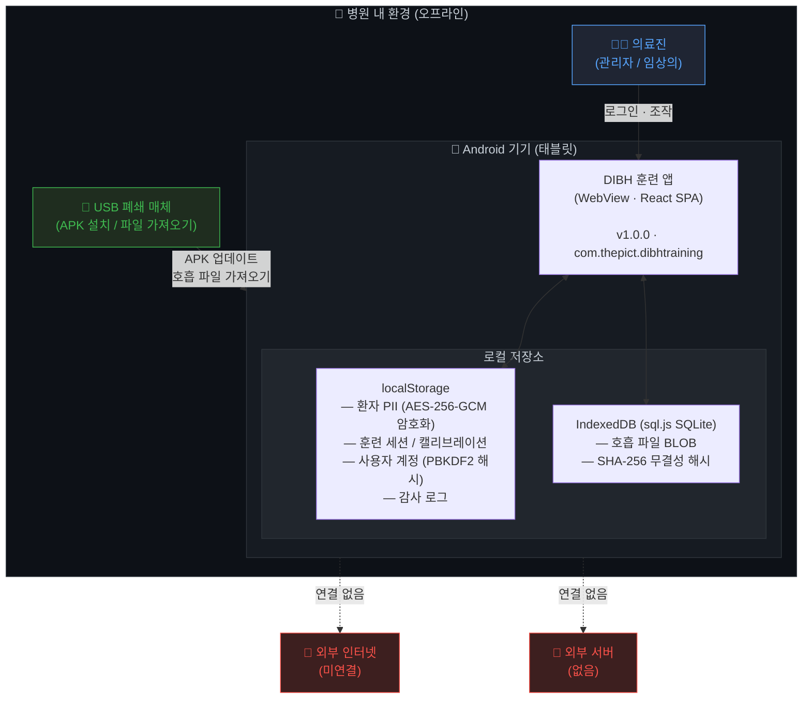
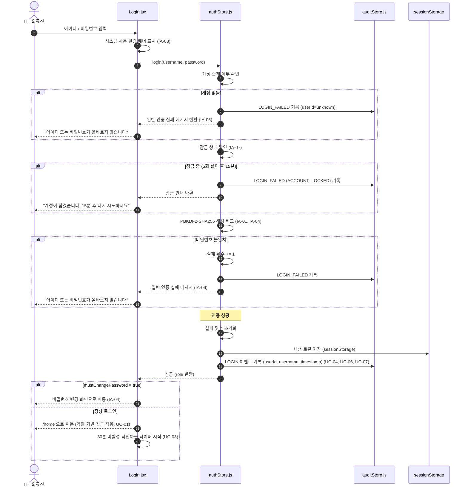
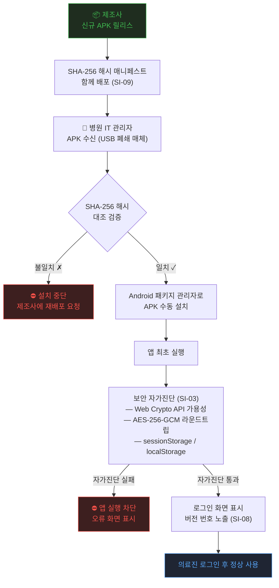
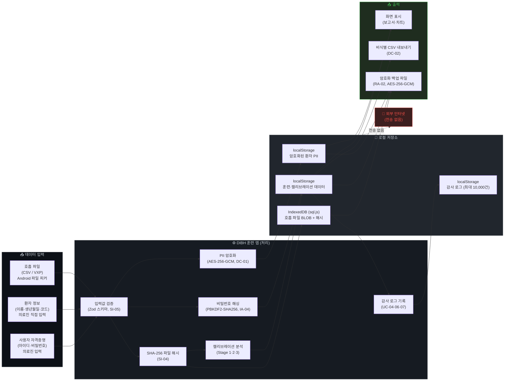

# 사이버보안 준수명세서 — 작성 내용

**제품명:** DIBH 호흡훈련 시스템 (DIBH Training System)  
**버전:** 1.0.0  
**앱 ID:** com.thepict.dibhtraining  
**유형:** SaMD (독립형 소프트웨어 의료기기)  
**작성일:** 2026-05-11  
**근거:** 의료기기 사이버보안 허가·심사 가이드라인 (안내서-0995-05, 2025.01.10)

---

> **이 파일은 PDF 양식 기재용 원고입니다.**  
> 각 절의 내용을 PDF 서식에 그대로 옮겨 기입하세요.  
> 다이어그램은 `## 다이어그램` 절의 Mermaid 코드를 렌더링한 이미지로 대체하세요.

---

## 1. 제품 개요

| 항목 | 내용 |
|---|---|
| 제품명 | DIBH 호흡훈련 시스템 |
| 모델명 / 버전 | v1.0.0 |
| 제품 유형 | SaMD — 독립형 모바일 웹 앱 (Android WebView, Capacitor) |
| 앱 ID | com.thepict.dibhtraining |
| 목적 | 방사선 치료 시 심호흡 유지(DIBH) 훈련을 지원하는 의료용 소프트웨어. 호흡 데이터를 분석하여 CV 및 평균 DIBH 유지 시간을 산출하고 훈련 유형(A/B/C)을 결정함 |
| 운영 환경 | 병원 내, 완전 오프라인 (외부 서버 없음) |
| 대상 사용자 | 의료진 (임상의), 관리자 |

---

## 2. 하드웨어 정보

| 구분 | 시스템 사양 |
|---|---|
| **Android 기기** | Android 12 이상 탑재 태블릿 / 스마트폰 |
| **USB (Type-C)** 표준 | USB 3.1 Gen 1 (Type-C) |
| **USB (Type-C)** 암호방식 및 수준 | 해당없음 — 앱 설치(APK) 전달용으로만 사용하며, 앱 실행 중 USB 데이터 통신 기능을 사용하지 않음 |
| **WiFi / BLE** | 해당없음 — 현재 버전에서 외부 네트워크 및 BLE 통신 기능 미구현 |

---

## 3. 운영체제 정보

| 구분 | 시스템 사양 |
|---|---|
| **OS명** | Android |
| **버전** | 12 (최소 요구 사양) |
| **WebView 최소 버전** | 96 (Web Crypto API 완전 지원을 위한 최소값) |

---

## 4. 소프트웨어 정보

| 구분 | 시스템 사양 |
|---|---|
| **소프트웨어 유형** | 모바일 앱 — Android WebView 기반 (Capacitor 8) |
| **개발 플랫폼(언어)** | React 18, Vite 6, JavaScript/JSX |
| **적용 SDK 버전** | Capacitor CLI 8.3.1 / @capacitor/core 8.3.1 / @capacitor/android 8.3.1 |
| **3rd Party 라이브러리 (보안 관련)** | Web Crypto API (브라우저 내장) — AES-256-GCM 암호화, PBKDF2-SHA256 키 유도, SHA-256 해시 |
| **3rd Party 라이브러리 (DB)** | sql.js 1.14.1 (WebAssembly SQLite) — IndexedDB에 영속화 |
| **3rd Party 라이브러리 (UI/기타)** | React 18.2.0, react-router-dom 7.2.0, @tanstack/react-query 5.90.16, react-hook-form 7.54.2, zod 3.24.2, recharts 2.15.1, Radix UI, framer-motion 12.4.7, sonner 2.0.1, tailwindcss 3.4.17 외 (전체 목록: `docs/sbom.md` 참조) |
| **통신 모듈 SW 버전** | 해당없음 — 통신 모듈 미적용 |
| **업데이트 방식** | 수동 설치 — 제조사가 배포한 APK 파일을 USB 등 폐쇄 매체로 전달하여 Android 패키지 관리자로 수동 설치. FOTA·업데이트 서버 미사용 |

---

## 5. 데이터 정보

### 5.1 수집데이터

| 수집경로 | 데이터 |
|---|---|
| Android 파일 피커 (로컬 저장소 / USB) | 호흡 신호 데이터 파일 (CSV / VXP 형식 — 시간 및 힘(Force, N) 시계열) |

### 5.2 저장데이터

| 저장방법 | 데이터 |
|---|---|
| AES-256-GCM 암호화 저장 (localStorage) | 환자 개인식별정보(PII): 이름, 생년월일, 환자 코드 |
| PBKDF2-SHA256 단방향 해시 저장 (100,000회 반복 + 16바이트 솔트) | 사용자 계정 비밀번호 |
| 평문 저장 (localStorage) | 훈련 세션 정보, 캘리브레이션 결과, 사용자 계정 메타데이터(역할·잠금 상태 등), 감사 로그 (최대 10,000건, 추가 전용) |
| SQLite WASM + IndexedDB (sql.js) | 호흡 파일 BLOB 원본, SHA-256 무결성 해시, 환자 메타데이터 |

### 5.3 전송데이터

| 전송 구간 | 데이터 |
|---|---|
| 해당없음 | 완전 오프라인 운영 — 앱 실행 중 외부 네트워크 전송 기능 없음. 모든 데이터는 기기 내부에 저장 |

---

## 6. 기기 운영환경

### 6.1 기기 운영환경 (네트워크 구성도)

> **다이어그램 → 아래 `## 다이어그램 — 6.1 네트워크 구성도` 절 참조**

**구성 설명:**

본 제품은 외부 서버 또는 네트워크 연결 없이 단일 Android 기기에서 완전히 독립 실행됩니다.

| 노드 | 역할 |
|---|---|
| 의료진 (사용자) | 로그인, 환자 등록, 호흡 파일 업로드, 분석 실행, 보고서 조회 |
| Android 기기 (DIBH 훈련 앱) | 비즈니스 로직·캘리브레이션 알고리즘·보안 기능 수행 (WebView 내 React SPA) |
| 로컬 저장소 (localStorage + IndexedDB) | 환자 PII (암호화), 훈련 데이터, 호흡 파일 BLOB, 감사 로그 저장 |
| 외부 네트워크 / 서버 | **연결 없음** (현재 버전) |
| APK 배포 경로 | USB 등 폐쇄 매체 → Android 패키지 관리자 (업데이트 시에만) |

---

### 6.2 기기 운영 절차

#### (1) 사용자 인증

> **다이어그램 → 아래 `## 다이어그램 — 6.2 (1) 사용자 인증 플로우` 절 참조**

| 단계 | 설명 |
|---|---|
| 1 | 의료진이 앱 실행 — 로그인 화면에서 아이디·비밀번호 입력 |
| 2 | 앱이 계정 잠금 여부 확인 (5회 연속 실패 시 15분 잠금) |
| 3 | PBKDF2-SHA256 해시 비교로 비밀번호 검증 |
| 4 | 인증 성공 시 세션 토큰을 sessionStorage에 저장 (탭 종료 시 자동 소멸) |
| 5 | 30분 비활성 타임아웃 타이머 시작 |
| 6 | 감사 로그에 LOGIN 또는 LOGIN_FAILED 이벤트 기록 |
| 7 | 성공 시 역할(admin/clinician)에 따라 접근 가능 경로 제한 |

#### (2) 데이터 전송

| 구분 | 내용 |
|---|---|
| 해당없음 | 외부 네트워크 데이터 전송 기능 없음 — 완전 오프라인 앱 |

#### (3) 업데이트 절차

> **다이어그램 → 아래 `## 다이어그램 — 6.2 (3) 업데이트 절차 플로우` 절 참조**

| 단계 | 설명 |
|---|---|
| 1 | 제조사가 신규 APK 파일 및 SHA-256 해시 매니페스트를 배포 |
| 2 | 병원 관리자가 APK를 USB 등 폐쇄 매체로 Android 기기에 전달 |
| 3 | 관리자가 SHA-256 해시를 매니페스트와 비교하여 무결성 확인 |
| 4 | Android 패키지 관리자로 APK 수동 설치 |
| 5 | 앱 최초 실행 시 보안 자가진단(Web Crypto 가용성·암호화 라운드트립) 수행 |
| 6 | 로그인 화면 하단에 새 버전 번호 표시 |

---

## 7. 의료기기 사이버보안 요구사항 체크리스트

**\<의료기기 사이버보안 특성 기재\>**

1. **사용되는 통신 기술:** 해당없음 (현재 버전 기준 외부 유·무선 통신 기능 없음)
2. **사용 환경:** 병원 내 사용
3. **공용 네트워크망 사용여부:** N

---

### 식별 및 인증 (IA)

| 코드 | 사이버보안 요구사항 | 적용여부 | 적합성 입증 방법 |
|---|---|---|---|
| IA-01 | 사용자 식별 및 인증 | **적용** | `authStore.js` — PBKDF2-SHA256 해시 기반 로그인; `Login.jsx` — 로그인 UI 구현 |
| IA-02 | 계정 관리 (추가·활성·수정·비활성·삭제) | **적용** | `AdminAccounts.jsx` — 관리자 전용 계정 관리 페이지; `authStore.js` UserStore |
| IA-03 | 식별정보 관리 (고유 사용자 ID) | **적용** | `authStore.js` generateId() — 각 계정에 타임스탬프+난수 기반 고유 ID 부여 |
| IA-04 | 인증정보 관리 (초기 비밀번호 강제 변경, 주기적 변경, 해시 저장) | **적용** | `authStore.js` — mustChangePassword 플래그로 초기 비밀번호 강제 변경; PBKDF2-SHA256 단방향 해시 저장 |
| IA-05 | 비밀번호 강도 설정 | **적용** | `passwordUtils.js` — 최소 8자, 대문자·소문자·숫자·특수문자 포함 필수 |
| IA-06 | 인증정보에 대한 피드백 (마스킹, 일반 오류 메시지) | **적용** | `Login.jsx` — type="password" 마스킹; 인증 실패 시 원인 비구분 일반 오류 메시지 반환 |
| IA-07 | 연속적인 로그인 시도 실패 시 로그인 제한 | **적용** | `authStore.js` — 5회 연속 실패 시 15분 계정 잠금 (MAX_FAILED_ATTEMPTS=5, LOCKOUT_MS=900,000ms) |
| IA-08 | 시스템 사용 알림 메시지 (로그인 전 배너) | **적용** | `Login.jsx` UsageNoticeBanner — 로그인 완료 전 시스템 사용 조건 고지 배너 표시 |

### 사용 통제 (UC)

| 코드 | 사이버보안 요구사항 | 적용여부 | 적합성 입증 방법 |
|---|---|---|---|
| UC-01 | 권한 부여 (역할 기반, 최소권한) | **적용** | `src/pages/index.jsx` AdminRoute — admin 역할만 /admin/* 접근 허용; clinician은 환자·훈련 기능만 접근 |
| UC-02 | 모바일 코드 사용 통제 (CSP) | **적용** | `index.html` — CSP 메타태그 설정; `vite.config.js` — 개발 서버 CSP 헤더 설정 |
| UC-03 | 세션 잠금 (비활성 타임아웃) | **적용** | `src/context/AuthContext.jsx` — 30분 비활성 시 자동 세션 종료 (mousedown·keydown·touchstart·scroll 이벤트로 타이머 리셋) |
| UC-04 | 감사기록 생성 | **적용** | `auditStore.js` — 로그인·계정 변경·환자 CRUD·파일 업로드·분석·캘리브레이션 등 전 이벤트 기록 |
| UC-05 | 감사 처리 실패 대응 | **적용** | `auditStore.js` writeAuditLog — 기록 실패 시 예외 전파 (묵음 처리 안 함) |
| UC-06 | 타임스탬프 | **적용** | 모든 감사 로그 항목에 `timestamp: new Date().toISOString()` (ISO 8601) 기록 |
| UC-07 | 부인 방지 | **적용** | 모든 감사 로그 항목에 `userId`, `username` 포함 — 행위자 식별 가능 |

### 시스템 무결성 (SI)

| 코드 | 사이버보안 요구사항 | 적용여부 | 적합성 입증 방법 |
|---|---|---|---|
| SI-01 | 통신에 대한 무결성 보장 | **미적용** | 오프라인 전용 — 외부 통신 기능 없음 (미적용 사유 참조) |
| SI-02 | 악성코드로부터 보호 | **미적용** | SaMD 예외 — 브라우저 샌드박스·CSP 및 호스트 OS 보안에 의존 (미적용 사유 참조) |
| SI-03 | 보안 기능 검증 (자가진단) | **적용** | `main.jsx` securitySelfCheck — 앱 시작 시 Web Crypto API 가용성, AES-256-GCM 암호화 라운드트립, sessionStorage/localStorage 동작 검증 |
| SI-04 | 소프트웨어 및 정보에 대한 무결성 점검 | **적용** | `breathingFileRepository.js` — 파일 업로드 시 SHA-256 해시 저장; 분석 실행 전 재검증하여 위변조 탐지 |
| SI-05 | 입력값 검증 | **적용** | Zod 스키마 — 모든 폼 입력 유효성 검사; 파일 크기·형식 제한; React DOM 기본 XSS 방지; sql.js 파라미터화 쿼리로 SQL 인젝션 방지 |
| SI-06 | 오류 시 사전 결정된 상태로 출력 | **미적용** | 자동화된 치료 프로세스에 연결되지 않는 SaMD — 해당없음 (미적용 사유 참조) |
| SI-07 | 오류 처리 (내부 정보 미노출) | **적용** | 모든 사용자 대면 오류 메시지 일반화 처리; 내부 스택 트레이스는 console.error로만 출력 |
| SI-08 | 업데이트 | **적용** | `__APP_VERSION__` — UI 하단 버전 표시; 업데이트 절차 사용자 설명서(`docs/user-manual-security.md`) 기술 |
| SI-09 | 업데이트에 대한 진본성 및 무결성 검증 | **적용** | 각 릴리스에 SHA-256 해시 매니페스트 제공; 설치 전 관리자가 해시 대조 검증 절차 수립 |
| SI-10 | 물리적 변조 방지 | **미적용** | SaMD 예외 — 독립형 소프트웨어로 하드웨어 기반 물리 변조 방지 구현 불가 (미적용 사유 참조) |
| SI-11 | 부트 프로세스 무결성 검증 | **미적용** | SaMD 예외 — 독립형 소프트웨어로 부트 프로세스 무결성 검증 구현 불가 (미적용 사유 참조) |

### 데이터 기밀성 (DC)

| 코드 | 사이버보안 요구사항 | 적용여부 | 적합성 입증 방법 |
|---|---|---|---|
| DC-01 | 정보에 대한 기밀성 보장 | **적용** | `src/lib/crypto.js` — AES-256-GCM으로 환자 PII 필드 암호화 저장 (설치별 고유 256비트 키); 외부 전송 없음 |
| DC-02 | 보건의료정보 비식별화 | **적용** | `AdminBackup.jsx` — 비식별 CSV 내보내기 기능 (이름·생년월일 제외한 데이터 내보내기) |
| DC-03 | 안전한 암호화 사용 (112비트 이상 보안강도) | **적용** | AES-256-GCM (256비트), PBKDF2-SHA256 (256비트, 100,000회 반복), SHA-256 해시 — 모두 MFDS 권고 기준 충족 |

### 이벤트 적시 대응 (TRE)

| 코드 | 사이버보안 요구사항 | 적용여부 | 적합성 입증 방법 |
|---|---|---|---|
| TRE-01 | 감사로그에 대한 비인가된 접근 제한 | **적용** | `AdminAuditLog.jsx` — admin 역할 전용 읽기 전용 뷰어; 수정·삭제 UI 없음 (추가 전용 로그) |

### 자원 가용성 (RA)

| 코드 | 사이버보안 요구사항 | 적용여부 | 적합성 입증 방법 |
|---|---|---|---|
| RA-01 | 서비스 거부(DoS) 방지 | **미적용** | 오프라인 단일 사용자 앱 — 네트워크 DoS 해당없음; 계정 잠금(IA-07)으로 무차별대입 방지 (미적용 사유 참조) |
| RA-02 | 의료기기 백업 | **적용** | `AdminBackup.jsx` — AES-256-GCM 암호화 전체 백업; 정상 운영 중 언제든 백업 가능 |
| RA-03 | 의료기기 복구 및 재구성 | **적용** | `AdminBackup.jsx` — 복원 시 SHA-256 무결성 검증 후 데이터 복구 |
| RA-04 | 네트워크 및 보안 구성 설정 | **미적용** | 외부 네트워크 미사용 — 네트워크 보안 구성 기능 해당없음 (미적용 사유 참조) |
| RA-05 | 불필요한 기능 비활성화 | **적용** | 외부 네트워크 미사용; allowMixedContent=false; 불필요한 Capacitor 플러그인 미등록; CSP로 외부 리소스 로드 제한 |

---

## ※ 의료기기의 사이버보안 요구사항 미적용 사유

| 코드 | 미적용 사유 |
|---|---|
| **SI-01** | 독립형 소프트웨어(SaMD)로 외부 네트워크 통신 기능이 없어 통신 무결성 보장 요구사항 해당없음. 향후 네트워크 기능 추가 시 TLS 1.2 이상 적용 예정. |
| **SI-02** | 독립형 소프트웨어(SaMD)로 호스트 OS 및 브라우저 샌드박스 보안에 의존. CSP(Content-Security-Policy) 헤더로 스크립트 삽입 방지. 엔드포인트 악성코드 방지 소프트웨어는 병원 IT 정책 범위. |
| **SI-06** | 자동화된 환자 치료 프로세스(물리적 액추에이터, 자동 투약 등)에 연결되지 않는 분석·훈련 지원 소프트웨어이므로 해당없음. |
| **SI-10** | 독립형 소프트웨어(SaMD) 예외 조항 적용 — 물리적 하드웨어를 포함하지 않아 하드웨어 기반 변조 방지 구현 불가. |
| **SI-11** | 독립형 소프트웨어(SaMD) 예외 조항 적용 — Android 부트 무결성(Verified Boot)은 기기 제조사 및 OS 책임 범위이며, 앱 레벨에서 구현 불가. |
| **RA-01** | 완전 오프라인 단일 사용자 앱으로 네트워크 DoS 공격 경로 없음. 계정 잠금 기능(IA-07)으로 로컬 무차별대입 공격 방지. |
| **RA-04** | 외부 네트워크 미사용으로 네트워크 보안 구성(방화벽, VPN 등) 기능 해당없음. Android 기기 네트워크 설정은 병원 IT 정책 범위. |

---

## 암호 알고리즘 준수 확인

| 사용 목적 | 알고리즘 | 키 길이 | 보안강도 | MFDS 적합성 |
|---|---|---|---|---|
| 환자 PII 저장 암호화 | AES-GCM | 256비트 | 256비트 | 적합 (▶ DC-01, DC-03) |
| 비밀번호 저장 | PBKDF2-SHA256 | 256비트 출력, 100,000회 반복, 16바이트 솔트 | 256비트 | 적합 (▶ IA-04, DC-03) |
| 파일 무결성 해시 | SHA-256 | — | 256비트 | 적합 (▶ SI-04) |
| 백업 무결성 해시 | SHA-256 | — | 256비트 | 적합 (▶ RA-02, RA-03) |
| 백업 암호화 | AES-GCM | 256비트 | 256비트 | 적합 (▶ RA-02, DC-03) |

모든 암호 알고리즘이 MFDS 권고 기준(112비트 이상 보안강도) 충족.

---

---

# 다이어그램

아래 Mermaid 코드를 렌더링하여 PDF 양식의 해당 절에 이미지로 삽입하세요.  
(VS Code Mermaid 플러그인, mermaid.live, 또는 `mmdc` CLI로 PNG 변환 가능)

---

## 다이어그램 — 6.1 네트워크 구성도



### ASCII 대안 (Mermaid 미지원 시)

```
┌──────────────────────────────────────────────────────────┐
│                  병원 내 환경 (오프라인)                    │
│                                                          │
│  ┌──────────────┐    로그인·조작    ┌──────────────────┐  │
│  │   의료진     │ ───────────────► │  Android 기기     │  │
│  │ (관리자/임상의)│                  │  (DIBH 훈련 앱)   │  │
│  └──────────────┘                  │                  │  │
│                                    │  ┌────────────┐  │  │
│  ┌──────────────┐  APK 업데이트/   │  │localStorage│  │  │
│  │ USB 폐쇄 매체 │ ─ 파일 가져오기 ►│  │(PII 암호화) │  │  │
│  └──────────────┘                  │  └────────────┘  │  │
│                                    │  ┌────────────┐  │  │
│                                    │  │ IndexedDB  │  │  │
│                                    │  │(파일 BLOB) │  │  │
│                                    │  └────────────┘  │  │
│                                    └──────────────────┘  │
│                                            │              │
│                              외부 인터넷 연결 없음 ✗        │
│                              외부 서버 없음 ✗              │
└──────────────────────────────────────────────────────────┘
```

---

## 다이어그램 — 6.2 (1) 사용자 인증 플로우



---

## 다이어그램 — 6.2 (3) 업데이트 절차 플로우



---

## 다이어그램 — 데이터 흐름도 (Data Flow, 보조 참고용)


