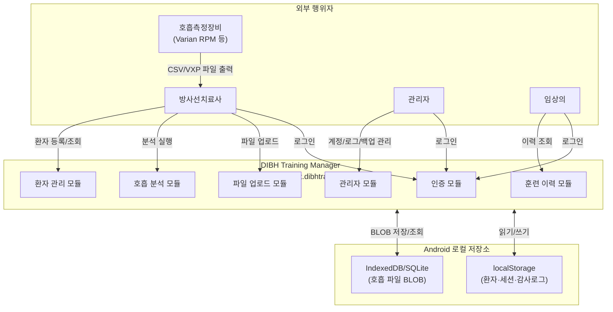
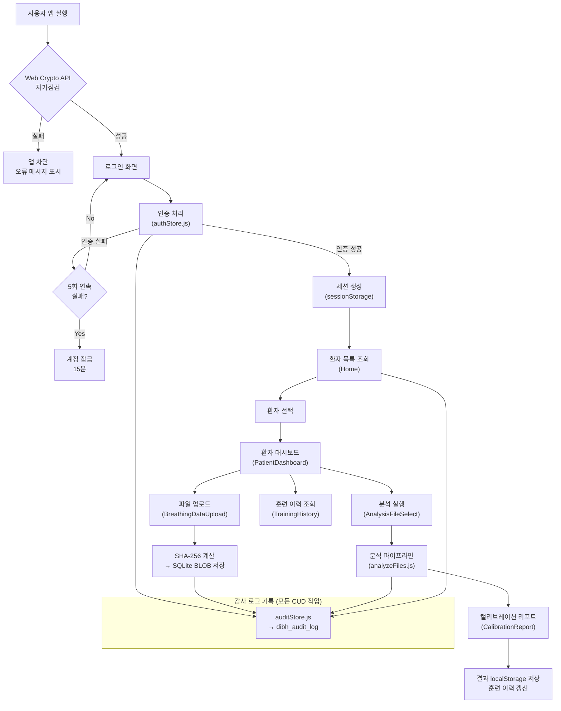
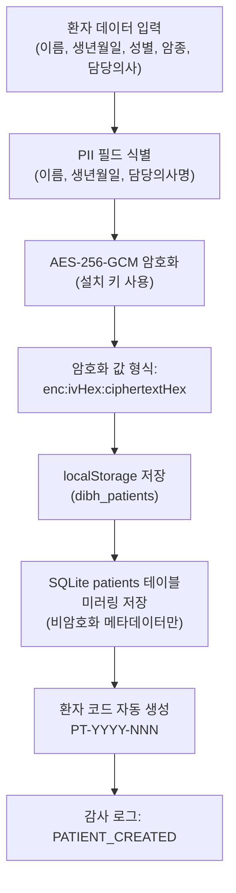
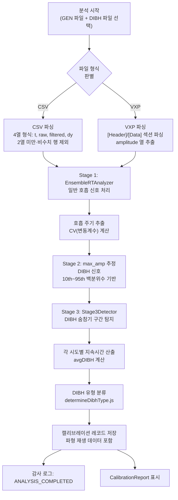
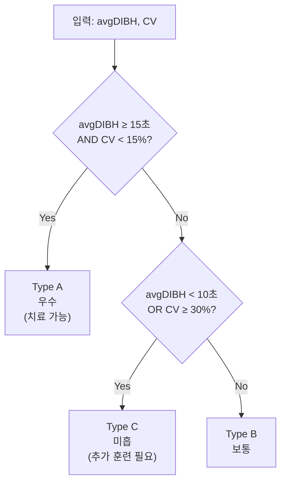

# 소프트웨어 요구사항 명세서
# Software Requirements Specification

| 항목 | 내용 |
|------|------|
| 문서번호 | P705-2 |
| 제품명 | DIBH 훈련 관리 시스템 |
| 모델명 | DIBH-TRAIN-01 |
| SW 명칭 | DIBH Training Manager (com.thepict.dibhtraining) |
| SW 안전성 등급 | Class B (IEC 62304) |
| 버전 | 1.0.0 |
| 작성일 | 2026년 6월 4일 |
| 제조자 | 주식회사 더픽트 |

---

## 결재

| 구분 | 성명 | 직책 | 서명 | 일자 |
|:---:|:---:|:---:|:---:|:---:|
| 승인자 |  |  |  |  |
| 검토자 |  |  |  |  |
| 작성자 |  |  |  |  |

---

## 개정 이력

| 개정번호 | 개정일자 | 개정내용 | 작성자 |
|:---:|:---:|------|:---:|
| 0 | 2026-06-04 | 최초 제정 | 개발팀 |

---

## 목차

1. [개요](#1-개요)
2. [요구사항 기준](#2-요구사항-기준)
3. [제품 개요](#3-제품-개요)
   - 3.1 [작동원리](#31-작동원리)
   - 3.2 [사용목적](#32-사용목적)
   - 3.3 [구성](#33-구성)
   - 3.4 [사용자 특성](#34-사용자-특성)
   - 3.5 [일반적 제한](#35-일반적-제한)
   - 3.6 [가정 및 종속성](#36-가정-및-종속성)
   - 3.7 [SW 시스템 속성](#37-sw-시스템-속성)
   - 3.8 [안전 요구사항](#38-안전-요구사항)
   - 3.9 [테스팅 요구사항](#39-테스팅-요구사항)
   - 3.10 [요구사항 갱신](#310-요구사항-갱신)
4. [설계 요구사항](#4-설계-요구사항)
   - 4.1 [인터페이스 요구사항](#41-인터페이스-요구사항)
   - 4.2 [운영환경 요구사항](#42-운영환경-요구사항)
   - 4.3 [개발도구 요구사항](#43-개발도구-요구사항)
   - 4.4 [SW 성능 요구사항](#44-sw-성능-요구사항)
   - 4.5 [논리적 데이터베이스 요구사항](#45-논리적-데이터베이스-요구사항)
   - 4.6 [사용성 엔지니어링 요구사항](#46-사용성-엔지니어링-요구사항)
   - 4.7 [위험관리 요구사항](#47-위험관리-요구사항)
5. [SW 구조 요구사항](#5-sw-구조-요구사항)
   - 5.1 [SW 구조](#51-sw-구조)
   - 5.2 [기능적 요구사항 명세](#52-기능적-요구사항-명세)
   - 5.3 [비기능적 요구사항 명세](#53-비기능적-요구사항-명세)
   - 5.4 [하드웨어/소프트웨어 구성 요구사항](#54-하드웨어소프트웨어-구성-요구사항)
   - 5.5 [네트워크 구성 요구사항](#55-네트워크-구성-요구사항)
6. [결과](#6-결과)

---

## 1. 개요

### 1.1 목적

본 문서는 주식회사 더픽트(이하 "당사")가 개발하는 **DIBH 훈련 관리 시스템(DIBH-TRAIN-01)**의 소프트웨어 요구사항에 대한 완전하고 명확한 명세를 제공하는 것을 목적으로 한다.

본 문서는 다음 사항을 포함한다.

- 소프트웨어 기능 요구사항 및 비기능 요구사항의 상세 정의
- 소프트웨어 구조 및 모듈별 요구사항 명세
- 보안, 성능, 가용성, 호환성 등 시스템 속성 요구사항
- 요구사항 식별자(Req ID) 기반의 추적성 매트릭스

요구사항의 설명을 위해 텍스트, 표, 흐름도(Mermaid 다이어그램)를 활용하며, 복잡한 상호작용 및 데이터 흐름은 다이어그램으로 제공된다.

### 1.2 범위

본 문서는 1.3에 식별된 제품(DIBH 훈련 관리 시스템)의 소프트웨어 전체 생명주기에 적용된다.

본 소프트웨어는 방사선 종양학 분야에서 유방암 환자의 심호흡 후 숨참기(DIBH, Deep Inspiration Breath Hold) 훈련 상태를 관리하고 분석하는 Android 기반 오프라인 임상 지원 소프트웨어이다.

포함 범위:
- Android APK 형태로 배포되는 DIBH Training Manager 앱
- 사용자 인증 모듈
- 환자 관리 모듈
- 호흡 데이터 업로드 모듈
- 호흡 분석 모듈 (Stage 1~3, 유형 분류)
- 훈련 이력 모듈
- 관리자 기능 모듈 (계정 관리, 감사 로그, 백업/복원)

### 1.3 식별

| 항목 | 내용 |
|------|------|
| 제품명 | DIBH 훈련 관리 시스템 |
| 모델명 | DIBH-TRAIN-01 |
| SW 명칭 | DIBH Training Manager |
| 패키지명 | com.thepict.dibhtraining |
| SW 안전성 등급 | Class B (IEC 62304:2006/AMD1:2015) |
| 제조자 | 주식회사 더픽트 |
| 작성일 | 2026년 6월 4일 |

### 1.4 참조문서

| 번호 | 문서명 |
|------|--------|
| 1 | IEC 62304:2006/AMD1:2015 Medical device software – Software life cycle processes |
| 2 | ISO 14971:2019 Medical devices – Application of risk management to medical devices |
| 3 | IEC 62366-1:2015 Medical devices – Usability engineering |
| 4 | MFDS 의료기기 사이버보안 허가심사 가이드라인 (2022) |
| 5 | MFDS 독립형 의료기기 소프트웨어(SaMD) 허가심사 가이드라인 |
| 6 | 위험관리 계획서 (P705-RM) |
| 7 | 소프트웨어 개발 계획서 (P705-1) |
| 8 | 소프트웨어 구조 설계서 (P705-3) |

---

## 2. 요구사항 기준

본 문서의 기술적 요구사항은 제품원리, 제품성능, 사용자특성, 제한사항, 가정 및 종속성, 기능/비기능 요구사항으로 구성된다.

### 2.1 SW 요구사항 식별 방식

본 문서 내의 모든 소프트웨어 요구사항은 고유 식별자(Req ID)를 부여하여 추적성을 확보한다.

식별자 체계:
- **REQ-AUTH-NNN**: 사용자 인증 모듈
- **REQ-PAT-NNN**: 환자 관리 모듈
- **REQ-FILE-NNN**: 호흡 데이터 업로드 모듈
- **REQ-ANAL-NNN**: 호흡 분석 모듈
- **REQ-HIST-NNN**: 훈련 이력 모듈
- **REQ-ADMIN-NNN**: 관리자 기능 모듈
- **REQ-SEC-NNN**: 보안 요구사항
- **REQ-PERF-NNN**: 성능 요구사항
- **REQ-AVAIL-NNN**: 가용성 요구사항
- **REQ-COMPAT-NNN**: 호환성 요구사항

### 2.2 SW 요구사항 검증

#### 2.2.1 요구사항 검증 기준

1. 요구사항은 상호 모순되지 않아야 한다.
2. 모호한 용어를 사용하지 않아야 한다.
3. 설계 명세서 작성이 가능하도록 표현되어야 한다.
4. 각 요구사항은 테스트 가능한 형태로 작성되어야 한다.
5. 각 기능 모듈은 식별 가능한 결과물을 산출할 수 있어야 한다.

#### 2.2.2 검증 활동

1. SW 개발 계획(P705-1)에 언급된 제품 개요가 본 명세에 반영되었는지 확인
2. 요구사항이 검증 기준에 따라 작성되었는지 동료 검토(peer review) 수행
3. 위험관리 파일과의 정합성 확인 (REQ-ID ↔ 위험 항목 연계)
4. 검증의 검토 및 승인은 본 문서 결재를 통해 확인

### 2.3 용어의 정의

| 용어 | 정의 |
|------|------|
| DIBH | Deep Inspiration Breath Hold. 심호흡 후 숨참기. 방사선 치료 시 심장을 흉벽으로부터 멀어지게 하여 방사선 조사량을 최소화하는 기법. |
| CV | Coefficient of Variation (변동계수). 호흡 신호의 안정성을 나타내는 지표. 표준편차/평균 × 100(%). |
| GEN | General. 일반 호흡 데이터 카테고리. |
| VXP | Varian eXtended Position. Varian 의료기기에서 출력되는 호흡 신호 파일 형식. |
| PII | Personally Identifiable Information. 개인식별정보. |
| AES-256-GCM | Advanced Encryption Standard, 256-bit key, Galois/Counter Mode. 인증 암호화 방식. |
| PBKDF2 | Password-Based Key Derivation Function 2. 비밀번호 기반 키 파생 함수. |
| SaMD | Software as a Medical Device. 독립형 의료기기 소프트웨어. |
| SOUP | Software Of Unknown Provenance. 기성 소프트웨어 구성요소. |
| Stage 1/2/3 | 호흡 분석 파이프라인의 단계별 처리 과정. |
| localStorage | 브라우저 기반 키-값 저장소. 탭 종료 후에도 데이터가 유지됨. |
| sessionStorage | 브라우저 기반 키-값 저장소. 탭/브라우저 종료 시 데이터가 삭제됨. |
| IndexedDB | 브라우저 기반 NoSQL 데이터베이스. BLOB 저장 지원. |
| Capacitor | 웹 애플리케이션을 네이티브 Android/iOS 앱으로 패키징하는 프레임워크. |

---

## 3. 제품 개요

### 3.1 작동원리

DIBH 훈련 관리 시스템은 방사선 종양학 임상 환경에서 유방암 환자의 DIBH 훈련 상태를 정량적으로 평가하고 관리하기 위한 독립형 의료기기 소프트웨어이다.

시스템은 다음의 원리로 동작한다.

1. **호흡 신호 수집**: 방사선치료사가 Varian RPM 시스템 또는 유사 장비로 측정한 환자의 호흡 신호 파일(CSV 또는 VXP 형식)을 시스템에 업로드한다.

2. **신호 분석**: 업로드된 파일에 대해 3단계 분석 파이프라인을 적용한다.
   - **Stage 1**: 일반 호흡 신호에서 호흡 주기를 추출하고 변동계수(CV)를 산출한다.
   - **Stage 2**: DIBH 신호에서 백분위수 기반 최대 진폭(max_amp)을 추정한다.
   - **Stage 3**: 안정적인 DIBH 숨참기 구간을 탐지하고 지속시간을 산출한다.

3. **유형 분류**: 분석 결과(평균 DIBH 지속시간, CV)를 기반으로 훈련 유형(A/B/C)을 자동 분류한다.

4. **결과 관리**: 분석 결과는 캘리브레이션 레코드로 저장되며, 환자별 훈련 이력을 통해 시계열로 추적할 수 있다.

5. **오프라인 동작**: 모든 데이터는 Android 기기 내 로컬 저장소(localStorage, IndexedDB/SQLite)에만 저장되며 외부 네트워크는 필요하지 않다.

### 3.2 사용목적

본 소프트웨어의 의도된 사용목적은 다음과 같다.

**주요 사용목적**: 방사선 종양학 분야에서 유방암 환자의 DIBH(심호흡 후 숨참기) 훈련 상태를 정량적으로 분석하고 임상 의사결정을 지원한다.

**구체적 사용 기능**:
- 환자 정보 등록 및 관리
- 환자의 호흡 신호 파일(일반 호흡 / DIBH 호흡) 업로드 및 저장
- 호흡 분석 알고리즘을 통한 DIBH 훈련 유형(A/B/C) 자동 분류
- 훈련 이력 조회 및 캘리브레이션 상태 추적
- 분석 결과의 파형 시각화(파형 재생)

**의도된 사용자**: 방사선치료사, 임상의, 관리자 (3.4절 참조)

**의도된 사용 환경**: 방사선 종양학과 임상 환경 (Android 태블릿/스마트폰 기반, 오프라인)

**의도되지 않은 사용**:
- 실시간 방사선 치료 제어 또는 치료 기기 연동
- 호흡 신호의 직접 측정 (외부 장비로 측정한 결과 파일을 입력으로 사용)
- 진단 또는 치료 처방 결정

### 3.3 구성

#### 3.3.1 시스템 컨텍스트 다이어그램



#### 3.3.2 소프트웨어 모듈 구성

| 모듈명 | 설명 | 주요 소스 경로 |
|--------|------|---------------|
| 인증 모듈 | 로그인, 세션 관리, 잠금, 비밀번호 정책 | `src/pages/Login.jsx`, `src/api/authStore.js`, `src/context/AuthContext.jsx` |
| 환자 관리 모듈 | 환자 등록·조회·수정·삭제, 대시보드 | `src/pages/Home.jsx`, `src/pages/PatientDashboard.jsx` |
| 파일 업로드 모듈 | CSV/VXP 호흡 파일 업로드, 카테고리 분류, SHA-256 | `src/pages/BreathingDataUpload.jsx`, `src/api/breathingFileRepository.js` |
| 호흡 분석 모듈 | Stage 1~3, 유형 분류, 리포트 생성 | `src/lib/calibration/`, `src/pages/` (analysisfileselect, calibrationreport) |
| 훈련 이력 모듈 | 세션 이력 조회, 재교정 알림 | `src/pages/TrainingHistory.jsx` |
| 관리자 모듈 | 계정 관리, 감사 로그, 백업/복원 | `src/pages/AdminAccounts.jsx`, `src/pages/AdminAuditLog.jsx`, `src/pages/AdminBackup.jsx` |
| 보안/암호화 라이브러리 | AES-256-GCM, PBKDF2, SHA-256 | `src/lib/crypto.js`, `src/lib/passwordUtils.js` |
| 로컬 저장소 API | localStorage CRUD, SQLite WASM | `src/api/localStore.js`, `src/db/sqliteDb.js` |

### 3.4 사용자 특성

| 사용자 역할 | 설명 | 기술 수준 | 주요 기능 |
|------------|------|-----------|-----------|
| 방사선치료사 (Radiation Therapist) | 환자 치료 담당 의료기사. 방사선 치료 관련 전문 지식 보유. | 의료기기 사용 경험 있음, IT 기본 소양 | 환자 등록, 파일 업로드, 분석 실행, 결과 조회 |
| 관리자 (Admin) | 시스템 관리 담당자. 의료기관 IT 담당 또는 지정된 방사선치료사. | 기본적인 IT 관리 능력 | 계정 관리, 감사 로그 조회, 백업/복원, 비식별화 데이터 내보내기 |
| 임상의 (Clinician) | 담당 의사 또는 임상 보조 인력. 분석 결과 확인 용도. | 의료 전문 지식, IT 기본 소양 | 환자 대시보드 조회, 훈련 이력 확인 |

모든 사용자는 시스템 접속을 위해 인증된 계정이 필요하며, 역할에 따라 접근 가능한 기능이 제한된다.

### 3.5 일반적 제한

1. **규제정책**: IEC 62304:2006/AMD1:2015 SW 수명주기 절차, MFDS 의료기기 사이버보안 가이드라인 준수
2. **하드웨어 제한**: Android 13 이상의 스마트폰/태블릿에서만 동작. Web Crypto API 지원 WebView 필요.
3. **저장공간 제한**: Android 기기의 내부 저장소 용량에 의존. 호흡 파일은 환자 1인당 카테고리별 최대 10개 제한.
4. **오프라인 전용**: 네트워크 연결 없이 동작하도록 설계. 외부 서버, 클라우드 저장소 연동 없음.
5. **단일 기기 운영**: 데이터는 기기 로컬에만 저장되며, 기기 간 실시간 동기화는 지원하지 않음.
6. **언어**: 사용자 인터페이스는 한국어로 제공됨.

### 3.6 가정 및 종속성

1. 본 소프트웨어는 Android 13 이상 OS 환경에 종속적이다.
2. 호흡 신호 파일(CSV/VXP)은 외부 측정 장비(예: Varian RPM)에서 생성되며, 본 소프트웨어는 해당 장비의 파일 형식 규격에 종속된다.
3. Web Crypto API가 Android WebView에서 정상적으로 동작한다고 가정한다. 가용하지 않을 경우 앱이 시작 단계에서 차단된다.
4. Capacitor 프레임워크가 지원하는 Android 버전의 WebView를 사용한다고 가정한다.
5. sql.js (SQLite WASM) 라이브러리가 정상적으로 로드되어야 데이터베이스 기능이 활성화된다.
6. 기기의 내부 저장소에 충분한 여유 공간이 있다고 가정한다 (최소 500MB 권장).
7. 사용자는 시스템 사용 전 적절한 교육을 이수하였다고 가정한다.

### 3.7 SW 시스템 속성

#### 3.7.1 신뢰성

- 소프트웨어는 정의된 요구사항에 따라 일관되게 동작해야 한다.
- 데이터 저장 실패 시 오류 메시지를 표시하고 데이터 손실을 방지해야 한다.
- 분석 알고리즘은 동일 입력에 대해 항상 동일한 결과를 산출해야 한다 (결정론적 동작).

#### 3.7.2 가용성

- 소프트웨어는 네트워크 연결 없이 완전히 동작해야 한다.
- 일시적인 오류 발생 시 앱 재시작으로 정상 동작이 복구되어야 한다.
- 앱 비정상 종료 시에도 저장된 데이터는 유지되어야 한다.

#### 3.7.3 규제 요구사항

1. **사이버보안 요구사항**: MFDS 의료기기 사이버보안 허가심사 가이드라인의 기본원칙 및 [표3. 의료기기 사이버보안 요구사항]을 충족해야 한다.
2. **의료기기 소프트웨어 적합성**: MFDS 의료기기 허가 및 심사에 관한 규정 [별지 13호 서식] 요구사항을 충족해야 한다.
3. **IEC 62304 Class B**: 소프트웨어 안전성 등급 Class B에 따른 모든 수명주기 활동을 이행해야 한다.

#### 3.7.4 오류 감지 및 처리

1. 앱 시작 시 Web Crypto API 가용성 및 암호화 라운드트립 자가점검을 수행하고, 실패 시 앱을 차단하고 오류 메시지를 표시해야 한다.
2. 파일 파싱 오류, 분석 실패, 저장 오류 등 각 처리 단계의 오류는 사용자에게 명확한 오류 메시지로 안내해야 한다.
3. 각 오류 이벤트는 내부적으로 기록되어야 한다.

#### 3.7.5 유지보수성

1. 모든 소스코드는 ESLint 기준을 준수하여 작성한다.
2. 요구사항 변경 시 요구사항 추적성 매트릭스를 갱신한다.
3. 사용 중 오류 발생 시 팝업(Toast 알림)으로 오류 안내 및 대응 메시지를 제공한다.

#### 3.7.6 이식성

- 소프트웨어는 Capacitor를 통해 Android APK로 패키징되어 배포된다.
- 웹 표준(HTML5, ES2020+) 기반 구현으로, 향후 iOS 플랫폼으로의 이식 가능성을 고려한다.

### 3.8 안전 요구사항

1. 소프트웨어는 DIBH 치료 결정을 자동으로 내리지 않으며, 최종 임상 판단은 반드시 의료진이 수행한다.
2. 호흡 분석 결과(유형 A/B/C)는 참고 정보로 제공되며, 치료 여부 최종 결정을 대체하지 않는다.
3. 암호화 자가점검 실패 시 소프트웨어는 환자 데이터에 접근 불가 상태로 안전하게 차단되어야 한다.
4. 세션 만료(30분 비활동) 시 자동 로그아웃하여 비인가 접근을 방지해야 한다.
5. 소프트웨어 오작동이 환자에게 직접적인 물리적 위해를 가하지 않으며(치료 기기와 연동되지 않음), ISO 14971 위험관리 파일에 기술된 잔존 위험은 허용 가능한 수준이어야 한다.

### 3.9 테스팅 요구사항

1. 본 문서에 정의된 모든 기능 요구사항은 테스트 계획서(P705-V&V) 및 테스트 결과 문서에 따라 테스트한다.
2. 단위 시험(Unit Test)은 Vitest를 사용하여 각 분석 모듈, 파싱 로직, 분류 로직에 대해 수행한다.
3. 통합 시험(Integration Test)은 전체 분석 파이프라인을 모의(mock) 데이터로 검증한다.
4. 보안 기능(암호화, 인증, 잠금)은 별도 보안 시험 항목으로 검증한다.
5. 요구사항 추적성 매트릭스(6절 참조)를 통해 모든 요구사항이 테스트 항목과 연결됨을 확인한다.

### 3.10 요구사항 갱신

소프트웨어 개발 또는 유지보수 과정에서 요구사항 변경이 발생하는 경우, 다음 절차에 따라 갱신한다.

1. 변경 요청서(Change Request) 작성 및 영향도 분석
2. 변경 사항이 위험관리 파일에 미치는 영향 평가
3. 본 문서 개정 및 개정 이력 기록
4. 설계 명세서, 테스트 계획서 등 관련 문서 동시 갱신
5. 검토자 및 승인자 서명을 통한 변경 확정

---

## 4. 설계 요구사항

### 4.1 인터페이스 요구사항

#### 4.1.1 사용자 인터페이스

| 구분 | 요구사항 |
|------|---------|
| Android 태블릿/스마트폰 | 사용자가 터치스크린을 통해 앱의 모든 기능에 접근하고 입력할 수 있어야 한다. |
| 화면 해상도 | 1080×1920 px 이상 해상도에서 UI가 깨지지 않고 정상 표시되어야 한다. |
| 언어 | 모든 UI 텍스트는 한국어로 제공되어야 한다. |
| 다크 테마 | GitHub 기반 다크 팔레트(`#0D1117` 배경, `#30363D` 테두리, `#C9D1D9` 텍스트)를 사용한다. |
| 접근성 | 버튼 및 입력 요소는 터치 영역이 최소 44×44 dp 이상이어야 한다. |

#### 4.1.2 MMI (Man Machine Interface)

| 구분 | 요구사항 |
|------|---------|
| 기기 제어 방식 | Android 스마트폰/태블릿의 터치스크린을 통한 입력. 물리적 뒤로가기 버튼 지원. |
| 소프트웨어 제어 방식 | React 기반 SPA(단일 페이지 애플리케이션). Capacitor WebView 내에서 동작. |
| 인터페이스 | Android WebView (Capacitor 래핑). 네이티브 파일 선택기 연동. |
| 신호 방식 | 분석 완료, 오류 등 주요 이벤트는 화면 내 Toast 알림으로 표시. |

#### 4.1.3 에러 핸들러

| 에러코드 | 에러 메시지 | 에러 상태 |
|---------|------------|----------|
| ERR-AUTH-001 | 사용자명 또는 비밀번호가 올바르지 않습니다. | 로그인 실패 (사용자명·비밀번호 불일치) |
| ERR-AUTH-002 | 계정이 잠겼습니다. 15분 후 다시 시도하거나 관리자에게 문의하세요. | 5회 연속 로그인 실패로 계정 잠금 |
| ERR-AUTH-003 | 세션이 만료되었습니다. 다시 로그인해 주세요. | 30분 비활동으로 세션 자동 만료 |
| ERR-AUTH-004 | 비밀번호 정책을 충족하지 않습니다. (최소 8자, 대/소문자/숫자/특수문자 포함) | 비밀번호 정책 위반 |
| ERR-CRYPTO-001 | 보안 초기화에 실패했습니다. 앱을 재시작하세요. | Web Crypto API 불가 또는 암호화 자가점검 실패 |
| ERR-FILE-001 | 파일 형식이 지원되지 않습니다. CSV 또는 VXP 파일을 선택하세요. | 지원하지 않는 파일 형식 업로드 시도 |
| ERR-FILE-002 | 파일 저장 한도 초과로 가장 오래된 파일이 삭제되었습니다. | 카테고리별 최대 10개 초과 |
| ERR-ANAL-001 | 분석에 실패했습니다. 파일 형식 및 내용을 확인하세요. | 분석 파이프라인 처리 오류 |
| ERR-DB-001 | 데이터 저장에 실패했습니다. 저장공간을 확인하세요. | localStorage 또는 SQLite 쓰기 오류 |
| ERR-PAT-001 | 환자를 찾을 수 없습니다. | 존재하지 않는 환자 ID 접근 |

### 4.2 운영환경 요구사항

| 구분 | 항목 | 요구사항 |
|------|------|---------|
| 운영체제 | Android | Android 13 이상 |
| 동작환경 | CPU | ARMv8 (64-bit) 이상 |
|  | RAM | 3GB 이상 권장 |
|  | 저장공간 | 내부 저장소 500MB 이상 여유 공간 |
|  | 화면 | 1080×1920 px 이상, 터치스크린 |
|  | WebView | Android System WebView 114 이상 |
| 네트워크 | 필요 여부 | 불필요 (완전 오프라인 동작) |
| 시간대 | | KST (UTC/GMT +9) |
| 개발·배포 플랫폼 | | Android APK (Capacitor 패키징) |

### 4.3 개발도구 요구사항

#### 4.3.1 프론트엔드 (앱 UI)

| 구분 | 명칭 | 버전 | 역할 |
|------|------|------|------|
| 코딩언어 | JavaScript (ES2020+) | — | 앱 로직 |
|  | JSX | — | React 컴포넌트 |
|  | CSS / Tailwind CSS | 3.x | 스타일링 |
|  | HTML5 | 5 | 마크업 |
| 런타임 플랫폼 | Node.js | 20.x 이상 | 빌드 도구 실행 환경 |
| 빌드 도구 | Vite | 5.x | 번들링, 개발 서버 |
| 모바일 패키징 | Capacitor | 6.x | Android APK 래핑 |
| 앱 크기 (빌드 후) | — | ~5MB (압축 APK 기준) | — |

#### 4.3.2 주요 SOUP (기성 소프트웨어 구성요소)

| No. | 명칭 | 제조사/출처 | 버전 | 기능 | 안전성 관련 |
|-----|------|-----------|------|------|------------|
| 1 | React | Meta (Opensource) | 18.x | UI 렌더링 프레임워크 | 비안전성 |
| 2 | React Router | Opensource | 6.x | SPA 라우팅 | 비안전성 |
| 3 | TanStack Query (React Query) | Opensource | 5.x | 데이터 캐싱/상태 관리 | 비안전성 |
| 4 | Tailwind CSS | Opensource | 3.x | 유틸리티 기반 CSS | 비안전성 |
| 5 | Radix UI | Opensource | 1.x | 접근성 UI 컴포넌트 | 비안전성 |
| 6 | Recharts | Opensource | 2.x | 파형 차트/시각화 | 비안전성 |
| 7 | react-hook-form | Opensource | 7.x | 폼 유효성 검증 | 비안전성 |
| 8 | zod | Opensource | 3.x | 스키마 유효성 검증 | 비안전성 |
| 9 | sonner | Opensource | 1.x | Toast 알림 | 비안전성 |
| 10 | lucide-react | Opensource | 0.x | SVG 아이콘 | 비안전성 |
| 11 | sql.js | Opensource | 1.x | SQLite WASM (브라우저 내 DB) | 비안전성 |
| 12 | Capacitor (core) | Ionic (Opensource) | 6.x | Android 네이티브 브릿지 | 비안전성 |
| 13 | Vitest | Opensource | 2.x | 단위/통합 테스트 프레임워크 | 비안전성 |

#### 4.3.3 개발 도구

| 구분 | 명칭 | 버전 |
|------|------|------|
| IDE | Visual Studio Code | 최신 안정 버전 |
| 버전 관리 | Git | 2.x 이상 |
| Android 빌드 | Android Studio | Ladybug 이상 |
| Android SDK | Android SDK | API Level 33 이상 |
| 코드 품질 | ESLint | 9.x |
| 패키지 관리 | npm | 10.x 이상 |

### 4.4 SW 성능 요구사항

#### 4.4.1 응답 시간 요구사항

| 요구사항 ID | 항목 | 목표값 | 측정 조건 |
|------------|------|--------|---------|
| REQ-PERF-001 | 앱 초기 로드 시간 | 5초 이내 | Android 13 기기, 저장된 환자 데이터 없음 |
| REQ-PERF-002 | 호흡 분석 처리 시간 | 10초 이내 | CSV/VXP 각 250KB 기준 |
| REQ-PERF-003 | 환자 목록 조회 시간 | 2초 이내 | 최대 500명 환자 데이터 기준 |

#### 4.4.2 용량 요구사항

| 항목 | 용량 |
|------|------|
| 환자 1인당 파일 저장 수 | 카테고리(GEN/DIBH)별 최대 10개 |
| 감사 로그 최대 건수 | 10,000건 |
| 최대 환자 수 (권장) | 500명 |

#### 4.4.3 임상적 성능

| 구분 | 기준값 |
|------|--------|
| DIBH 유형 분류 정확도 | 알고리즘 명세(REQ-ANAL-007)에 정의된 임계값 기준 결정론적 분류 |
| CV 계산 정밀도 | 소수점 1자리까지 표시 |
| avgDIBH 계산 정밀도 | 소수점 1자리(초 단위)까지 표시 |

### 4.5 논리적 데이터베이스 요구사항

#### 4.5.1 개요

본 시스템은 두 가지 로컬 저장소 계층을 사용한다.

1. **localStorage**: 환자 메타데이터, 세션, 캘리브레이션, 감사 로그 등 구조화된 JSON 데이터
2. **SQLite (sql.js/WASM) + IndexedDB**: 호흡 파일 BLOB 데이터 및 환자 미러링 데이터

#### 4.5.2 localStorage 키 구조

| 키 이름 | 데이터 형식 | 설명 |
|---------|-----------|------|
| `dibh_install_key` | String (hex, 64자) | 설치별 고유 256-bit AES 암호화 키 |
| `dibh_users` | JSON Array | 사용자 계정 배열 (비밀번호는 PBKDF2 해시) |
| `dibh_patients` | JSON Array | 환자 레코드 (PII 필드는 AES-256-GCM 암호화) |
| `dibh_training_sessions` | JSON Array | 훈련 세션 레코드 |
| `dibh_calibrations` | JSON Array | 캘리브레이션 결과 레코드 |
| `dibh_calibration_sessions` | JSON Array | 진행 중인 캘리브레이션 세션 |
| `dibh_audit_log` | JSON Array | 감사 로그 (최대 10,000건) |

#### 4.5.3 SQLite 테이블 스키마

**breathing_files 테이블**

| 컬럼명 | 타입 | Not Null | PK | 설명 |
|--------|------|----------|-----|------|
| id | INTEGER | Y | Y | 자동 증가 PK |
| patient_id | TEXT | Y | N | 환자 코드 (dibh_patients 참조) |
| category | TEXT | Y | N | 파일 카테고리: 'GEN' 또는 'DIBH' |
| original_name | TEXT | Y | N | 업로드 시 원본 파일명 |
| mime | TEXT | N | N | MIME 타입 (예: text/csv) |
| size | INTEGER | Y | N | 파일 크기 (bytes) |
| sha256 | TEXT | Y | N | SHA-256 해시값 (무결성 검증용) |
| created_at | TEXT | Y | N | ISO 8601 형식 업로드 일시 |
| data | BLOB | Y | N | 파일 원본 바이너리 데이터 |

**patients 테이블 (localStorage 미러링)**

| 컬럼명 | 타입 | Not Null | PK | 설명 |
|--------|------|----------|-----|------|
| id | TEXT | Y | Y | 환자 코드 (PT-YYYY-NNN) |
| patient_code | TEXT | Y | N | 환자 코드 (중복 저장, 검색용) |
| gender | TEXT | N | N | 성별 |
| age_group | TEXT | N | N | 나이대 |
| cancer_type | TEXT | N | N | 암종 |
| created_at | TEXT | Y | N | ISO 8601 형식 등록 일시 |

#### 4.5.4 데이터 정합성 규칙

1. `breathing_files.patient_id`는 `patients.id`를 참조한다.
2. 환자 삭제 시 관련 `breathing_files` 레코드도 함께 삭제된다 (Cascade).
3. `sha256` 컬럼에는 업로드 시 계산된 SHA-256 해시값이 필수 저장된다.
4. `category` 컬럼은 'GEN' 또는 'DIBH' 값만 허용된다.
5. 암호화된 PII 값은 `enc:<ivHex>:<ciphertextHex>` 형식으로 저장된다.

### 4.6 사용성 엔지니어링 요구사항

IEC 62366-1:2015 및 IEC/TR 62366-2에 따른 사용적합성 엔지니어링 파일을 별도 작성한다.

주요 사용성 요구사항:

1. 모든 UI 텍스트 및 오류 메시지는 한국어로 표시되어야 한다.
2. 분석 결과 화면에서 DIBH 유형(A/B/C)과 치료 가능 여부가 명확하게 시각적으로 구분되어야 한다.
3. 재교정 필요 상태의 환자는 환자 목록 및 대시보드에서 시각적으로 강조 표시되어야 한다.
4. 파일 업로드 시 지원 형식(CSV, VXP)이 명시되어야 한다.
5. 비밀번호 입력 오류 시 구체적인 정책 안내 (최소 8자, 대/소문자/숫자/특수문자)가 제공되어야 한다.
6. 분석 처리 중에는 로딩 애니메이션을 표시하여 진행 중임을 사용자에게 알려야 한다.

### 4.7 위험관리 요구사항

ISO 14971:2019에 따른 위험관리 파일을 별도 작성한다.

소프트웨어 관련 주요 위험 항목:

| 위험 항목 | 완화 수단 | 관련 요구사항 |
|----------|---------|-------------|
| 환자 PII 비인가 접근 | AES-256-GCM 암호화, 세션 만료, 로그인 잠금 | REQ-SEC-001, REQ-AUTH-003, REQ-AUTH-006 |
| 분석 결과 오류로 인한 잘못된 임상 결정 | 결과는 참고용임을 명시, 최종 판단은 의료진 책임 명시 | REQ-ANAL-007, REQ-ANAL-008 |
| 데이터 손실 | 이중 저장(localStorage + SQLite), 백업 기능 | REQ-PAT-008, REQ-ADMIN-006 |
| 비인가 계정 접근 | PBKDF2 해시, 잠금 정책, 세션 만료 | REQ-AUTH-002, REQ-AUTH-003, REQ-AUTH-006 |
| 파일 무결성 침해 | SHA-256 해시 저장 | REQ-FILE-005, REQ-SEC-005 |
| 암호화 키 손실 | 설치별 키를 localStorage에 저장, 백업 파일로 복구 가능 | REQ-SEC-003, REQ-ADMIN-006 |

---

## 5. SW 구조 요구사항

### 5.1 SW 구조

#### 5.1.1 모듈 구조도

```mermaid
flowchart TD
    subgraph APP["DIBH Training Manager"]
        subgraph UI["UI 계층 (React Pages)"]
            LOGIN["Login\n/login"]
            HOME["Home\n/home"]
            PDASH["PatientDashboard\n/patientdashboard"]
            UPLOAD["BreathingDataUpload\n/breathingdataupload"]
            ANAL["AnalysisFileSelect\n/analysisfileselect"]
            REPORT["CalibrationReport\n/calibrationreport"]
            HIST["TrainingHistory\n/traininghistory"]
            ADMIN_ACC["AdminAccounts\n/admin/accounts"]
            ADMIN_LOG["AdminAuditLog\n/admin/auditlog"]
            ADMIN_BK["AdminBackup\n/admin/backup"]
        end

        subgraph CTX["Context 계층"]
            AUTH_CTX["AuthContext\n(세션·타임아웃 관리)"]
        end

        subgraph LIB["비즈니스 로직 계층"]
            CRYPTO["crypto.js\nAES-256-GCM / SHA-256"]
            PWUTIL["passwordUtils.js\n비밀번호 정책"]
            PTCODE["patientCode.js\nPT-YYYY-NNN 생성"]
            CAL["calibration/\nanalyzeFiles.js\nstage1~3\ndetermineDibhType.js"]
        end

        subgraph API["데이터 접근 계층"]
            LSTORE["localStore.js\nlocalStorage CRUD"]
            AUTH_STORE["authStore.js\nPBKDF2 인증"]
            AUDIT["auditStore.js\n감사 로그"]
            BFILE["breathingFileRepository.js\nSQLite BLOB"]
        end

        subgraph DB["저장소 계층"]
            LS["localStorage\n(JSON 데이터)"]
            SQLITE["SQLite/IndexedDB\n(BLOB 파일)"]
        end
    end

    UI --> CTX
    UI --> LIB
    UI --> API
    LIB --> API
    API --> DB
    CTX --> API
```



#### 5.1.2 SW 동작 흐름 (전체 시스템 데이터 흐름도)



#### 5.1.3 Use Case 다이어그램

**방사선치료사**: 환자 등록, 파일 업로드, 분석 실행, 결과 조회, 훈련 이력 확인
**임상의**: 환자 대시보드 조회, 훈련 이력 확인
**관리자**: 계정 관리(생성/삭제/잠금해제), 감사 로그 조회, 백업/복원, 비식별화 데이터 내보내기

### 5.2 기능적 요구사항 명세

#### 5.2.1 사용자 인증 모듈

```mermaid
flowchart TD
    S["로그인 시도"] --> A["사용자명·비밀번호 입력"]
    A --> B{"계정 잠금\n상태?"}
    B -->|잠김| C["잠금 안내 메시지\n(남은 시간 표시)"]
    B -->|정상| D["PBKDF2-SHA256\n해시 비교"]
    D -->|불일치| E{"연속 실패\n횟수 ≥ 5?"}
    E -->|No| F["실패 횟수 +1\n제네릭 오류 메시지"]
    F --> A
    E -->|Yes| G["계정 잠금\n15분 타이머 시작\n감사 로그: ACCOUNT_LOCKED"]
    D -->|일치| H["실패 횟수 초기화"]
    H --> I{"최초 로그인\n(비밀번호 변경 필요)?"}
    I -->|Yes| J["강제 비밀번호\n변경 화면"]
    I -->|No| K["세션 토큰 생성\n(256-bit 랜덤)\n→ sessionStorage"]
    J --> K
    K --> L["감사 로그: LOGIN\n→ 메인 화면 이동"]

    subgraph 세션관리["세션 관리 (AuthContext)"]
        M["30분 비활동 감시"]
        N{"비활동 시간\n≥ 30분?"}
        O["경고 알림\n(만료 전 5분)"]
        P["자동 로그아웃\n세션 삭제\n감사 로그: SESSION_EXPIRED"]
        M --> N
        N -->|Yes (경고)| O
        O --> P
        N -->|사용자 활동 감지\n(mousedown/keydown\n/touchstart/scroll)| M
    end
```

| ID | 기능 | 요구사항 | 세부내용 |
|:--|:--|:--|:--|
| REQ-AUTH-001 | 사용자 인증 | 시스템은 사용자명(username)과 비밀번호로 인증을 수행해야 한다. | 사용자는 로그인 시 사용자명과 비밀번호를 입력한다. 인증은 저장된 PBKDF2-SHA256 해시와 비교하여 수행한다. |
| REQ-AUTH-002 | 비밀번호 해시 저장 | 비밀번호는 PBKDF2-SHA256 (100,000 iterations, 16-byte random salt)으로 해시하여 저장해야 한다. | 각 사용자 계정은 고유한 16바이트 랜덤 salt를 가진다. salt와 해시값은 분리 저장된다. |
| REQ-AUTH-003 | 계정 잠금 | 연속 5회 로그인 실패 시 계정을 15분간 잠금해야 한다. | 잠금 해제는 15분 경과 후 자동으로 이루어지거나, 관리자가 수동으로 해제할 수 있다. |
| REQ-AUTH-004 | 제네릭 오류 메시지 | 로그인 실패 시 사용자명 존재 여부를 노출하지 않아야 한다. | 성공 여부와 관계없이 동일한 "사용자명 또는 비밀번호가 올바르지 않습니다" 메시지만 표시한다. |
| REQ-AUTH-005 | 세션 저장 | 세션은 sessionStorage에 저장하고 탭/브라우저 종료 시 자동 삭제되어야 한다. | Capacitor 환경에서 앱 완전 종료 시 sessionStorage가 초기화됨을 확인한다. |
| REQ-AUTH-006 | 세션 자동 만료 | 30분 비활동 후 세션을 자동 만료하고 로그인 화면으로 이동해야 한다. | mousedown, keydown, touchstart, scroll 이벤트로 타이머를 초기화한다. 만료 5분 전 경고 알림을 표시한다. |
| REQ-AUTH-007 | 초기 비밀번호 변경 강제 | 최초 생성 계정(admin)은 첫 로그인 후 비밀번호 변경을 강제해야 한다. | 비밀번호 변경 완료 전까지 다른 화면으로 이동할 수 없다. |
| REQ-AUTH-008 | 비밀번호 복잡도 정책 | 비밀번호는 최소 8자 이상, 대문자·소문자·숫자·특수문자 각 1개 이상 포함해야 한다. | 정책 위반 시 즉시 오류 메시지를 표시한다. 비밀번호 변경 API에 모두 적용된다. |
| REQ-AUTH-009 | 계정 잠금 해제 (관리자) | 관리자는 다른 사용자 계정을 잠금 해제할 수 있어야 한다. | 관리자 계정 관리 화면(/admin/accounts)에서 잠금 해제 버튼을 제공한다. |
| REQ-AUTH-010 | 인증 이벤트 감사 로그 | 모든 인증 이벤트(로그인 성공/실패, 잠금, 로그아웃)를 감사 로그에 기록해야 한다. | 로그 항목: 이벤트 유형(LOGIN/LOGIN_FAILED/ACCOUNT_LOCKED/LOGOUT), 사용자명, ISO 8601 타임스탬프. |

#### 5.2.2 환자 관리 모듈



| ID | 기능 | 요구사항 | 세부내용 |
|:--|:--|:--|:--|
| REQ-PAT-001 | 환자 CRUD | 시스템은 환자를 등록, 조회, 수정, 삭제할 수 있어야 한다. | 등록: 이름, 생년월일, 성별, 나이대, 암종, 담당의사명 필드. 삭제 시 확인 다이얼로그를 표시한다. |
| REQ-PAT-002 | 환자 코드 자동 생성 | 환자 코드는 PT-YYYY-NNN 형식으로 자동 생성되어야 한다. | YYYY는 등록 연도, NNN은 해당 연도 내 순번(001부터 시작). 중복 방지 로직을 포함한다. |
| REQ-PAT-003 | PII 암호화 저장 | 환자의 PII 필드(이름, 생년월일, 담당의사명)는 AES-256-GCM으로 암호화하여 저장해야 한다. | 암호화된 값은 `enc:<ivHex>:<ciphertextHex>` 형식으로 저장한다. 복호화는 읽기 시 자동으로 수행된다. 레거시 평문 레코드는 투명하게 읽을 수 있어야 한다. |
| REQ-PAT-004 | 환자 목록 필터링/정렬 | 환자 목록은 환자 코드, 암종, 성별, 나이대 기준으로 필터링 및 정렬이 가능해야 한다. | 검색 텍스트 입력, 드롭다운 필터를 제공한다. |
| REQ-PAT-005 | 대시보드 상태 표시 | 환자 대시보드에서 최근 캘리브레이션 날짜, 훈련 유형, 상태(유효/재교정 필요)를 표시해야 한다. | 유효기간(기본 90일) 경과 여부에 따라 상태 색상을 달리 표시한다. |
| REQ-PAT-006 | 연쇄 삭제 | 환자 삭제 시 해당 환자의 훈련 세션, 캘리브레이션, 호흡 파일도 함께 삭제되어야 한다. | localStorage 관련 레코드 및 SQLite breathing_files 레코드를 모두 삭제한다. |
| REQ-PAT-007 | 환자 CUD 감사 로그 | 모든 환자 CUD(생성/수정/삭제) 작업을 감사 로그에 기록해야 한다. | 로그 항목: PATIENT_CREATED / PATIENT_UPDATED / PATIENT_DELETED, 환자 코드, 작업자, 타임스탬프. |
| REQ-PAT-008 | 이중 저장 | 환자 정보는 localStorage와 SQLite(IndexedDB)에 이중 저장되어야 한다. | localStorage는 PII 암호화 포함 전체 데이터, SQLite는 비식별 메타데이터(코드, 성별, 나이대, 암종)만 저장한다. |

#### 5.2.3 호흡 데이터 업로드 모듈

| ID | 기능 | 요구사항 | 세부내용 |
|:--|:--|:--|:--|
| REQ-FILE-001 | 파일 형식 지원 | 시스템은 CSV 및 VXP 형식의 호흡 데이터 파일을 업로드할 수 있어야 한다. | 파일 선택기에서 .csv, .vxp 확장자를 허용한다. |
| REQ-FILE-002 | 카테고리 분류 | 파일은 일반 호흡(GEN)과 DIBH 호흡(DIBH) 두 카테고리로 구분하여 저장해야 한다. | 업로드 화면에서 카테고리를 선택하거나 파일명 규칙으로 자동 판별한다. |
| REQ-FILE-003 | 파일 명명 규칙 | 파일 명명 규칙: `{환자코드}_{GEN\|DIBH}_{YYYYMMDD}[_{seq}].{ext}`을 준수해야 한다. | 파일명 규칙 불일치 시 경고를 표시하되 업로드를 차단하지는 않는다. |
| REQ-FILE-004 | 파일 수 제한 | 환자 1인당 카테고리별 최대 10개 파일을 저장할 수 있으며 초과 시 가장 오래된 파일을 삭제해야 한다. | 삭제 전 사용자에게 Toast 알림으로 알린다. |
| REQ-FILE-005 | 파일 무결성 해시 | 업로드된 파일에 대해 SHA-256 해시값을 계산하여 무결성 정보로 저장해야 한다. | Web Crypto API의 `subtle.digest('SHA-256', ...)` 사용. 해시값은 `breathing_files.sha256` 컬럼에 저장. |
| REQ-FILE-006 | SQLite BLOB 저장 | 파일은 SQLite BLOB으로 저장되어야 한다. | `breathing_files.data` 컬럼에 원본 바이너리 저장. sql.js (WASM) 및 IndexedDB 영속화 사용. |
| REQ-FILE-007 | 파일 작업 감사 로그 | 파일 업로드/삭제 작업을 감사 로그에 기록해야 한다. | 로그 항목: FILE_UPLOADED / FILE_DELETED, 파일명, 카테고리, 환자 코드, 타임스탬프. |

#### 5.2.4 호흡 분석 모듈





| ID | 기능 | 요구사항 | 세부내용 |
|:--|:--|:--|:--|
| REQ-ANAL-001 | 분석 입력 | 시스템은 일반 호흡(GEN) 파일과 DIBH 파일을 입력으로 받아 분석을 수행해야 한다. | analyzeFiles.js가 오케스트레이터 역할을 하며 두 파일 경로를 받아 전체 파이프라인을 실행한다. |
| REQ-ANAL-002 | CSV 파싱 | CSV 파일 파싱: 4열 형식(시간, 원시값, [필터값], [미분값]) 처리, 2열 미만 행 또는 비수치 데이터 무시 | 헤더 행이 있는 경우 자동으로 건너뛴다. 쉼표 구분자 기본 사용. |
| REQ-ANAL-003 | VXP 파싱 | VXP 파일 파싱: [Header]와 [Data] 섹션 구조 파싱, amplitude 열 사용 | [Header] 섹션에서 샘플링 주파수 등 메타데이터 추출. [Data] 섹션에서 amplitude 열 추출. |
| REQ-ANAL-004 | Stage 1 분석 | Stage 1 (EnsembleRTAnalyzer): 일반 호흡 신호에서 호흡 주기를 추출하고 CV(변동계수)를 계산해야 한다. | CV = (표준편차 / 평균) × 100 (%). 소수점 1자리로 표시. |
| REQ-ANAL-005 | Stage 2 분석 | Stage 2: DIBH 신호에서 10번째~95번째 백분위수 기반으로 최대 진폭(max_amp)을 추정해야 한다. | 극단값의 영향을 줄이기 위해 백분위수 범위를 사용한다. |
| REQ-ANAL-006 | Stage 3 분석 | Stage 3 (Stage3Detector): 안정적인 DIBH 숨참기 구간을 탐지하고 각 시도의 지속시간을 산출해야 한다. | 탐지된 각 hold 구간의 시작/종료 시간과 지속시간(초)을 출력한다. |
| REQ-ANAL-007 | DIBH 유형 분류 | DIBH 유형 분류 규칙: Type A(avgDIBH ≥ 15초 AND CV < 15%), Type C(avgDIBH < 10초 OR CV ≥ 30%), Type B(그 외) | 분류 로직은 determineDibhType.js에 구현. 단위 테스트로 경계값 검증. |
| REQ-ANAL-008 | 분석 결과 표시 | 분석 결과는 파형 재생(Playback) 데이터를 포함하여 캘리브레이션 리포트에 표시되어야 한다. | Recharts 기반 파형 차트, 유형 배지, 평균 지속시간, CV 값, 시도별 상세 정보 표시. |
| REQ-ANAL-009 | 분석 감사 로그 | 분석 실행을 감사 로그에 기록해야 한다. | 로그 항목: ANALYSIS_STARTED / ANALYSIS_COMPLETED / ANALYSIS_FAILED, 환자 코드, 파일명, 분류 유형, 타임스탬프. |
| REQ-ANAL-010 | 분석 성능 | 분석 완료 시간은 파일 크기 250KB 기준 10초 이내여야 한다. | 분석 중 로딩 애니메이션을 표시한다. |

#### 5.2.5 훈련 이력 모듈

| ID | 기능 | 요구사항 | 세부내용 |
|:--|:--|:--|:--|
| REQ-HIST-001 | 이력 조회 | 환자별 훈련 세션 이력을 날짜 역순으로 조회할 수 있어야 한다. | TrainingHistory 페이지(/traininghistory). 페이지네이션 또는 무한 스크롤 지원 권장. |
| REQ-HIST-002 | 이력 상세 표시 | 각 이력에는 훈련 날짜, DIBH 유형, 평균 지속시간, CV 값을 표시해야 한다. | DIBH 유형은 A/B/C 배지로 색상 구분 표시. |
| REQ-HIST-003 | 재교정 알림 | 캘리브레이션 유효기간(기본 90일) 경과 시 재교정 알림을 표시해야 한다. | 유효기간 임계값은 `src/config/recalibration.js`에서 설정 가능. 대시보드 및 이력 화면 모두 표시. |

#### 5.2.6 관리자 기능 모듈

| ID | 기능 | 요구사항 | 세부내용 |
|:--|:--|:--|:--|
| REQ-ADMIN-001 | 사용자 계정 생성 | 관리자는 새 사용자 계정을 생성(역할: admin/clinician)할 수 있어야 한다. | 초기 비밀번호 설정 후 첫 로그인 시 비밀번호 변경 강제. 비밀번호 정책 적용. |
| REQ-ADMIN-002 | 사용자 계정 삭제 | 관리자는 사용자 계정을 삭제할 수 있으나 마지막 계정은 삭제 불가해야 한다. | 삭제 시 확인 다이얼로그 표시. 현재 로그인 중인 계정은 삭제 불가. |
| REQ-ADMIN-003 | 계정 잠금 해제 | 관리자는 잠긴 계정을 잠금 해제할 수 있어야 한다. | 잠금 해제 시 실패 횟수를 0으로 초기화한다. 감사 로그 기록. |
| REQ-ADMIN-004 | 감사 로그 조회 | 감사 로그는 50건/페이지로 페이지네이션하여 조회 가능해야 하며, 사용자명/액션/날짜로 검색 가능해야 한다. | AdminAuditLog 페이지. 검색 필터: 사용자명 텍스트, 액션 드롭다운, 날짜 범위. |
| REQ-ADMIN-005 | 감사 로그 용량 제한 | 감사 로그는 최대 10,000건을 유지하며 초과 시 가장 오래된 항목을 삭제해야 한다. | 로그 추가 시 10,000건 초과 여부를 확인하고 오래된 항목을 제거한다. |
| REQ-ADMIN-006 | 데이터 백업 | 관리자는 전체 데이터를 AES-256-GCM 암호화된 JSON 파일로 백업할 수 있어야 한다. | localStorage 전체 데이터 및 SQLite BLOB 데이터를 포함한 백업 파일 생성. 파일명: `dibh_backup_{YYYYMMDD}.enc`. |
| REQ-ADMIN-007 | 데이터 복원 | 관리자는 백업 파일을 복원할 수 있어야 한다. | 복원 전 현재 데이터 덮어쓰기 경고를 표시한다. 복호화 실패 시 오류 메시지를 표시한다. |
| REQ-ADMIN-008 | 비식별화 데이터 내보내기 | 관리자는 환자 PII를 제거한 비식별화 CSV 파일을 내보낼 수 있어야 한다. | 내보내기 항목: 환자 코드, 성별, 나이대, 암종, 훈련 날짜, DIBH 유형, 평균 지속시간, CV. 이름·생년월일·담당의사명 제외. |

### 5.3 비기능적 요구사항 명세

#### 5.3.1 보안 요구사항

| ID | 요구사항 | 세부내용 |
|:--|:--|:--|
| REQ-SEC-001 | PII 암호화 저장 | 환자 PII(이름, 생년월일, 담당의사명)는 AES-256-GCM으로 암호화하여 저장해야 한다. Web Crypto API `subtle.encrypt` 사용. |
| REQ-SEC-002 | 비밀번호 해시 | 비밀번호는 PBKDF2-SHA256(100,000 iterations, 16-byte random salt)으로 해시 저장해야 한다. |
| REQ-SEC-003 | 설치별 암호화 키 | 설치별 고유한 256-bit 암호화 키를 생성하여 `dibh_install_key`로 localStorage에 저장해야 한다. 키가 없는 경우 최초 실행 시 자동 생성. |
| REQ-SEC-004 | 시작 시 자가점검 | 앱 시작 시 Web Crypto API 가용성 및 암호화 라운드트립 자가점검을 수행해야 한다. 실패 시 앱을 차단한다 (src/main.jsx에서 React 마운트 전 실행). |
| REQ-SEC-005 | 파일 무결성 | 업로드 파일의 SHA-256 해시를 저장하여 무결성 추적을 지원해야 한다. |
| REQ-SEC-006 | 세션 토큰 강도 | 세션 토큰은 최소 256-bit(32바이트) 랜덤값이어야 한다. `crypto.getRandomValues()` 사용. |

#### 5.3.2 성능 요구사항

| ID | 요구사항 | 목표값 | 조건 |
|:--|:--|:--|:--|
| REQ-PERF-001 | 앱 초기 로드 | 5초 이내 | Android 13 기기, 저장 데이터 없음 |
| REQ-PERF-002 | 분석 처리 시간 | 10초 이내 | CSV/VXP 각 250KB 기준 |
| REQ-PERF-003 | 환자 목록 조회 | 2초 이내 | 최대 500명 환자 기준 |

#### 5.3.3 가용성 요구사항

| ID | 요구사항 | 세부내용 |
|:--|:--|:--|
| REQ-AVAIL-001 | 완전 오프라인 동작 | 시스템은 네트워크 연결 없이 완전히 동작해야 한다. 외부 API 호출, CDN 리소스 로드 없음. |

#### 5.3.4 호환성 요구사항

| ID | 요구사항 | 세부내용 |
|:--|:--|:--|
| REQ-COMPAT-001 | Android 버전 | Android 13 이상에서 동작해야 한다. Capacitor가 지원하는 WebView 버전 포함. |
| REQ-COMPAT-002 | 레거시 데이터 호환 | 레거시 암호화 이전(평문) 환자 레코드를 투명하게 읽을 수 있어야 한다. `enc:` 접두사 없는 값은 평문으로 처리. |

### 5.4 하드웨어/소프트웨어 구성 요구사항

| 구분 | 항목 | 최소 사양 | 권장 사양 |
|------|------|---------|---------|
| 하드웨어 | CPU | ARMv8 (64-bit) | Snapdragon 8 Gen 1 이상 |
|  | RAM | 3GB | 6GB 이상 |
|  | 내부 저장공간 | 500MB 여유 | 2GB 이상 여유 |
|  | 화면 | 5인치 FHD (1080p) | 10인치 FHD 태블릿 |
|  | 입력 | 터치스크린 | 터치스크린 + 스타일러스 |
| 소프트웨어 | Android OS | 13 (API Level 33) | 14 (API Level 34) 이상 |
|  | Android System WebView | 114 이상 | 최신 안정 버전 |
|  | 설치 APK 크기 | — | ~30MB (예상) |

### 5.5 네트워크 구성 요구사항

| 항목 | 요구사항 |
|------|---------|
| 인터넷 연결 | 불필요. 시스템은 완전 오프라인으로 동작한다. |
| 내부 네트워크 | 불필요. 단일 기기 내 로컬 저장소만 사용한다. |
| 통신 프로토콜 | 없음 (오프라인 동작). 향후 백업 파일 전송 시 사용자가 자체 채널 사용. |
| 방화벽/VPN | 해당 없음. |
| 외부 API | 없음. 모든 처리는 기기 내에서 수행된다. |

---

## 6. 결과

### 6.1 요구사항 추적성 매트릭스 (RTM)

| 요구사항 ID | 요구사항 명칭 | 관련 소스 파일 | 테스트 케이스 ID | 위험 항목 ID |
|:------------|:------------|:-------------|:--------------|:------------|
| REQ-AUTH-001 | 사용자 인증 | `src/api/authStore.js`, `src/pages/Login.jsx` | TC-AUTH-001 | — |
| REQ-AUTH-002 | 비밀번호 PBKDF2 해시 | `src/api/authStore.js`, `src/lib/passwordUtils.js` | TC-AUTH-002 | RISK-SEC-002 |
| REQ-AUTH-003 | 계정 잠금 (5회/15분) | `src/api/authStore.js` | TC-AUTH-003 | RISK-SEC-001 |
| REQ-AUTH-004 | 제네릭 오류 메시지 | `src/pages/Login.jsx` | TC-AUTH-004 | RISK-SEC-001 |
| REQ-AUTH-005 | sessionStorage 세션 | `src/context/AuthContext.jsx` | TC-AUTH-005 | — |
| REQ-AUTH-006 | 30분 세션 자동 만료 | `src/context/AuthContext.jsx` | TC-AUTH-006 | RISK-SEC-003 |
| REQ-AUTH-007 | 초기 비밀번호 변경 강제 | `src/api/authStore.js`, `src/pages/Login.jsx` | TC-AUTH-007 | — |
| REQ-AUTH-008 | 비밀번호 복잡도 정책 | `src/lib/passwordUtils.js` | TC-AUTH-008 | RISK-SEC-002 |
| REQ-AUTH-009 | 관리자 계정 잠금 해제 | `src/pages/AdminAccounts.jsx` | TC-AUTH-009 | — |
| REQ-AUTH-010 | 인증 이벤트 감사 로그 | `src/api/auditStore.js` | TC-AUTH-010 | RISK-AUDIT-001 |
| REQ-PAT-001 | 환자 CRUD | `src/api/localStore.js`, `src/pages/Home.jsx` | TC-PAT-001 | — |
| REQ-PAT-002 | 환자 코드 자동 생성 | `src/lib/patientCode.js` | TC-PAT-002 | — |
| REQ-PAT-003 | PII 암호화 저장 | `src/lib/crypto.js`, `src/api/localStore.js` | TC-PAT-003 | RISK-PII-001 |
| REQ-PAT-004 | 환자 목록 필터링/정렬 | `src/pages/Home.jsx` | TC-PAT-004 | — |
| REQ-PAT-005 | 대시보드 상태 표시 | `src/pages/PatientDashboard.jsx` | TC-PAT-005 | — |
| REQ-PAT-006 | 연쇄 삭제 | `src/api/localStore.js`, `src/api/breathingFileRepository.js` | TC-PAT-006 | RISK-DATA-001 |
| REQ-PAT-007 | 환자 CUD 감사 로그 | `src/api/auditStore.js` | TC-PAT-007 | RISK-AUDIT-001 |
| REQ-PAT-008 | 이중 저장 | `src/api/localStore.js`, `src/db/sqliteDb.js` | TC-PAT-008 | RISK-DATA-001 |
| REQ-FILE-001 | 파일 형식 지원 (CSV/VXP) | `src/pages/BreathingDataUpload.jsx` | TC-FILE-001 | — |
| REQ-FILE-002 | 카테고리 분류 (GEN/DIBH) | `src/api/breathingFileRepository.js` | TC-FILE-002 | — |
| REQ-FILE-003 | 파일 명명 규칙 | `src/pages/BreathingDataUpload.jsx` | TC-FILE-003 | — |
| REQ-FILE-004 | 파일 수 제한 (최대 10개) | `src/api/breathingFileRepository.js` | TC-FILE-004 | RISK-PERF-001 |
| REQ-FILE-005 | SHA-256 무결성 해시 | `src/lib/crypto.js`, `src/api/breathingFileRepository.js` | TC-FILE-005 | RISK-INT-001 |
| REQ-FILE-006 | SQLite BLOB 저장 | `src/db/sqliteDb.js`, `src/api/breathingFileRepository.js` | TC-FILE-006 | — |
| REQ-FILE-007 | 파일 작업 감사 로그 | `src/api/auditStore.js` | TC-FILE-007 | RISK-AUDIT-001 |
| REQ-ANAL-001 | 분석 입력 | `src/lib/calibration/analyzeFiles.js` | TC-ANAL-001 | — |
| REQ-ANAL-002 | CSV 파싱 | `src/lib/calibration/parseCsv.js` | TC-ANAL-002 | RISK-ANAL-001 |
| REQ-ANAL-003 | VXP 파싱 | `src/lib/calibration/parseVxp.js` | TC-ANAL-003 | RISK-ANAL-001 |
| REQ-ANAL-004 | Stage 1 (EnsembleRTAnalyzer) | `src/lib/calibration/stage1Analyzer.js` | TC-ANAL-004 | RISK-ANAL-002 |
| REQ-ANAL-005 | Stage 2 (max_amp) | `src/lib/calibration/analyzeFiles.js` | TC-ANAL-005 | RISK-ANAL-002 |
| REQ-ANAL-006 | Stage 3 (Stage3Detector) | `src/lib/calibration/stage3Detector.js` | TC-ANAL-006 | RISK-ANAL-002 |
| REQ-ANAL-007 | DIBH 유형 분류 | `src/lib/calibration/determineDibhType.js` | TC-ANAL-007 | RISK-ANAL-003 |
| REQ-ANAL-008 | 분석 결과 표시 | `src/pages/` (calibrationreport) | TC-ANAL-008 | — |
| REQ-ANAL-009 | 분석 감사 로그 | `src/api/auditStore.js` | TC-ANAL-009 | RISK-AUDIT-001 |
| REQ-ANAL-010 | 분석 성능 (10초 이내) | `src/lib/calibration/analyzeFiles.js` | TC-ANAL-010 | RISK-PERF-002 |
| REQ-HIST-001 | 이력 날짜 역순 조회 | `src/pages/TrainingHistory.jsx`, `src/api/localStore.js` | TC-HIST-001 | — |
| REQ-HIST-002 | 이력 상세 표시 | `src/pages/TrainingHistory.jsx` | TC-HIST-002 | — |
| REQ-HIST-003 | 재교정 알림 (90일) | `src/config/recalibration.js` | TC-HIST-003 | — |
| REQ-ADMIN-001 | 사용자 계정 생성 | `src/pages/AdminAccounts.jsx`, `src/api/authStore.js` | TC-ADMIN-001 | — |
| REQ-ADMIN-002 | 사용자 계정 삭제 (마지막 계정 보호) | `src/pages/AdminAccounts.jsx` | TC-ADMIN-002 | RISK-SEC-004 |
| REQ-ADMIN-003 | 계정 잠금 해제 | `src/pages/AdminAccounts.jsx` | TC-ADMIN-003 | — |
| REQ-ADMIN-004 | 감사 로그 조회/검색 | `src/pages/AdminAuditLog.jsx` | TC-ADMIN-004 | — |
| REQ-ADMIN-005 | 감사 로그 용량 제한 (10,000건) | `src/api/auditStore.js` | TC-ADMIN-005 | — |
| REQ-ADMIN-006 | 백업 (AES-256-GCM) | `src/pages/AdminBackup.jsx` | TC-ADMIN-006 | RISK-DATA-002 |
| REQ-ADMIN-007 | 복원 | `src/pages/AdminBackup.jsx` | TC-ADMIN-007 | RISK-DATA-002 |
| REQ-ADMIN-008 | 비식별화 CSV 내보내기 | `src/pages/AdminBackup.jsx` | TC-ADMIN-008 | RISK-PII-002 |
| REQ-SEC-001 | PII AES-256-GCM 암호화 | `src/lib/crypto.js` | TC-SEC-001 | RISK-PII-001 |
| REQ-SEC-002 | 비밀번호 PBKDF2 해시 | `src/api/authStore.js` | TC-SEC-002 | RISK-SEC-002 |
| REQ-SEC-003 | 설치별 256-bit 키 | `src/lib/crypto.js`, `src/main.jsx` | TC-SEC-003 | RISK-PII-001 |
| REQ-SEC-004 | 시작 시 자가점검 | `src/main.jsx` | TC-SEC-004 | RISK-CRYPTO-001 |
| REQ-SEC-005 | 파일 SHA-256 무결성 | `src/lib/crypto.js` | TC-SEC-005 | RISK-INT-001 |
| REQ-SEC-006 | 세션 토큰 256-bit | `src/context/AuthContext.jsx`, `src/api/authStore.js` | TC-SEC-006 | RISK-SEC-003 |
| REQ-PERF-001 | 앱 초기 로드 5초 이내 | 빌드 최적화, Vite 번들링 | TC-PERF-001 | — |
| REQ-PERF-002 | 분석 처리 10초 이내 | `src/lib/calibration/analyzeFiles.js` | TC-PERF-002 | RISK-PERF-002 |
| REQ-PERF-003 | 환자 목록 조회 2초 이내 | `src/api/localStore.js`, `src/pages/Home.jsx` | TC-PERF-003 | — |
| REQ-AVAIL-001 | 완전 오프라인 동작 | 전체 앱 (외부 의존성 없음) | TC-AVAIL-001 | — |
| REQ-COMPAT-001 | Android 13 이상 | `capacitor.config.ts`, Android SDK | TC-COMPAT-001 | — |
| REQ-COMPAT-002 | 레거시 평문 데이터 호환 | `src/lib/crypto.js`, `src/api/localStore.js` | TC-COMPAT-002 | — |

---

*본 문서는 IEC 62304:2006/AMD1:2015 Class B 요구사항에 따라 작성되었으며, 소프트웨어 개발 생명주기 전반에 걸쳐 유지·관리된다.*

*문서번호: P705-2 | 버전: 1.0.0 | 작성일: 2026년 6월 4일 | 제조자: 주식회사 더픽트*
