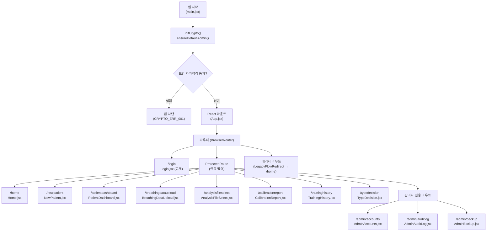
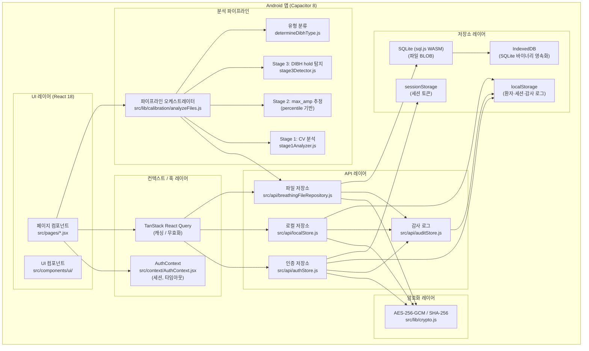
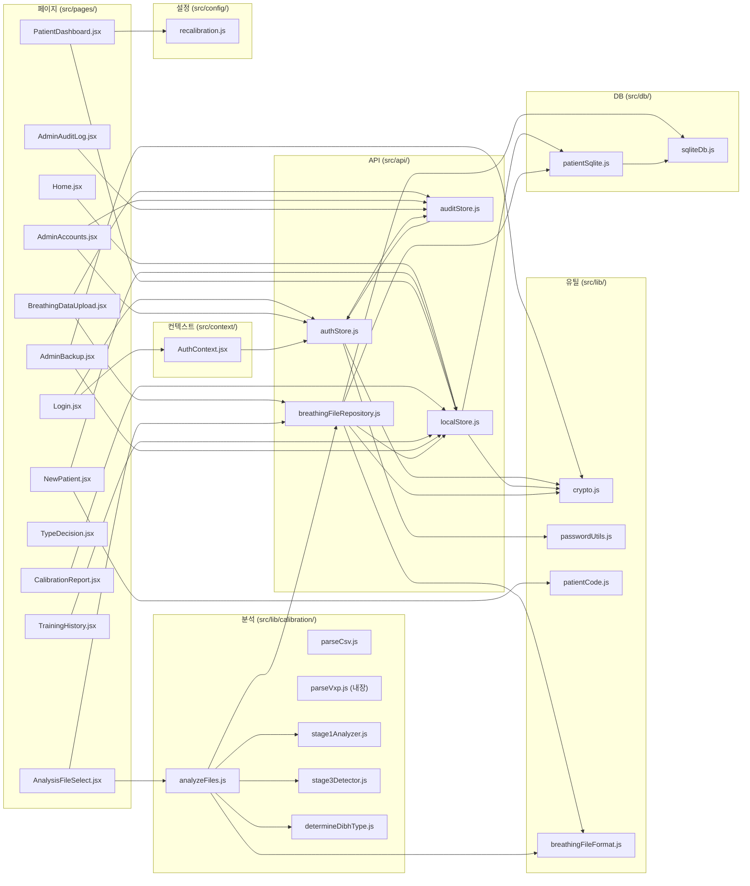
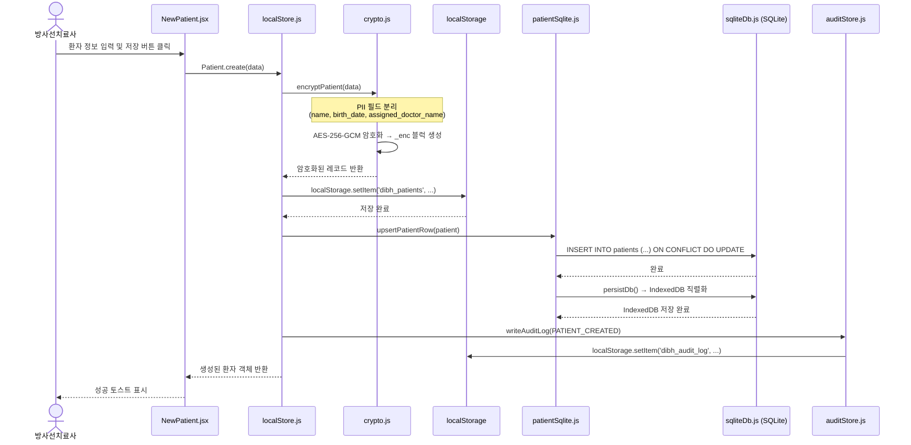
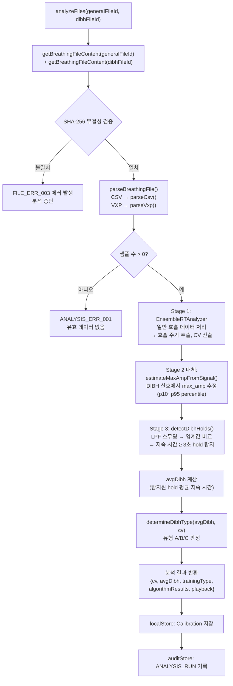
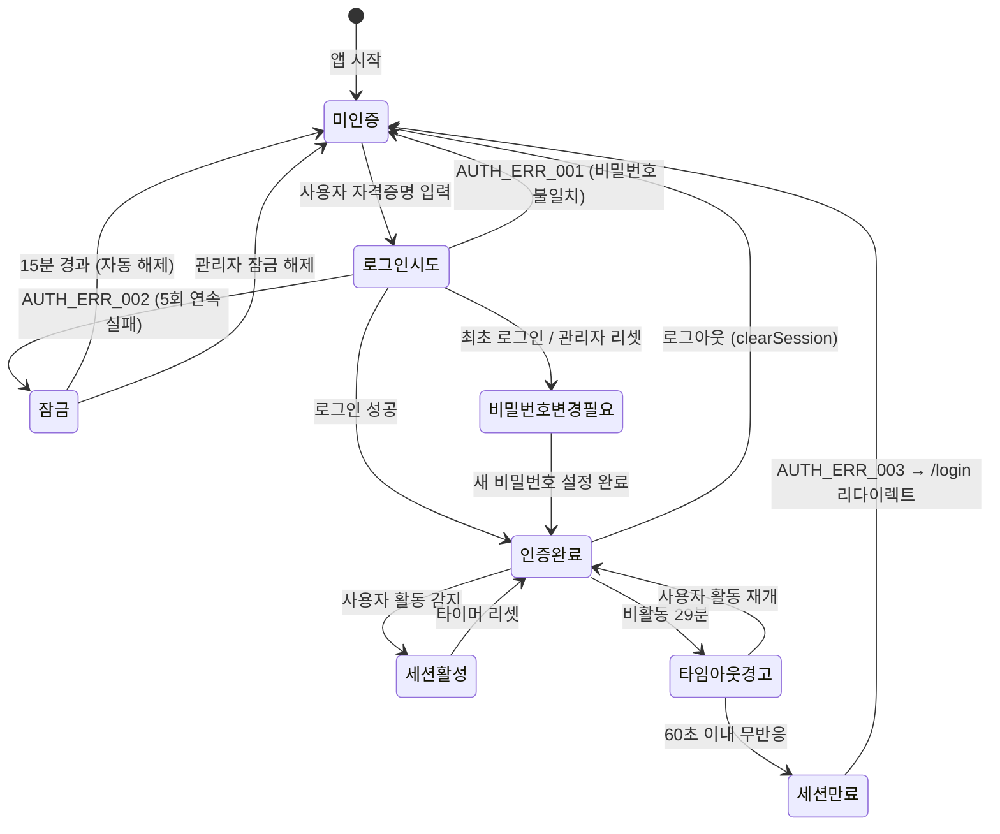
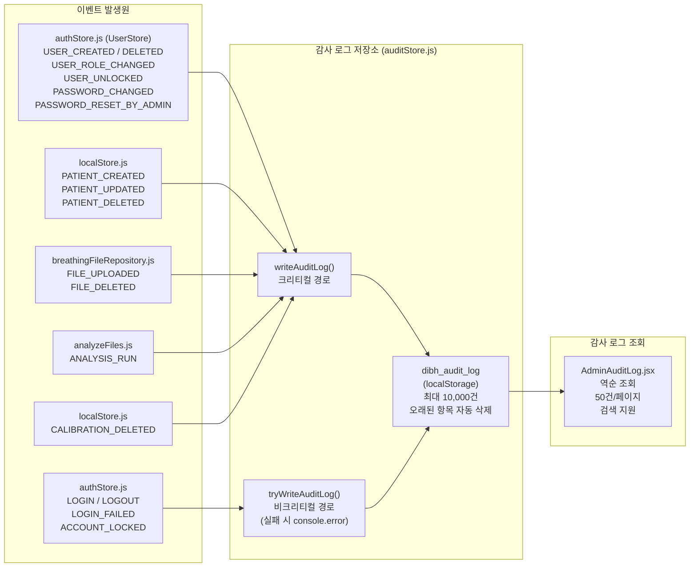

# 소프트웨어 구조 설계서

**문서 번호:** P705-3  
**제품명:** DIBH 훈련 관리 시스템  
**모델명:** DIBH-TRAIN-01  
**SW 명칭:** DIBH Training Manager  
**패키지 ID:** com.thepict.dibhtraining  
**제조자:** 주식회사 더픽트  
**버전:** 1.0.0  
**작성일:** 2026년 6월 4일  
**IEC 62304 등급:** Class B

---

## 개정 이력

| 버전 | 날짜 | 작성자 | 내용 |
|------|------|--------|------|
| 1.0.0 | 2026-06-04 | 더픽트 개발팀 | 최초 작성 |

---

## 목차

1. [개요](#1-개요)
   1. [목적](#11-목적)
   2. [범위](#12-범위)
   3. [제품 식별](#13-제품-식별)
   4. [참조 문서](#14-참조-문서)
   5. [설계 규칙](#15-설계-규칙)
   6. [SW 설계 검증](#16-sw-설계-검증)
2. [SW 개요](#2-sw-개요)
   1. [SW 목적](#21-sw-목적)
   2. [SW 사용자](#22-sw-사용자)
3. [SW 구조](#3-sw-구조)
   1. [유저 인터페이스](#31-유저-인터페이스)
   2. [MMI (사람-기계 인터페이스)](#32-mmi-사람-기계-인터페이스)
   3. [에러 핸들러](#33-에러-핸들러)
   4. [개발 도구 및 SOUP](#34-개발-도구-및-soup)
   5. [SW 성능](#35-sw-성능)
   6. [암호화 설계](#36-암호화-설계)
4. [아키텍처 설계](#4-아키텍처-설계)
   1. [전체 시스템 구성](#41-전체-시스템-구성)
   2. [모듈 구조 및 의존성](#42-모듈-구조-및-의존성)
   3. [데이터베이스 설계](#43-데이터베이스-설계)
5. [SW 모듈 설계](#5-sw-모듈-설계)
   1. [인증 모듈](#51-인증-모듈)
   2. [암호화 모듈](#52-암호화-모듈)
   3. [데이터 저장소 모듈](#53-데이터-저장소-모듈)
   4. [호흡 분석 모듈](#54-호흡-분석-모듈)
   5. [감사 로그 모듈](#55-감사-로그-모듈)
   6. [관리자 모듈](#56-관리자-모듈)

---

## 1. 개요

### 1.1 목적

본 문서는 **DIBH 훈련 관리 시스템 (DIBH Training Manager)** 의 소프트웨어 구조 및 모듈 설계를 기술한다. IEC 62304:2006/AMD1:2015 Class B 요구사항에 따라 소프트웨어 아키텍처, 모듈 간 인터페이스, 데이터 흐름, 보안 설계 및 에러 처리 전략을 문서화하여 소프트웨어 개발 및 유지보수의 기준으로 삼는다.

### 1.2 범위

본 문서가 기술하는 소프트웨어의 범위는 다음과 같다.

- Android 기반 오프라인 의료 지원 소프트웨어 (com.thepict.dibhtraining)
- 환자 등록 및 관리 기능
- 호흡 데이터(CSV/VXP) 업로드 및 저장 기능
- DIBH 훈련 분석 파이프라인
- 사용자 인증, 세션 관리, 감사 로그
- 로컬 데이터 암호화 및 보호

본 문서는 외부 시스템(방사선치료 계획 시스템, 병원 HIS 등)과의 인터페이스는 포함하지 않는다.

### 1.3 제품 식별

| 항목 | 내용 |
|------|------|
| 제품명 | DIBH 훈련 관리 시스템 |
| 모델명 | DIBH-TRAIN-01 |
| SW 명칭 | DIBH Training Manager |
| 패키지 ID | com.thepict.dibhtraining |
| SW 버전 | 1.0.0 |
| 제조자 | 주식회사 더픽트 |
| 대상 플랫폼 | Android (Capacitor) / 웹 브라우저 |
| SW 안전성 등급 | Class B (IEC 62304) |
| 작성일 | 2026년 6월 4일 |

### 1.4 참조 문서

| 문서 번호 | 문서명 |
|-----------|--------|
| IEC 62304:2006/AMD1:2015 | Medical device software — Software life cycle processes |
| IEC 62366-1:2015 | Medical devices — Application of usability engineering |
| ISO 14971:2019 | Medical devices — Application of risk management |
| MFDS 가이드라인 | 의료기기 사이버보안 허가·심사 가이드라인 (2022) |
| P705-1 | 소프트웨어 요구사항 명세서 |
| P705-2 | 소프트웨어 위험관리 보고서 |
| P705-4 | 소프트웨어 단위 시험 계획서 |

### 1.5 설계 규칙

본 소프트웨어의 설계는 다음 규칙을 따른다.

1. **오프라인 우선 설계**: 네트워크 연결 없이 모든 기능이 동작하여야 한다. 외부 서버 통신은 없다.
2. **단방향 데이터 흐름**: UI 레이어 → 컨텍스트/훅 → API 레이어 → 저장소 레이어 순서로 데이터가 흐른다.
3. **암호화 우선 원칙**: 환자 개인정보(PII)는 저장 전 반드시 AES-256-GCM으로 암호화된다.
4. **감사 추적 원칙**: 모든 보안 관련 동작(로그인, 환자 생성/수정/삭제, 파일 업로드/삭제, 분석 실행)은 감사 로그에 기록된다.
5. **방어적 에러 처리**: 크리티컬 경로(암호화 초기화 실패 등)는 앱 구동을 차단하고, 비크리티컬 경로는 `console.error`로 기록 후 계속 동작한다.
6. **경로 별칭**: 소스 코드 내 `@`는 `src/` 디렉터리를 가리킨다.

### 1.6 SW 설계 검증

소프트웨어 설계 검증은 다음 방법으로 수행한다.

| 검증 방법 | 도구 | 대상 |
|-----------|------|------|
| 단위 테스트 | Vitest | 호흡 분석 파이프라인, CSV 파서, 유형 분류기 |
| 통합 테스트 | Vitest (모킹) | analyzeFiles 전체 파이프라인 |
| 코드 리뷰 | 수동 검토 | 보안 관련 모듈 (authStore, crypto, auditStore) |
| 정적 분석 | ESLint | 전체 소스 코드 |

테스트 파일 위치:
- `src/lib/calibration/parseCsv.test.js`
- `src/lib/calibration/determineDibhType.test.js`
- `src/lib/calibration/analyzeFiles.integration.test.js`

---

## 2. SW 개요

### 2.1 SW 목적

DIBH 훈련 관리 시스템은 방사선 종양학 분야에서 유방암 환자의 **심호흡 후 숨참기(Deep Inspiration Breath Hold, DIBH)** 훈련 데이터를 분석하고 훈련 상태를 관리하는 오프라인 의료 지원 소프트웨어이다.

본 소프트웨어는 다음의 기능을 수행한다.

- 환자 등록 및 개인정보 관리 (AES-256-GCM 암호화 적용)
- 호흡 측정 파일(CSV, VXP 형식) 업로드 및 저장 (환자당 카테고리별 최대 10개)
- 일반 호흡 데이터에서 호흡 변동 계수(CV) 산출
- DIBH 호흡 데이터에서 숨참기 지속 시간(avgDibh) 산출
- 분석 결과를 기반으로 DIBH 훈련 유형(A/B/C) 판정
- 훈련 이력 관리 및 재캘리브레이션 필요 여부 판단
- 관리자 계정 관리, 감사 로그 조회, 데이터 백업/복원

본 소프트웨어는 **진단 또는 치료 결정을 직접 수행하지 않으며**, 방사선치료사의 임상적 판단을 지원하는 보조 도구이다.

### 2.2 SW 사용자

| 사용자 역할 | 권한 수준 | 주요 기능 |
|-------------|-----------|-----------|
| 방사선치료사 (Therapist) | 일반 사용자 | 환자 등록, 파일 업로드, 분석 실행, 훈련 이력 조회 |
| 관리자 (Admin) | 관리자 | 계정 생성/삭제/잠금해제, 감사 로그 조회, 백업/복원/내보내기 |
| 일반 사용자 (Clinician) | 조회 전용 | 환자 목록 및 대시보드 조회 |

최초 설치 시 기본 관리자 계정이 자동 생성된다 (아이디: `admin`, 초기 비밀번호: `Admin@1234!`). 초기 비밀번호는 최초 로그인 시 반드시 변경하여야 한다.

---

## 3. SW 구조

### 3.1 유저 인터페이스

소프트웨어의 UI는 **React 18** 기반 SPA(Single Page Application)로 구현되며, **Capacitor 8**을 통해 Android 네이티브 앱으로 패키징된다.

UI 기술 스택:

| 항목 | 라이브러리/버전 |
|------|----------------|
| UI 프레임워크 | React 18.2 |
| 라우팅 | react-router-dom 7.2 |
| 상태 관리 | React Context + TanStack React Query 5 |
| UI 컴포넌트 | Radix UI (비제어형 접근성 우선 컴포넌트) |
| 스타일링 | Tailwind CSS 3.4 (다크 테마, GitHub 팔레트) |
| 아이콘 | lucide-react 0.475 |
| 폼 검증 | react-hook-form 7.54 + zod 3.24 |
| 토스트 알림 | sonner 2.0 |
| 차트/파형 | recharts 2.15 |
| 애니메이션 | framer-motion 12 |

**전역 색상 팔레트:**
- 배경: `#0D1117` (GitHub Dark)
- 테두리: `#30363D`
- 본문 텍스트: `#C9D1D9`
- 강조 컬러: 캘리브레이션 상태에 따른 `#22C55E` (유효) / `#EAB308` (만료 임박) / `#EF4444` (필요) / `#8B949E` (신규)

### 3.2 MMI (사람-기계 인터페이스)

**라우팅 구조:**



**세션 타임아웃 동작:**
- 30분 비활동 시 세션 자동 만료
- 만료 60초 전 경고 다이얼로그 표시
- 사용자 이벤트(mousedown / keydown / touchstart / scroll) 감지 시 타이머 초기화

### 3.3 에러 핸들러

시스템에서 정의된 에러 코드 및 처리 방침은 다음과 같다.

| 에러코드 | 에러 메시지 | 발생 조건 | 처리 방침 |
|----------|-------------|-----------|-----------|
| AUTH_ERR_001 | 아이디 또는 비밀번호가 올바르지 않습니다 (남은 시도: N회) | 비밀번호 불일치 | UI 경고 표시; 감사 로그 기록(LOGIN_FAILED) |
| AUTH_ERR_002 | 계정이 잠금되었습니다. N분 후 다시 시도하거나 관리자에게 문의하세요 | 5회 연속 로그인 실패 | 15분 잠금; 감사 로그 기록(ACCOUNT_LOCKED) |
| AUTH_ERR_003 | 세션이 만료되었습니다 | 30분 비활동 초과 | 세션 삭제 후 /login 리다이렉트 |
| FILE_ERR_001 | 지원하지 않는 파일 형식 | CSV/VXP 외 파일 업로드 시도 | UI 에러 표시; 업로드 차단 |
| FILE_ERR_002 | 파일 파싱 오류 | CSV 데이터 형식 오류 | UI 에러 표시; 분석 중단 |
| FILE_ERR_003 | 파일 무결성 오류: 저장된 이후 파일이 변경되었습니다 | SHA-256 불일치 | 분석 차단; UI 에러 표시 |
| ANALYSIS_ERR_001 | 분석에 필요한 데이터가 부족합니다 | 호흡 주기 미검출 또는 유효 샘플 부족 | UI 에러 표시; 분석 결과 null 반환 |
| CRYPTO_ERR_001 | 암호화 초기화 실패 — 앱을 사용할 수 없습니다 | Web Crypto API 미지원 | 앱 구동 전면 차단; 화면에 에러 표시 |
| CRYPTO_ERR_002 | [복호화 실패] | 암호화 키 불일치 (설치 키 재생성 등) | PII 필드를 플레이스홀더로 대체; console.warn 출력 |
| STORAGE_ERR_001 | 데이터 저장 실패 | localStorage 용량 초과 | UI 에러 표시; 동작 중단 |
| AUDIT_ERR_001 | [감사 로그 기록 실패] | localStorage 쓰기 실패 | console.error 출력; 앱 동작 계속 |

**에러 처리 계층:**
- **크리티컬 에러 (앱 차단):** CRYPTO_ERR_001 — `main.jsx`에서 React 마운트 전에 처리
- **비크리티컬 에러 (앱 계속):** CRYPTO_ERR_002, AUDIT_ERR_001 — 해당 함수 내부에서 처리 후 계속 동작
- **사용자 알림 에러:** 나머지 모두 — sonner 토스트 또는 인라인 에러 메시지로 사용자에게 표시

### 3.4 개발 도구 및 SOUP

**빌드 도구:**

| 도구 | 버전 | 용도 |
|------|------|------|
| Vite | 6.1 | 개발 서버, 번들링 |
| Tailwind CSS | 3.4 | 유틸리티 CSS 빌드 |
| ESLint | 9.19 | 정적 코드 분석 |
| Vitest | 3.0 | 단위/통합 테스트 |
| Capacitor | 8.3 | Android 패키징 |

**SOUP (Software Of Unknown Provenance) 목록:**

| SOUP 명칭 | 버전 | 용도 | 안전성 관련성 |
|-----------|------|------|---------------|
| React | 18.2 | UI 렌더링 프레임워크 | 없음 (표시 전용) |
| react-router-dom | 7.2 | 클라이언트 라우팅 | 없음 |
| TanStack React Query | 5.90 | 서버 상태 캐싱 | 없음 |
| sql.js | 1.14 | SQLite WASM 엔진 | 있음 (파일 저장) |
| zod | 3.24 | 폼/데이터 검증 | 있음 (입력 유효성) |
| react-hook-form | 7.54 | 폼 상태 관리 | 없음 |
| recharts | 2.15 | 파형 차트 렌더링 | 없음 (시각화 전용) |
| date-fns | 3.6 | 날짜 연산 | 없음 |
| Radix UI | 다수 | 접근성 UI 컴포넌트 | 없음 |
| sonner | 2.0 | 토스트 알림 | 없음 |
| lucide-react | 0.475 | 아이콘 | 없음 |
| framer-motion | 12.4 | UI 애니메이션 | 없음 |
| @capacitor/core | 8.3 | Android 브릿지 | 없음 |

> **참고:** `sql.js`는 브라우저 내장 Web Crypto API와 함께 사용되는 핵심 저장소 엔진이다. sql.js 버전 변경 시 IndexedDB 스키마 호환성 검증이 필요하다.

### 3.5 SW 성능

| 항목 | 기준값 | 측정 조건 |
|------|--------|-----------|
| 앱 초기 로드 | 5초 이내 | Android 중급 사양 기기 |
| 호흡 분석 처리 | 10초 이내 | 250 KB CSV 파일 기준 |
| 환자 목록 조회 | 2초 이내 | 500명 환자 기준 |
| 파일 업로드 (저장) | 5초 이내 | 10 MB 파일 기준 |
| 로그인 응답 | 3초 이내 | PBKDF2 100,000회 반복 포함 |
| 감사 로그 조회 | 1초 이내 | 10,000건 최대 기준 |

### 3.6 암호화 설계

본 소프트웨어는 MFDS 의료기기 사이버보안 가이드라인의 DC-01(데이터 기밀성), DC-03(키 관리), IA-05(패스워드 정책), SI-04(무결성 검증) 요구사항을 준수한다.

| 대상 | 알고리즘 | 세부 사항 |
|------|----------|-----------|
| 환자 PII 데이터 (이름, 생년월일, 담당의) | AES-256-GCM | 설치별 랜덤 256-bit 키; 96-bit 랜덤 IV; 저장 형식: `enc:<24자리 ivHex>:<ciphertextHex>` |
| 사용자 비밀번호 | PBKDF2-SHA256 | 100,000 iterations; 16바이트 랜덤 솔트; 결과: 256-bit hex 해시 |
| 파일 무결성 | SHA-256 | 업로드 시 계산; 분석 실행 전 재검증 (SI-04) |
| 세션 토큰 | CSPRNG 256-bit | `crypto.getRandomValues()`; sessionStorage 저장 (탭 종료 시 삭제) |
| 백업 파일 | AES-256-GCM | 관리자 지정 패스워드 기반 키 파생 |
| 설치 키 저장 | localStorage | `dibh_install_key`: 256-bit hex 문자열 |

**암호화 초기화 흐름:**
1. `main.jsx` — React 마운트 전 `initCrypto()` 호출
2. `initCrypto()` — localStorage에서 설치 키 로드 또는 신규 생성
3. Web Crypto API 가용성 검사 → 불가 시 앱 차단 (CRYPTO_ERR_001)
4. 암호화 라운드트립 자가점검 수행
5. 검사 통과 후 React 마운트

---

## 4. 아키텍처 설계

### 4.1 전체 시스템 구성



### 4.2 모듈 구조 및 의존성



**데이터 저장 흐름 (환자 생성 시):**



**호흡 분석 파이프라인 흐름:**



**인증 상태 머신:**



**감사 로그 흐름:**



### 4.3 데이터베이스 설계

#### 4.3.1 localStorage 스키마

모든 데이터는 JSON 직렬화 후 localStorage에 문자열로 저장된다.

**dibh_users** (사용자 계정)

| 필드 | 타입 | 설명 |
|------|------|------|
| id | string | `{timestamp}-{random}` 형식 고유 ID |
| username | string | 로그인 아이디 (고유) |
| displayName | string | 화면 표시 이름 |
| passwordHash | string | PBKDF2-SHA256 해시 (256-bit hex) |
| salt | string | 16바이트 랜덤 솔트 (32자리 hex) |
| role | string | `admin` / `therapist` / `clinician` |
| mustChangePassword | boolean | 최초 로그인/리셋 후 비밀번호 변경 필요 여부 |
| failedAttempts | number | 연속 로그인 실패 횟수 (최대 5) |
| lockedUntil | string\|null | 잠금 해제 시각 (ISO 8601) |
| createdAt | string | 계정 생성 시각 (ISO 8601) |
| updatedAt | string | 마지막 수정 시각 (ISO 8601) |

**dibh_patients** (환자 정보)

| 필드 | 타입 | 설명 |
|------|------|------|
| id | string | 고유 ID |
| patient_code | string | 자동 생성 코드 `PT-YYYY-NNN` |
| gender | string | 성별 |
| age_group | string | 연령대 |
| cancer_type | string | 암종 |
| _enc | string | AES-256-GCM 암호화된 PII 블럭 (`enc:<IV>:<CT>`) |
| created_at | string | 등록 시각 (ISO 8601) |
| updated_at | string | 수정 시각 (ISO 8601) |
| training_type | string\|null | 최종 확정 훈련 유형 (A/B/C) |
| last_calibration_date | string\|null | 마지막 캘리브레이션 날짜 |
| calibration_count | number | 총 캘리브레이션 횟수 |
| calibration_status | string\|null | `valid` / `expiring` / `needed` / `new` |

> PII 암호화 대상 필드: `name`, `birth_date`, `assigned_doctor_name`

**dibh_training_sessions** (훈련 세션)

| 필드 | 타입 | 설명 |
|------|------|------|
| id | string | 고유 ID |
| patient_id | string | 환자 ID (외래 키) |
| session_date | string | 세션 날짜 |
| notes | string | 메모 |
| created_at / updated_at | string | ISO 8601 타임스탬프 |

**dibh_calibrations** (캘리브레이션 결과)

| 필드 | 타입 | 설명 |
|------|------|------|
| id | string | 고유 ID |
| patient_id | string | 환자 ID |
| calibration_date | string | 캘리브레이션 날짜 |
| training_type | string | 유형 A/B/C |
| dibh_duration | number | 평균 DIBH hold 지속 시간 (초) |
| cv | number | 호흡 변동 계수 (%) |
| algorithm_results | object | Stage 1/2/3 상세 결과 JSON |
| stage_data | object | playback 데이터 (차트 포인트 등) |
| created_at / updated_at | string | ISO 8601 타임스탬프 |

**dibh_calibration_sessions** (진행 중 캘리브레이션)

| 필드 | 타입 | 설명 |
|------|------|------|
| id | string | 고유 ID |
| patient_id | string | 환자 ID |
| stage_data | object | 단계별 데이터 누적 |
| created_at / updated_at | string | ISO 8601 타임스탬프 |

**dibh_audit_log** (감사 로그)

| 필드 | 타입 | 설명 |
|------|------|------|
| id | string | `{timestamp}-{random}` |
| userId | string | 수행자 ID (또는 `system`) |
| username | string | 수행자 아이디 |
| action | string | 이벤트 상수 (AUDIT_ACTIONS) |
| targetType | string\|null | 대상 유형 (`user`, `patient`, `file` 등) |
| targetId | string\|null | 대상 ID |
| detail | string\|null | 상세 내용 |
| timestamp | string | ISO 8601 (UC-06) |

**dibh_install_key**  
- 값: 256-bit 랜덤 키의 hex 문자열 (64자리)
- 설치별 1회 생성, 앱 생애주기 동안 변경 없음

#### 4.3.2 SQLite 스키마 (sql.js / IndexedDB)

IndexedDB 이름: `dibh_app`, 오브젝트 스토어: `sqlite`, 키: `main`

```sql
-- 환자 미러 테이블 (localStorage 동기화용)
CREATE TABLE IF NOT EXISTS patients (
  id           TEXT PRIMARY KEY NOT NULL,
  payload      TEXT NOT NULL,          -- JSON 직렬화된 환자 레코드 (암호화 포함)
  created_at   TEXT NOT NULL,
  updated_at   TEXT NOT NULL
);

-- 호흡 파일 저장소 (BLOB)
CREATE TABLE IF NOT EXISTS breathing_files (
  id            TEXT PRIMARY KEY NOT NULL,
  patient_id    TEXT NOT NULL,
  category      TEXT NOT NULL CHECK (category IN ('general', 'dibh')),
  original_name TEXT NOT NULL,         -- {PT-CODE}_{GEN|DIBH}_{YYYYMMDD}[_{seq}].{ext}
  size_bytes    INTEGER NOT NULL,
  mime          TEXT,
  imported_at   TEXT NOT NULL,         -- ISO 8601
  content       BLOB,                  -- 원시 파일 바이트
  content_hash  TEXT,                  -- SHA-256 hex (무결성 검증 SI-04)
  FOREIGN KEY (patient_id) REFERENCES patients(id) ON DELETE CASCADE
);

CREATE INDEX IF NOT EXISTS idx_breathing_files_patient
  ON breathing_files(patient_id);

CREATE INDEX IF NOT EXISTS idx_breathing_files_cat
  ON breathing_files(patient_id, category);
```

**파일 명명 규칙:**  
`{PATIENT_CODE}_{GEN|DIBH}_{YYYYMMDD}[_{seq}].{ext}`  
예시: `PT-2026-001_GEN_20260604.csv`, `PT-2026-001_DIBH_20260604_2.vxp`

동일 날짜/카테고리/확장자에 두 번째 파일부터 `_2`, `_3`, ... 시퀀스 번호가 부여된다.

---

## 5. SW 모듈 설계

### 5.1 인증 모듈

**파일:** `src/api/authStore.js`  
**참조 규정:** MFDS IA-01~IA-07

#### 5.1.1 모듈 개요

사용자 인증, 세션 관리, 계정 잠금 정책을 구현한다. 비밀번호는 PBKDF2-SHA256으로 해시하여 저장하며, 세션 토큰은 sessionStorage에 보관(탭 종료 시 자동 삭제)한다.

#### 5.1.2 함수 명세

**ensureDefaultAdmin()**

| 항목 | 내용 |
|------|------|
| 목적 | 사용자 목록이 비어 있을 때 기본 admin 계정 생성 |
| 호출 시점 | `main.jsx` 초기화 단계 |
| 동작 | `dibh_users`에 사용자가 없는 경우에만 실행; `mustChangePassword: true` 설정 |
| 초기 자격증명 | 아이디: `admin`, 비밀번호: `Admin@1234!` |

**loginUser(username, password)**

| 항목 | 내용 |
|------|------|
| 목적 | 자격증명 검증 및 세션 생성 |
| 반환 | `{ success, session? }` 또는 `{ success: false, error, locked? }` |
| 잠금 정책 | 5회 연속 실패 시 15분 잠금 (IA-07) |
| 사용자명 노출 방지 | 존재하지 않는 사용자명에도 동일한 에러 메시지 반환 (IA-06) |
| 감사 기록 | LOGIN / LOGIN_FAILED / ACCOUNT_LOCKED |

**getSession() / touchSession() / clearSession()**

| 함수 | 동작 |
|------|------|
| `getSession()` | sessionStorage에서 세션 객체 파싱 반환 |
| `touchSession()` | `lastActivity` 타임스탬프 갱신 |
| `clearSession()` | sessionStorage에서 세션 삭제 + LOGOUT 감사 기록 |

**UserStore** (관리자 전용 계정 관리 API)

| 메서드 | 동작 |
|--------|------|
| `list()` | 비밀번호 해시 제외 사용자 목록 반환 |
| `create({username, displayName, password, role})` | 신규 계정 생성; 중복 아이디 오류 처리 |
| `changePassword(userId, newPassword)` | 비밀번호 변경; `mustChangePassword: false` 업데이트 |
| `resetPassword(userId, newPassword)` | 관리자에 의한 비밀번호 리셋; `mustChangePassword: true` 재설정 |
| `unlock(userId)` | 계정 잠금 해제 (`failedAttempts: 0`, `lockedUntil: null`) |
| `setRole(userId, role)` | 역할 변경 (`admin` / `therapist` / `clinician`) |
| `delete(userId)` | 계정 삭제; 마지막 계정 삭제 시도 시 오류 |

#### 5.1.3 비밀번호 정책

`src/lib/passwordUtils.js`에 정의된 MFDS IA-05 준수 정책:

- 최소 8자 이상
- 영문 대문자 포함
- 영문 소문자 포함
- 숫자 포함
- 특수문자 포함 (예: `!@#$%^&*`)

---

### 5.2 암호화 모듈

**파일:** `src/lib/crypto.js`  
**참조 규정:** MFDS DC-01, DC-03, SI-04

#### 5.2.1 모듈 개요

브라우저 Web Crypto API를 사용하여 AES-256-GCM 암호화 및 SHA-256 해시를 구현한다. 암호화 키는 설치별 1회 생성 후 localStorage에 hex 문자열로 저장되며, 런타임에는 메모리 내 `CryptoKey` 객체로 캐시된다.

#### 5.2.2 함수 명세

**initCrypto()**

- `dibh_install_key` 로드 또는 신규 32바이트 랜덤 키 생성
- `crypto.subtle.importKey()`로 AES-GCM CryptoKey 객체 생성
- 모듈 내 `_key` 변수에 캐시 (중복 초기화 방지)

**encryptValue(plaintext) → `enc:<ivHex>:<ciphertextHex>`**

- 12바이트 랜덤 IV 생성
- AES-256-GCM으로 UTF-8 인코딩된 plaintext 암호화
- 반환 형식: `enc:{24자리 ivHex}:{ciphertextHex}`

**decryptValue(value) → plaintext**

- `enc:` 프리픽스 없으면 레거시 평문으로 처리하여 그대로 반환
- IV 고정 위치 파싱 (split(':') 미사용, 위치 기반 추출)
- AES-256-GCM 복호화 후 UTF-8 디코딩

**sha256Hex(buffer) → hex string**

- `crypto.subtle.digest('SHA-256', buffer)` 실행
- 파일 업로드 시 및 분석 실행 전 무결성 검증에 사용 (SI-04)

**encryptPatient(data) → 암호화된 레코드**

- PII 필드 (`name`, `birth_date`, `assigned_doctor_name`) 분리
- PII를 JSON 직렬화 후 `encryptValue()`로 암호화
- 결과를 `_enc` 필드로 저장

**decryptPatient(raw) → 복호화된 레코드**

- `_enc` 필드 없으면 레거시 평문 레코드로 투명 처리
- 복호화 실패 시: `name: '[복호화 실패]'` 등 플레이스홀더 반환; `_decryptionFailed: true` 플래그 설정; `console.warn` 출력

---

### 5.3 데이터 저장소 모듈

#### 5.3.1 로컬 저장소 (src/api/localStore.js)

localStorage 기반 CRUD API를 제공한다. 각 엔티티는 JSON 배열로 관리된다.

**엔티티 및 주요 메서드:**

| 엔티티 | localStorage 키 | 주요 메서드 |
|--------|-----------------|-------------|
| Patient | `dibh_patients` | `list()`, `filter(pred)`, `get(id)`, `create(data)`, `update(id, data)`, `delete(id)` |
| TrainingSession | `dibh_training_sessions` | `list()`, `filter(pred)`, `get(id)`, `create(data)`, `update(id, data)`, `delete(id)` |
| Calibration | `dibh_calibrations` | `list()`, `filter(pred)`, `get(id)`, `create(data)`, `update(id, data)`, `delete(id)` |
| CalibrationSession | `dibh_calibration_sessions` | `list()`, `filter(pred)`, `get(id)`, `create(data)`, `update(id, data)`, `delete(id)`, `complete()` |

`CalibrationSession.complete()`: 진행 중 캘리브레이션 세션을 완료 처리하여 `Calibration` 레코드로 변환한다.

`Patient.create()`: `encryptPatient()`를 호출하여 PII 필드를 암호화한 뒤 저장하고, `upsertPatientRow()`로 SQLite에 미러링한다.

#### 5.3.2 SQLite 모듈 (src/db/sqliteDb.js)

**getSqliteDatabase()**

1. sql.js WASM 모듈 초기화
2. IndexedDB에서 기존 DB 바이너리 로드
3. `runMigrations()` 실행 (테이블 생성, 인덱스 생성)
4. `migrateLocalStoragePatientsOnce()`: 최초 실행 시 localStorage 환자를 SQLite로 일괄 이전
5. `persistDb()`: 현재 DB 상태를 IndexedDB에 직렬화

**withTransaction(fn)**

- `BEGIN` / `COMMIT` / `ROLLBACK` 트랜잭션 래퍼
- 완료 후 `persistDb()` 자동 호출
- 직렬화 큐(`persistQueue`)로 IndexedDB 쓰기 순서 보장

**persistDb(db)**

- `db.export()`로 SQLite 바이너리 추출
- `saveDbBinary()`로 IndexedDB에 저장
- 직렬화 큐로 경쟁 조건 방지

#### 5.3.3 호흡 파일 저장소 (src/api/breathingFileRepository.js)

**createBreathingFile({patientId, category, file})**

1. 환자 존재 확인 (localStore)
2. `upsertPatientRow()`로 SQLite 환자 레코드 보장
3. `sha256Hex()`로 파일 해시 계산
4. 동일 카테고리 10개 한도 확인 (초과 시 에러)
5. `computeStoredBreathingFileName()`으로 저장 파일명 결정
6. SQLite에 BLOB 저장
7. `persistDb()` 호출

**listBreathingFilesByPatient(patientId, category)**
- `SELECT` 시 BLOB 제외 (성능 최적화)
- `imported_at ASC` 정렬

**getBreathingFileContent(fileId)**
- BLOB + `content_hash` 로드
- SHA-256 재계산 후 `content_hash`와 비교 (SI-04)
- 불일치 시 `FILE_ERR_003` 에러 발생

---

### 5.4 호흡 분석 모듈

**디렉터리:** `src/lib/calibration/`

#### 5.4.1 모듈 구성

| 파일 | 역할 |
|------|------|
| `analyzeFiles.js` | 전체 파이프라인 오케스트레이터 + CSV/VXP 파서 |
| `stage1Analyzer.js` | `Stage1EnsembleRTAnalyzer` — 실시간 호흡 주기 추출 및 CV 계산 |
| `stage2Detector.js` | (참조용) 실시간 Stage 2 기준 amplitude 추정 로직 |
| `stage3Detector.js` | `Stage3Detector` + `OnePoleLPF` — 실시간 DIBH 탐지 |
| `determineDibhType.js` | 유형 A/B/C 분류 함수 |

#### 5.4.2 분석 파이프라인 (analyzeFiles.js)

**입력:** `generalFileId` (일반 호흡 파일 ID), `dibhFileId` (DIBH 파일 ID)

**Stage 1 — CV 산출:**

`Stage1EnsembleRTAnalyzer`를 사용하여 일반 호흡 신호에서 호흡 주기를 추출하고 변동 계수(CV)를 계산한다.

- 알고리즘: 상승/하강 엣지 감지 기반 실시간 앙상블 분석
- 출력: `cv` (%), `cv_period`, `ok_cycles_count`, 호흡 주기 배열

**Stage 2 대체 — max_amp 추정:**

DIBH 파일에서 직접 진폭 범위를 추정한다 (실시간 Bluetooth 센서 없음).
- `baseline` = 원시 신호 10th percentile
- `peak` = 원시 신호 95th percentile
- `max_amp` = `peak` - `baseline` (최소 0.1 보장)

**Stage 3 — DIBH hold 탐지:**

`detectDibhHolds()`는 스캔 기반 알고리즘을 사용한다.

- `OnePoleLPF(1.2)`로 신호 스무딩 (노이즈 억제)
- `hold_th` = `baseline + 0.80 × max_amp` (진입 임계값)
- `release_th` = `baseline + 0.50 × max_amp` (이탈 임계값, 히스테리시스)
- 지속 시간 ≥ 3.0초인 구간만 유효 hold로 인정
- 파일 끝까지 활성 hold는 마지막 샘플 시각으로 종료 처리

**유형 분류 (determineDibhType.js):**

| 유형 | 조건 |
|------|------|
| A (우수) | `avgDibh ≥ 15.0초` AND `cv < 15%` |
| C (불량) | `avgDibh < 10.0초` OR `cv ≥ 30%` |
| B (중간) | 유형 A / C 이외 |

**UI 응답성 유지:**

대용량 파일 처리 시 `await yieldToUI()` (setTimeout 0ms)를 2,000 샘플마다 호출하여 이벤트 루프를 양보한다. `AbortSignal`을 통한 분석 취소를 지원한다.

**재캘리브레이션 임계값 (src/config/recalibration.js):**

| 설정값 | 내용 |
|--------|------|
| `timeThresholdDays: 30` | 마지막 캘리브레이션 이후 30일 경과 시 재캘리브레이션 필요 |
| `sessionThreshold: 10` | 10회 이상 세션 후 재캘리브레이션 권장 |

---

### 5.5 감사 로그 모듈

**파일:** `src/api/auditStore.js`  
**참조 규정:** MFDS UC-04, UC-05, UC-06, UC-07

#### 5.5.1 모듈 개요

모든 보안 관련 이벤트를 append-only 방식으로 기록한다. UI를 통한 수정/삭제는 불가능하다.

#### 5.5.2 함수 명세

**writeAuditLog({action, targetType, targetId, detail})**

- 현재 세션 정보(`userId`, `username`)를 자동 포함
- ISO 8601 타임스탬프 기록 (UC-06)
- 10,000건 초과 시 오래된 항목 자동 삭제 (FIFO)
- localStorage 쓰기 실패 시 예외 전파 (UC-05 — 호출자가 처리)

**tryWriteAuditLog(params)**

- `writeAuditLog()`의 비크리티컬 래퍼
- 실패 시 `console.error` 출력 후 계속 진행

**getAuditLogEntries({search, limit, offset})**

- 역순 정렬 (최신 항목 먼저)
- `username`, `action`, `detail`, `timestamp`, `targetType` 필드 대상 텍스트 검색
- 페이지네이션 지원 (기본 50건/페이지)

#### 5.5.3 감사 이벤트 상수 (AUDIT_ACTIONS)

| 상수 | 의미 |
|------|------|
| LOGIN | 로그인 성공 |
| LOGOUT | 로그아웃 |
| LOGIN_FAILED | 로그인 실패 |
| ACCOUNT_LOCKED | 계정 잠금 |
| USER_CREATED | 사용자 계정 생성 |
| USER_DELETED | 사용자 계정 삭제 |
| USER_ROLE_CHANGED | 역할 변경 |
| USER_UNLOCKED | 잠금 해제 |
| PASSWORD_CHANGED | 비밀번호 변경 |
| PASSWORD_RESET_BY_ADMIN | 관리자에 의한 비밀번호 리셋 |
| PATIENT_CREATED | 환자 등록 |
| PATIENT_UPDATED | 환자 정보 수정 |
| PATIENT_DELETED | 환자 삭제 |
| FILE_UPLOADED | 파일 업로드 |
| FILE_DELETED | 파일 삭제 |
| ANALYSIS_RUN | 분석 실행 |
| CALIBRATION_DELETED | 캘리브레이션 삭제 |

---

### 5.6 관리자 모듈

#### 5.6.1 계정 관리 (src/pages/AdminAccounts.jsx)

관리자(admin 역할) 전용 페이지로 다음 기능을 제공한다.

- 전체 사용자 목록 조회 (`UserStore.list()`)
- 신규 계정 생성 (`UserStore.create()`) — 비밀번호 정책 검증 포함
- 비밀번호 초기화 (`UserStore.resetPassword()`) — 다음 로그인 시 변경 강제
- 잠금 해제 (`UserStore.unlock()`)
- 역할 변경 (`UserStore.setRole()`)
- 계정 삭제 (`UserStore.delete()`) — 마지막 계정 삭제 불가

모든 관리 동작은 `writeAuditLog()`로 기록된다.

#### 5.6.2 감사 로그 뷰어 (src/pages/AdminAuditLog.jsx)

- `getAuditLogEntries()` 호출로 역순 조회
- 50건/페이지 페이지네이션
- 검색어 필터링 (사용자명, 이벤트, 상세, 타임스탬프)

#### 5.6.3 백업/복원/내보내기 (src/pages/AdminBackup.jsx)

- **암호화 백업**: 모든 localStorage 데이터를 AES-256-GCM으로 암호화하여 JSON 파일로 내보내기 (관리자 지정 패스워드 사용)
- **백업 복원**: 암호화된 백업 파일을 복호화하여 데이터 복원
- **비식별화 CSV 내보내기**: 환자 PII 제외 분석 데이터를 CSV 형식으로 내보내기

---

*본 문서는 IEC 62304:2006/AMD1:2015 Class B 소프트웨어 생명주기 프로세스 요구사항에 따라 작성되었습니다.*

*제조자: 주식회사 더픽트 | 작성일: 2026년 6월 4일 | 버전: 1.0.0*
