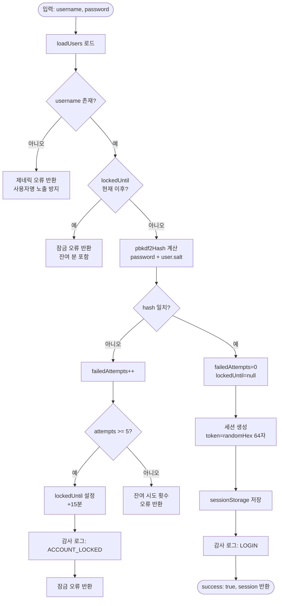
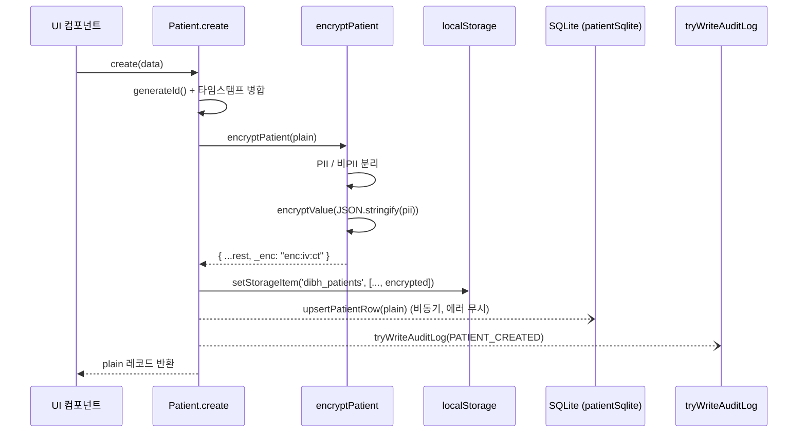
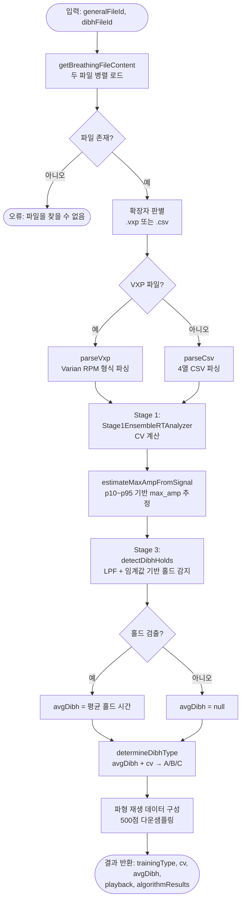
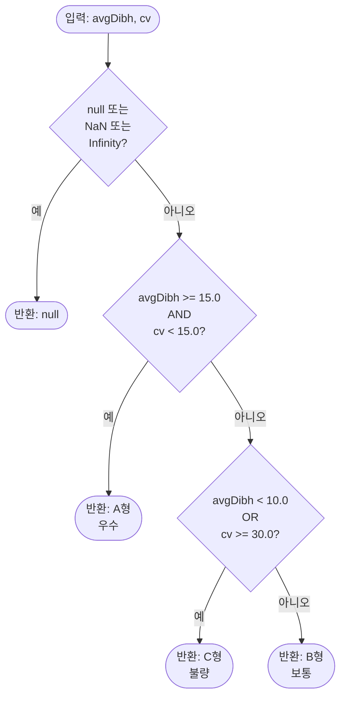
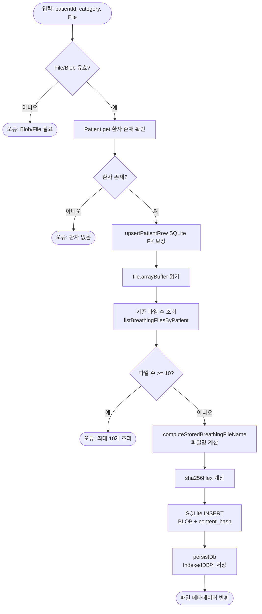
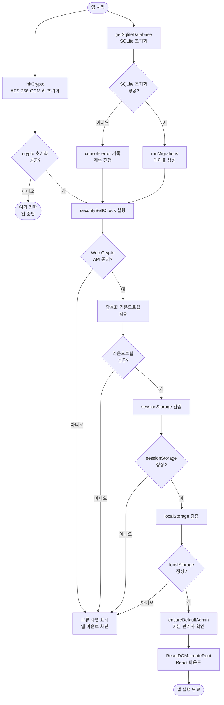
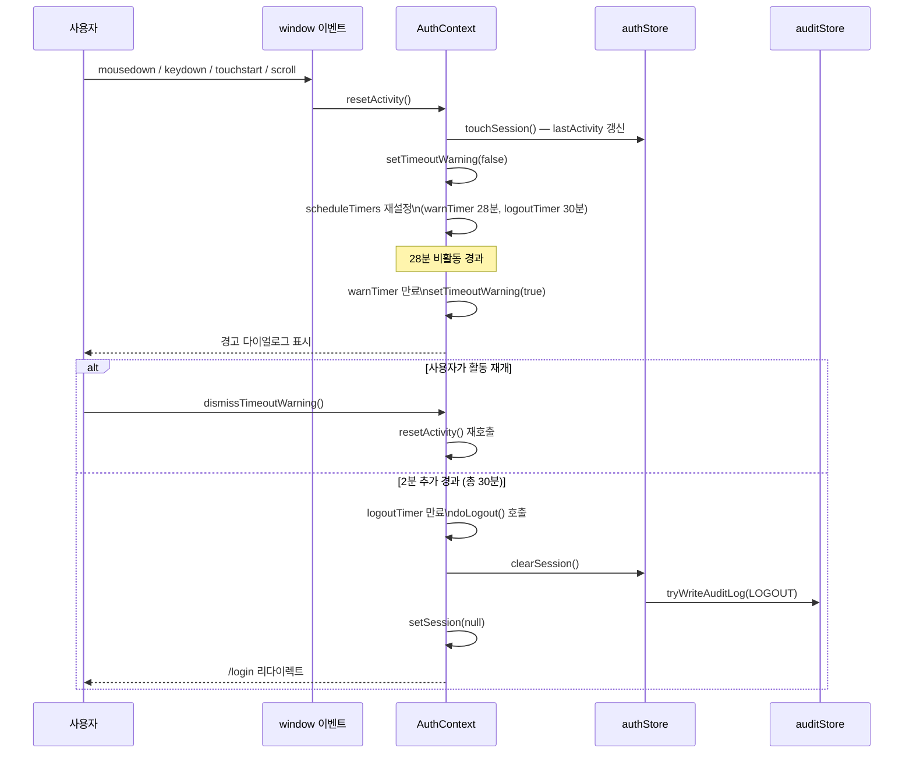

# 소프트웨어 설계 명세서 (유닛 수준)
## Software Design Specification — Unit Level

---

| 항목 | 내용 |
|------|------|
| 문서 번호 | P705-4 |
| 제품명 | DIBH 훈련 관리 시스템 |
| 모델명 | DIBH-TRAIN-01 |
| SW 명칭 | DIBH Training Manager |
| SW 식별자 | com.thepict.dibhtraining |
| 제조자 | 주식회사 더픽트 |
| SW 안전성 등급 | Class B (IEC 62304) |
| 작성일 | 2026년 6월 4일 |
| 버전 | 1.0 |
| 작성자 | 개발팀 |
| 승인자 | 품질보증팀 |

---

## 개정 이력

| 버전 | 일자 | 내용 | 작성자 |
|------|------|------|--------|
| 1.0 | 2026-06-04 | 최초 작성 | 개발팀 |

---

## 목차

1. [개요](#1-개요)
2. [SW 개요](#2-sw-개요)
3. [SW 구조](#3-sw-구조)
4. [아키텍처 설계](#4-아키텍처-설계)
5. [SW 모듈 설계](#5-sw-모듈-설계)
   - 5.1 [인증 유닛](#51-인증-유닛)
   - 5.2 [암호화 유닛](#52-암호화-유닛)
   - 5.3 [데이터 저장소 유닛](#53-데이터-저장소-유닛)
   - 5.4 [호흡 분석 유닛](#54-호흡-분석-유닛)
   - 5.5 [감사 로그 유닛](#55-감사-로그-유닛)
   - 5.6 [파일 저장소 유닛](#56-파일-저장소-유닛)
   - 5.7 [초기화 유닛](#57-초기화-유닛)
   - 5.8 [보안 컨텍스트 유닛](#58-보안-컨텍스트-유닛)

---

## 1. 개요

### 1.1 목적

본 문서는 IEC 62304 Class B 의료기기 소프트웨어 표준에 따라 DIBH 훈련 관리 시스템(DIBH Training Manager)의 유닛 수준 소프트웨어 설계를 명세화한다. 각 소프트웨어 유닛의 입출력, 처리 절차, 에러 처리, 요구사항 추적 정보를 포함한다.

### 1.2 범위

본 문서는 다음 소프트웨어 구성 요소를 포함한다.

- 인증 및 세션 관리 유닛
- 데이터 암호화 유닛
- 환자 및 임상 데이터 저장소 유닛
- 호흡 분석 파이프라인 유닛
- 감사 로그 유닛
- 파일 저장소 유닛
- 앱 초기화 및 자가점검 유닛
- 보안 컨텍스트 및 세션 타임아웃 유닛

### 1.3 식별

| 항목 | 내용 |
|------|------|
| 제품명 | DIBH 훈련 관리 시스템 |
| 모델명 | DIBH-TRAIN-01 |
| SW 명칭 | DIBH Training Manager |
| 패키지 ID | com.thepict.dibhtraining |
| SW 안전성 등급 | Class B |
| 플랫폼 | Android (Capacitor), 웹 브라우저 |
| 대상 OS | Android 10 이상 |

### 1.4 참조문서

| 문서 번호 | 문서명 |
|-----------|--------|
| IEC 62304:2006+AMD1:2015 | Medical device software — Software life cycle processes |
| IEC 62443-4-2 | Security for industrial automation and control systems |
| MFDS | 의료기기 사이버보안 허가심사 가이드라인 (식약처) |
| P705-1 | 소프트웨어 요구사항 명세서 |
| P705-2 | 소프트웨어 위험관리 보고서 |
| P705-3 | 소프트웨어 아키텍처 설계서 |
| P705-5 | 소프트웨어 통합 및 시스템 시험 계획서 |

---

## 2. SW 개요

### 2.1 SW 목적

DIBH(Deep Inspiration Breath Hold) 훈련 관리 시스템은 방사선 치료 시 필요한 DIBH 훈련 과정을 지원하는 의료기기 소프트웨어이다. 본 소프트웨어는 다음 기능을 수행한다.

- 환자 등록 및 개인정보 보호 관리
- 호흡 데이터 파일(CSV, VXP) 업로드 및 저장
- DIBH 보정 분석 실행 및 결과 도출
- DIBH 유형 판정 (A형: 우수, B형: 보통, C형: 불량)
- 훈련 이력 조회 및 보정 상태 관리
- 사용자 계정 및 감사 로그 관리

### 2.2 SW 사용자

| 사용자 유형 | 권한 | 주요 기능 |
|-------------|------|-----------|
| 임상의(clinician) | 일반 | 환자 등록, 파일 업로드, 분석 실행, 이력 조회 |
| 관리자(admin) | 전체 | 위 기능 + 계정 관리, 감사 로그 조회, 백업/복원 |

---

## 3. SW 구조

### 3.1 유저 인터페이스

사용자 인터페이스는 React 18 기반의 단일 페이지 응용 프로그램(SPA)으로 구현된다. 전체 UI는 한국어로 작성되며, 다크 테마(배경색 #0D1117, 테두리 #30363D, 텍스트 #C9D1D9)를 사용한다. Tailwind CSS를 활용하여 스타일을 적용하며, Radix UI 컴포넌트를 UI 기본 요소로 사용한다.

### 3.2 MMI (Man-Machine Interface)

| 화면 경로 | 화면명 | 접근 권한 |
|-----------|--------|-----------|
| /login | 로그인 | 공개 |
| /home | 환자 목록 | 인증 필요 |
| /newpatient | 환자 등록 | 인증 필요 |
| /patientdashboard | 환자 대시보드 | 인증 필요 |
| /breathingdataupload | 호흡 데이터 업로드 | 인증 필요 |
| /analysisfileselect | 분석 파일 선택 | 인증 필요 |
| /calibrationreport | 보정 보고서 | 인증 필요 |
| /traininghistory | 훈련 이력 | 인증 필요 |
| /typedecision | 유형 확정 | 인증 필요 |
| /admin/accounts | 계정 관리 | 관리자 전용 |
| /admin/auditlog | 감사 로그 | 관리자 전용 |
| /admin/backup | 백업/복원 | 관리자 전용 |

### 3.3 에러 핸들러

- 암호화/복호화 실패: 개별 레코드 수준에서 처리, 앱 중단 방지 (`_decryptionFailed` 플래그 설정)
- 저장소 쓰기 실패: `tryWriteAuditLog` 래퍼가 에러를 console.error로 기록하고 계속 진행
- 보안 자가점검 실패: 앱 마운트 차단, 사용자에게 오류 화면 표시
- 로그인 실패: 제네릭 오류 메시지 반환 (사용자명 존재 여부 노출 방지)
- SQLite 초기화 실패: 콘솔에 기록 후 앱 진행 (파일 저장 기능 비활성화)

### 3.4 운영환경 및 통신 인터페이스

| 항목 | 내용 |
|------|------|
| 운영환경 | Android 10 이상 (Capacitor) / 최신 브라우저 |
| 네트워크 | 완전 오프라인 동작 (백엔드 없음) |
| 저장소 | localStorage, sessionStorage, IndexedDB (SQLite WASM) |
| 외부 통신 | 없음 (의도적 격리) |
| 파일 형식 | CSV (4열: t, raw, filtered, dy), VXP (Varian RPM) |

### 3.5 개발도구 및 SOUP

| 구성요소 | 버전 | 용도 | 비고 |
|----------|------|------|------|
| React | 18.x | UI 프레임워크 | SOUP |
| Vite | 5.x | 빌드 도구 | 개발 도구 |
| Tailwind CSS | 3.x | 스타일링 | SOUP |
| Radix UI | 1.x | UI 컴포넌트 | SOUP |
| sql.js | 1.x | SQLite WASM | SOUP — 파일 저장 |
| date-fns | 3.x | 날짜 처리 | SOUP |
| react-query | 5.x | 서버 상태 관리 | SOUP |
| react-hook-form | 7.x | 폼 검증 | SOUP |
| zod | 3.x | 스키마 검증 | SOUP |
| recharts | 2.x | 파형 시각화 | SOUP |
| lucide-react | 0.x | 아이콘 | SOUP |
| sonner | 1.x | 토스트 알림 | SOUP |
| Capacitor | 6.x | Android 래퍼 | SOUP |

### 3.6 SW 성능

| 항목 | 기준값 |
|------|--------|
| 분석 파이프라인 실행 시간 | 10,000 샘플 기준 3초 이내 |
| UI 응답성 | 분석 중 2,000 샘플마다 이벤트 루프에 양보 |
| 파형 재생 최대 포인트 | 500점 (다운샘플링 적용) |
| 감사 로그 최대 항목 | 10,000건 (초과 시 오래된 항목 삭제) |
| 환자별 파일 한도 | 카테고리당 10개 |

### 3.7 암호화

| 알고리즘 | 용도 | 키 길이 |
|----------|------|---------|
| AES-256-GCM | 환자 PII 필드 암호화 | 256비트 |
| PBKDF2-SHA256 | 비밀번호 해싱 | 256비트 파생 키, 100,000회 반복 |
| SHA-256 | 파일 무결성 검증 | — |

---

## 4. 아키텍처 설계

### 4.1 SW 구성 레이어

본 소프트웨어는 다음 4개 레이어로 구성된다.

**1. 프레젠테이션 레이어 (Presentation Layer)**
React 컴포넌트 및 페이지 (`src/pages/`, `src/components/`). 사용자 인터랙션을 처리하고 React Query를 통해 데이터를 획득한다.

**2. 비즈니스 로직 레이어 (Business Logic Layer)**
호흡 분석 파이프라인 (`src/lib/calibration/`), 환자 코드 생성 (`src/lib/patientCode.js`), 비밀번호 정책 검증 (`src/lib/passwordUtils.js`).

**3. 데이터 접근 레이어 (Data Access Layer)**
localStorage 기반 CRUD (`src/api/localStore.js`), 인증 저장소 (`src/api/authStore.js`), 파일 저장소 (`src/api/breathingFileRepository.js`), 감사 로그 (`src/api/auditStore.js`).

**4. 인프라 레이어 (Infrastructure Layer)**
암호화 (`src/lib/crypto.js`), SQLite 데이터베이스 (`src/db/sqliteDb.js`), 보안 컨텍스트 (`src/context/AuthContext.jsx`).

### 4.2 레이어 구조 다이어그램

```
┌─────────────────────────────────────────────────────────┐
│             프레젠테이션 레이어                           │
│  Login  Home  PatientDashboard  BreathingDataUpload     │
│  AnalysisFileSelect  CalibrationReport  Admin*          │
└───────────────────────┬─────────────────────────────────┘
                        │ React Query
┌───────────────────────▼─────────────────────────────────┐
│             비즈니스 로직 레이어                          │
│  analyzeFiles  parseCsv  parseVxp  determineDibhType    │
│  Stage1EnsembleRTAnalyzer  detectDibhHolds              │
│  nextPatientCode  validatePassword                      │
└───────────────────────┬─────────────────────────────────┘
                        │
┌───────────────────────▼─────────────────────────────────┐
│             데이터 접근 레이어                            │
│  Patient  TrainingSession  Calibration  CalibrationSession│
│  loginUser  UserStore  writeAuditLog  createBreathingFile│
└───────────────────────┬─────────────────────────────────┘
                        │
┌───────────────────────▼─────────────────────────────────┐
│             인프라 레이어                                 │
│  initCrypto  encryptValue  decryptValue  sha256Hex      │
│  getSqliteDatabase  AuthContext  ProtectedRoute         │
│  localStorage  sessionStorage  IndexedDB                │
└─────────────────────────────────────────────────────────┘
```

---

## 5. SW 모듈 설계

---

## 5.1 인증 유닛

**소스 파일:** `src/api/authStore.js`

---

### 5.1.1 loginUser

#### 기능 설명

사용자 자격증명을 검증하고 세션을 생성한다. 사용자명 존재 여부를 노출하지 않는 제네릭 오류 메시지를 사용하며, 5회 연속 실패 시 계정을 15분간 잠근다. 로그인 이벤트 및 실패 이벤트를 감사 로그에 기록한다.

#### 입출력 테이블

| 방향 | 파라미터 | 타입 | 설명 |
|------|----------|------|------|
| 입력 | username | string | 사용자 아이디 |
| 입력 | password | string | 비밀번호 (평문) |
| 출력 | success | boolean | 로그인 성공 여부 |
| 출력 | session | object \| undefined | 세션 객체 (성공 시) |
| 출력 | error | string \| undefined | 오류 메시지 (실패 시) |
| 출력 | locked | boolean \| undefined | 계정 잠금 여부 |

**세션 객체 구조:**

| 필드 | 타입 | 설명 |
|------|------|------|
| token | string | 64자 hex 무작위 토큰 |
| userId | string | 사용자 ID |
| username | string | 사용자 아이디 |
| displayName | string | 표시 이름 |
| role | string | 'admin' \| 'clinician' |
| mustChangePassword | boolean | 비밀번호 변경 강제 여부 |
| loginTime | string | ISO 8601 로그인 시각 |
| lastActivity | string | ISO 8601 마지막 활동 시각 |

#### 처리 절차

1. `loadUsers()`로 localStorage `dibh_users` 배열 로드
2. `username`으로 사용자 검색; 미존재 시 제네릭 오류(`GENERIC_ERROR`) 반환 (IA-06: 사용자명 존재 노출 금지)
3. `user.lockedUntil` 확인: 현재 시각 이전이면 잠금 해제, 이후이면 잔여 분 포함 잠금 오류 반환
4. `pbkdf2Hash(password, user.salt)` 호출하여 해시 계산
5. `hash !== user.passwordHash`인 경우:
   - `failedAttempts` 증가
   - `failedAttempts >= 5`이면 `lockedUntil = now + 15분` 설정, `failedAttempts = 0`
   - `saveUsers()` 호출
   - 감사 로그에 `LOGIN_FAILED` 또는 `ACCOUNT_LOCKED` 기록 (비동기 lazy import)
   - 적절한 오류 반환
6. 해시 일치 시:
   - `failedAttempts = 0`, `lockedUntil = null` 초기화
   - `saveUsers()` 호출
   - 64바이트 무작위 토큰 생성 (`randomHex(32)`)
   - 세션 객체 구성 후 `sessionStorage.setItem(SESSION_KEY, JSON.stringify(session))` 저장
   - 감사 로그에 `LOGIN` 기록 (비동기 lazy import)
   - `{ success: true, session }` 반환

#### 에러 처리

| 오류 조건 | 처리 방식 |
|-----------|-----------|
| 사용자명 미존재 | 제네릭 오류 반환 (사용자명 노출 방지) |
| 계정 잠금 중 | 잔여 분 포함 잠금 메시지 반환 |
| 비밀번호 불일치 | 잔여 시도 횟수 포함 오류, 5회 초과 시 잠금 |
| localStorage 접근 불가 | 예외 전파 (상위에서 처리) |

#### 관련 요구사항

| Req ID | 내용 |
|--------|------|
| IA-01 | 사용자 인증 요구 |
| IA-06 | 사용자명 존재 여부 노출 금지 |
| IA-07 | 연속 실패 시 계정 잠금 |
| UC-04 | 인증 이벤트 감사 로그 기록 |

#### loginUser 처리 흐름 다이어그램



---

### 5.1.2 pbkdf2Hash

#### 기능 설명

비밀번호를 PBKDF2-SHA256 알고리즘으로 해싱한다. WebCrypto API를 사용하며 100,000회 반복으로 브루트포스 공격에 대한 저항성을 확보한다.

#### 입출력 테이블

| 방향 | 파라미터 | 타입 | 설명 |
|------|----------|------|------|
| 입력 | password | string | 평문 비밀번호 |
| 입력 | salt | string | 16바이트 hex 솔트 |
| 출력 | (반환값) | string | 64자 hex 해시 |

#### 처리 절차

1. `TextEncoder().encode(password)`로 비밀번호를 Uint8Array로 변환
2. `crypto.subtle.importKey('raw', encodedPw, 'PBKDF2', false, ['deriveBits'])` 호출
3. `crypto.subtle.deriveBits({ name: 'PBKDF2', salt: encode(salt), iterations: 100_000, hash: 'SHA-256' }, key, 256)` 호출
4. 결과 256비트를 `hexEncode()`로 64자 hex 문자열로 변환하여 반환

#### 에러 처리

| 오류 조건 | 처리 방식 |
|-----------|-----------|
| WebCrypto API 미지원 | 앱 시작 자가점검에서 사전 차단 |
| deriveBits 실패 | 예외 전파 |

#### 관련 요구사항

| Req ID | 내용 |
|--------|------|
| IA-05 | 비밀번호 안전 저장 (PBKDF2) |
| DC-02 | 비밀번호 해싱 알고리즘 |

---

### 5.1.3 세션 관리 (getSession / touchSession / clearSession)

#### 기능 설명

`getSession()`은 현재 sessionStorage에서 세션 객체를 읽어 반환한다. `touchSession()`은 `lastActivity` 타임스탬프를 갱신하여 타임아웃 기산점을 재설정한다. `clearSession()`은 세션을 삭제하고 `LOGOUT` 감사 로그를 기록한다.

#### 입출력 테이블

| 함수 | 입력 | 출력 |
|------|------|------|
| getSession() | 없음 | 세션 객체 또는 null |
| touchSession() | 없음 | 없음 (부수효과: lastActivity 갱신) |
| clearSession() | 없음 | 없음 (부수효과: 세션 삭제, 감사 로그) |

#### 처리 절차 (clearSession)

1. `getSession()`으로 현재 세션 획득
2. `sessionStorage.removeItem(SESSION_KEY)` 실행
3. 세션이 존재했다면 `LOGOUT` 감사 로그 기록 (lazy import)

#### 관련 요구사항

| Req ID | 내용 |
|--------|------|
| IA-03 | 세션 보안 (탭 종료 시 자동 삭제) |
| UC-04 | 로그아웃 감사 로그 기록 |

---

### 5.1.4 UserStore

#### 기능 설명

사용자 계정 CRUD 및 관리 기능을 제공하는 관리자 전용 인터페이스이다.

#### 제공 메서드

| 메서드 | 설명 |
|--------|------|
| `UserStore.list()` | 전체 사용자 목록 반환 (passwordHash, salt 필드 제외) |
| `UserStore.create({ username, displayName, password, role })` | 신규 계정 생성, PBKDF2 해싱, mustChangePassword=true |
| `UserStore.changePassword(userId, newPassword)` | 비밀번호 변경, 솔트 재생성, mustChangePassword=false |
| `UserStore.resetPassword(userId, newPassword)` | 관리자가 비밀번호 초기화, mustChangePassword=true |
| `UserStore.unlock(userId)` | 잠금 해제 (failedAttempts=0, lockedUntil=null) |
| `UserStore.setRole(userId, role)` | 역할 변경 |
| `UserStore.delete(userId)` | 계정 삭제 (마지막 계정 삭제 불가) |

#### 에러 처리

| 오류 조건 | 처리 방식 |
|-----------|-----------|
| 중복 사용자명 | '이미 존재하는 아이디입니다.' 예외 |
| 사용자 미존재 | '사용자를 찾을 수 없습니다.' 예외 |
| 마지막 계정 삭제 시도 | '마지막 계정은 삭제할 수 없습니다.' 예외 |

#### 관련 요구사항

| Req ID | 내용 |
|--------|------|
| IA-01 | 사용자 계정 관리 |
| IA-04 | 역할 기반 접근 제어 |
| IA-05 | 비밀번호 정책 강제 |

---

## 5.2 암호화 유닛

**소스 파일:** `src/lib/crypto.js`

---

### 5.2.1 initCrypto

#### 기능 설명

앱 시작 시 단 한 번 호출되어 AES-256-GCM 설치 키를 초기화한다. localStorage에서 기존 키를 읽거나, 없으면 새 256비트 무작위 키를 생성하여 저장한다. 임포트된 CryptoKey는 모듈 스코프 `_key` 변수에 캐시되어 이후 암호화/복호화 작업에 재사용된다.

#### 입출력 테이블

| 방향 | 파라미터 | 타입 | 설명 |
|------|----------|------|------|
| 입력 | 없음 | — | — |
| 출력 | 없음 | — | 부수효과: `_key` 전역 캐시 설정 |

#### 처리 절차

1. `_key` 이미 설정되어 있으면 즉시 반환 (중복 초기화 방지)
2. `localStorage.getItem('dibh_install_key')` 로 기존 키 hex 문자열 읽기
3. 키가 없는 경우:
   - `new Uint8Array(32)` 생성
   - `crypto.getRandomValues(raw)` 로 32바이트 무작위 값 채우기
   - `hexEncode(raw.buffer)` 후 `localStorage.setItem('dibh_install_key', keyHex)` 저장
4. `hexDecode(keyHex)` 로 키 바이트 배열 복원
5. `crypto.subtle.importKey('raw', keyBytes, { name: 'AES-GCM' }, false, ['encrypt', 'decrypt'])` 호출
6. 결과 CryptoKey를 모듈 스코프 `_key` 변수에 저장

#### 에러 처리

| 오류 조건 | 처리 방식 |
|-----------|-----------|
| Web Crypto API 미지원 | 앱 자가점검에서 사전 차단 |
| importKey 실패 | 예외 전파 → main.jsx에서 앱 마운트 차단 |

#### 관련 요구사항

| Req ID | 내용 |
|--------|------|
| DC-01 | AES-256-GCM 암호화 키 초기화 |
| DC-03 | 설치별 고유 키 생성 |
| SI-01 | 앱 시작 시 보안 초기화 |

---

### 5.2.2 encryptValue / decryptValue

#### 기능 설명

`encryptValue()`는 평문 문자열을 AES-256-GCM으로 암호화하여 `enc:<24자 ivHex>:<ciphertextHex>` 형식의 문자열을 반환한다. `decryptValue()`는 이 형식의 암호문을 복호화하며, `enc:` 접두사가 없으면 레거시 평문으로 간주하여 그대로 반환한다.

#### 입출력 테이블 (encryptValue)

| 방향 | 파라미터 | 타입 | 설명 |
|------|----------|------|------|
| 입력 | plaintext | string | 암호화할 평문 |
| 출력 | (반환값) | string | `enc:<ivHex>:<ctHex>` 형식 |

#### 입출력 테이블 (decryptValue)

| 방향 | 파라미터 | 타입 | 설명 |
|------|----------|------|------|
| 입력 | value | string | 암호문 또는 레거시 평문 |
| 출력 | (반환값) | string | 복호화된 평문 |

#### 처리 절차 (encryptValue)

1. `_key` 미초기화 시 예외 발생
2. `new Uint8Array(12)` 생성 후 `crypto.getRandomValues(iv)` 로 12바이트 무작위 IV 생성
3. `new TextEncoder().encode(plaintext)` 로 UTF-8 인코딩
4. `crypto.subtle.encrypt({ name: 'AES-GCM', iv }, _key, encodedText)` 호출
5. `enc:${hexEncode(iv.buffer)}:${hexEncode(ciphertext)}` 형식으로 반환

#### 처리 절차 (decryptValue)

1. 입력값이 falsy이면 그대로 반환
2. `String(value).trim()` 으로 공백 정규화
3. `enc:` 접두사 확인: 없으면 레거시 평문으로 반환
4. `_key` 미초기화 시 예외 발생
5. 위치 기반 파싱: `ivHex = trimmed.slice(4, 28)` (24자), `ciphertextHex = trimmed.slice(29)`
6. IV hex 길이 및 암호문 유효성 검증
7. `crypto.subtle.decrypt({ name: 'AES-GCM', iv: hexDecode(ivHex) }, _key, hexDecode(ciphertextHex))` 호출
8. `new TextDecoder().decode(plaintext)` 로 UTF-8 문자열 반환

#### 에러 처리

| 오류 조건 | 처리 방식 |
|-----------|-----------|
| _key 미초기화 | '[crypto] Not initialised' 예외 |
| 잘못된 암호문 형식 | '[crypto] Malformed encrypted value' 예외 |
| 복호화 실패 (키 불일치 등) | 예외 전파 (상위에서 처리) |

#### 관련 요구사항

| Req ID | 내용 |
|--------|------|
| DC-01 | AES-256-GCM 암호화 |
| DC-04 | 레거시 레코드 투명 처리 |

#### 암호화 라운드트립 다이어그램


---

### 5.2.3 encryptPatient / decryptPatient

#### 기능 설명

`encryptPatient()`는 환자 레코드에서 PII 필드(`name`, `birth_date`, `assigned_doctor_name`)를 분리하여 JSON 직렬화 후 `encryptValue()`로 암호화하고 `_enc` 필드로 저장한다. 비PII 필드는 평문으로 유지하여 필터링/정렬 성능을 확보한다. `decryptPatient()`는 `_enc` 필드를 복호화하여 PII를 복원하며, `_enc` 필드가 없는 레거시 레코드는 그대로 반환한다.

#### 입출력 테이블 (encryptPatient)

| 방향 | 파라미터 | 타입 | 설명 |
|------|----------|------|------|
| 입력 | data | object | 환자 레코드 (PII 포함 평문) |
| 출력 | (반환값) | object | `_enc` 포함, PII 필드 제거된 레코드 |

#### 입출력 테이블 (decryptPatient)

| 방향 | 파라미터 | 타입 | 설명 |
|------|----------|------|------|
| 입력 | raw | object | localStorage 저장 레코드 |
| 출력 | (반환값) | object | PII 복원된 평문 레코드 |

#### PII 필드 목록

| 필드명 | 설명 |
|--------|------|
| name | 환자 이름 |
| birth_date | 생년월일 |
| assigned_doctor_name | 담당 의사 이름 |

#### 처리 절차 (encryptPatient)

1. 입력 레코드를 PII 필드와 비PII 필드로 분리
2. PII 객체를 `JSON.stringify(pii)` 직렬화
3. `encryptValue(JSON.stringify(pii))` 호출하여 암호문 생성
4. 비PII `rest` 객체에 `_enc: 암호문` 추가 후 반환

#### 처리 절차 (decryptPatient)

1. `raw` 가 falsy이면 그대로 반환
2. `raw._enc` 없으면 레거시 레코드로 판단하여 그대로 반환
3. `decryptValue(raw._enc)` 호출
4. `JSON.parse(piiJson)` 으로 PII 객체 복원
5. `{ ...rest, ...pii }` 병합하여 반환 (`_enc` 필드 제거)
6. 복호화 실패 시 (catch):
   - console.warn 기록
   - `{ ...rest, name: '[복호화 실패]', birth_date: '', assigned_doctor_name: '', _decryptionFailed: true }` 반환

#### 에러 처리

| 오류 조건 | 처리 방식 |
|-----------|-----------|
| 복호화 실패 (설치 키 변경 등) | 플레이스홀더 PII 반환, 앱 중단 방지 |
| JSON 파싱 실패 | catch 블록에서 플레이스홀더 반환 |

#### 관련 요구사항

| Req ID | 내용 |
|--------|------|
| DC-01 | 환자 PII 암호화 |
| DC-04 | 레거시 레코드 하위 호환 |
| SI-02 | 복호화 실패 시 앱 안정성 유지 |

---

### 5.2.4 sha256Hex

#### 기능 설명

ArrayBuffer의 SHA-256 해시를 hex 문자열로 반환한다. 파일 업로드 시 무결성 해시를 계산하고, 파일 로드 시 재계산하여 저장 후 변조 여부를 검증하는 데 사용된다.

#### 입출력 테이블

| 방향 | 파라미터 | 타입 | 설명 |
|------|----------|------|------|
| 입력 | buffer | ArrayBuffer | 해시를 계산할 데이터 |
| 출력 | (반환값) | string | 64자 hex SHA-256 해시 |

#### 처리 절차

1. `crypto.subtle.digest('SHA-256', buffer)` 호출
2. `hexEncode(digest)` 로 64자 hex 문자열 변환 후 반환

#### 관련 요구사항

| Req ID | 내용 |
|--------|------|
| SI-04 | 파일 무결성 검증 (SHA-256) |

---

## 5.3 데이터 저장소 유닛

**소스 파일:** `src/api/localStore.js`

---

### 5.3.1 Patient CRUD

#### 기능 설명

환자 레코드의 생성, 조회, 수정, 삭제 기능을 제공한다. 모든 쓰기 작업은 AES-256-GCM으로 PII를 암호화하여 저장하고, SQLite `patients` 테이블에 미러링하며, 감사 로그에 기록한다.

#### Patient 엔티티 스키마

| 필드 | 타입 | 암호화 | 설명 |
|------|------|--------|------|
| id | string | 아니오 | `{Date.now()}-{random36}` 형식 ID |
| patient_code | string | 아니오 | `PT-YYYY-NNN` 형식 (정렬/필터 용도) |
| name | string | 예 (_enc) | 환자 이름 |
| birth_date | string | 예 (_enc) | 생년월일 |
| assigned_doctor_name | string | 예 (_enc) | 담당 의사 이름 |
| training_type | string | 아니오 | 최종 DIBH 유형 (A/B/C) |
| calibration_status | string | 아니오 | 보정 상태 |
| last_calibration_date | string | 아니오 | 마지막 보정 날짜 |
| calibration_count | number | 아니오 | 보정 횟수 |
| created_at | string | 아니오 | ISO 8601 생성 시각 |
| updated_at | string | 아니오 | ISO 8601 수정 시각 |

#### Patient.create 처리 절차

1. `generateId()` 로 고유 ID 생성 (`${Date.now()}-${Math.random().toString(36).substr(2, 9)}`)
2. 입력 `data`에 `id`, `created_at`, `updated_at` 병합하여 `plain` 객체 구성
3. `encryptPatient(plain)` 호출하여 PII 암호화
4. `getStorageItem('dibh_patients')` 로 기존 배열 로드
5. 암호화된 레코드를 배열에 push
6. `setStorageItem('dibh_patients', patients)` 저장
7. `upsertPatientRow(plain)` 로 SQLite 미러링 (비동기, 에러 무시)
8. `tryWriteAuditLog({ action: PATIENT_CREATED, targetType: 'patient', targetId: plain.id, detail: plain.patient_code })` 기록
9. 평문 `plain` 반환

#### Patient.update 처리 절차

1. localStorage에서 대상 레코드 검색
2. `decryptPatient(patients[index])` 로 기존 레코드 복호화
3. `{ ...existing, ...data, updated_at: now }` 병합
4. `encryptPatient(merged)` 로 재암호화
5. `patients[index]` 업데이트 후 `setStorageItem` 저장
6. `upsertPatientRow(merged)` SQLite 미러링
7. `tryWriteAuditLog(PATIENT_UPDATED)` 기록
8. 평문 `merged` 반환

#### Patient.list 처리 절차

1. `getStorageItem('dibh_patients')` 로 전체 로드
2. `Promise.all(raw.map(decryptPatient))` 로 전체 복호화
3. `sortBy` 지정 시 필드 기준 정렬 후 반환

#### Patient.filter 처리 절차

1. PII 필터(`name`, `birth_date`, `assigned_doctor_name`)와 비PII 필터 분리
2. 비PII 필터를 복호화 전에 먼저 적용 (성능 최적화)
3. 필터링된 레코드만 `Promise.all(...decryptPatient)` 복호화
4. PII 필터 적용 후 반환

#### Patient.create 시퀀스 다이어그램



#### 에러 처리

| 오류 조건 | 처리 방식 |
|-----------|-----------|
| Patient 미존재 (update/delete) | `Error: Patient with id ${id} not found` 예외 |
| localStorage 쓰기 실패 | console.error 기록 |
| SQLite 미러링 실패 | 비동기 무시 (localStorage가 primary) |

#### 관련 요구사항

| Req ID | 내용 |
|--------|------|
| DM-01 | 환자 데이터 CRUD |
| DC-01 | PII 암호화 저장 |
| UC-04 | 환자 데이터 변경 감사 로그 |

---

### 5.3.2 TrainingSession

#### 기능 설명

훈련 세션 레코드의 CRUD를 제공한다. 암호화는 적용하지 않으며 localStorage `dibh_training_sessions` 배열에 저장한다.

#### TrainingSession 엔티티 스키마

| 필드 | 타입 | 설명 |
|------|------|------|
| id | string | 고유 ID |
| patient_id | string | 환자 ID (FK) |
| session_date | string | 세션 날짜 (YYYY-MM-DD) |
| training_type | string | DIBH 유형 |
| notes | string | 메모 |
| created_at | string | ISO 8601 |
| updated_at | string | ISO 8601 |

#### 관련 요구사항

| Req ID | 내용 |
|--------|------|
| DM-02 | 훈련 세션 기록 관리 |

---

### 5.3.3 Calibration

#### 기능 설명

보정 분석 결과 레코드의 CRUD를 제공한다. localStorage `dibh_calibrations` 배열에 저장한다.

#### Calibration 엔티티 스키마

| 필드 | 타입 | 설명 |
|------|------|------|
| id | string | 고유 ID |
| patient_id | string | 환자 ID (FK) |
| calibration_date | string | 보정 날짜 |
| training_type | string | DIBH 유형 (A/B/C) |
| dibh_duration | number | 평균 DIBH 시간 (초) |
| cv | number | CV 값 (%) |
| algorithm_results | object | 알고리즘 상세 결과 |
| stage_data | object | 단계별 데이터 |
| created_at | string | ISO 8601 |
| updated_at | string | ISO 8601 |

#### 관련 요구사항

| Req ID | 내용 |
|--------|------|
| DM-03 | 보정 결과 저장 |
| AN-05 | 보정 이력 조회 |

---

### 5.3.4 CalibrationSession

#### 기능 설명

진행 중인 보정 세션의 임시 데이터를 관리한다. `CalibrationSession.complete()` 메서드는 세션 결과를 `Calibration` 레코드로 확정하고 환자 레코드를 업데이트한다.

#### CalibrationSession.complete 처리 절차

1. `CalibrationSession.get(sessionId)` 로 세션 획득
2. `Calibration.create({ patient_id, calibration_date, training_type, dibh_duration, cv, algorithm_results, ... })` 생성
3. `Patient.get(session.patient_id)` 로 환자 조회
4. `Patient.update(patient_id, { training_type, last_calibration_date, calibration_count+1, sessions_since_calibration: 0, calibration_status: 'valid' })` 업데이트
5. `CalibrationSession.delete(sessionId)` 임시 세션 삭제
6. 생성된 `Calibration` 레코드 반환

#### 관련 요구사항

| Req ID | 내용 |
|--------|------|
| DM-04 | 보정 세션 완료 처리 |
| AN-06 | 환자 보정 상태 업데이트 |

---

## 5.4 호흡 분석 유닛

**소스 파일:** `src/lib/calibration/analyzeFiles.js`, `determineDibhType.js`, `stage1Analyzer.js`, `stage3Detector.js`

---

### 5.4.1 analyzeFiles

#### 기능 설명

일반호흡 파일과 DIBH 파일의 ID를 입력받아 전체 분석 파이프라인을 실행하고 DIBH 유형, CV, 평균 DIBH 시간, 파형 재생 데이터를 반환한다. Stage 1 (CV 계산), Stage 2 대체 (max_amp 추정), Stage 3 (DIBH 홀드 감지) 순서로 처리한다.

#### 입출력 테이블

| 방향 | 파라미터 | 타입 | 설명 |
|------|----------|------|------|
| 입력 | generalFileId | string | 일반호흡 파일 ID (SQLite) |
| 입력 | dibhFileId | string | DIBH 파일 ID (SQLite) |
| 입력 | options.signal | AbortSignal? | 취소 신호 |
| 출력 | trainingType | 'A'\|'B'\|'C' | DIBH 유형 |
| 출력 | cv | number\|null | CV 값 (%) — 소수점 1자리 |
| 출력 | avgDibh | number\|null | 평균 DIBH 시간 (초) — 소수점 1자리 |
| 출력 | source | string | 'file_analysis' 고정 |
| 출력 | playback | object | 파형 재생 데이터 |
| 출력 | algorithmResults | object | Stage 1/2/3 상세 결과 |

#### 처리 절차

1. `Promise.all([getBreathingFileContent(generalFileId), getBreathingFileContent(dibhFileId)])` 로 병렬 파일 로드
2. 파일 미존재 시 해당 오류 메시지 예외 발생
3. `parseBreathingFile(generalFile.arrayBuffer, generalFile.original_name)` 호출 — 확장자에 따라 `parseCsv()` 또는 `parseVxp()` 디스패치
4. `parseBreathingFile(dibhFile.arrayBuffer, dibhFile.original_name)` 동일 처리
5. 파싱 결과가 빈 배열이면 예외 발생
6. **Stage 1:** `new Stage1EnsembleRTAnalyzer()` 인스턴스 생성, `s1.start(generalSamples[0].t)` 호출, 2,000 샘플마다 `yieldToUI()` 하며 전체 샘플에 `s1.update(t, raw)` 실행, `s1.stop()`, `s1.get_cv()` 및 `s1.cycles` 획득
7. **Stage 2 대체:** `estimateMaxAmpFromSignal(dibhSamples)` 호출 — dibh 신호의 p10~p95 범위로 max_amp 추정
8. **Stage 3:** `detectDibhHolds(dibhSamples, maxAmp, { signal })` 호출 — LPF 적용, 홀드 임계값(baseline + 0.80 * maxAmp) 초과 구간 수집, 3초 이상 유지된 구간만 유효 홀드로 등록
9. `avgDibh = holds.length > 0 ? sum(durations) / holds.length : null`
10. `determineDibhType(avgDibh ?? 0, cv ?? 0)` 호출, 결과가 null이면 'B' 기본값
11. 파형 재생 데이터 구성 (500점 다운샘플링 적용)
12. 최종 결과 객체 반환

#### 에러 처리

| 오류 조건 | 처리 방식 |
|-----------|-----------|
| 파일 미존재 | '일반호흡/DIBH 파일을 찾을 수 없습니다.' 예외 |
| 유효 데이터 없음 | '유효한 데이터가 없습니다.' 예외 |
| 분석 취소 (AbortSignal) | `DOMException('Analysis cancelled', 'AbortError')` |
| SHA-256 불일치 | '파일 무결성 오류' 예외 전파 |

#### 관련 요구사항

| Req ID | 내용 |
|--------|------|
| AN-01 | 호흡 분석 파이프라인 실행 |
| AN-02 | Stage 1 CV 계산 |
| AN-03 | Stage 3 DIBH 홀드 감지 |
| AN-04 | DIBH 유형 판정 |
| UC-04 | 분석 실행 감사 로그 |

#### analyzeFiles 처리 흐름 다이어그램



---

### 5.4.2 parseCsv

#### 기능 설명

4열 CSV 형식(`t, raw, [filtered], [dy]`)의 ArrayBuffer를 파싱하여 샘플 배열을 반환한다. 2열 미만이거나 수치가 아닌 행은 건너뛴다. 헤더 행은 파싱 시 비수치값으로 자동 제거된다.

#### 입출력 테이블

| 방향 | 파라미터 | 타입 | 설명 |
|------|----------|------|------|
| 입력 | arrayBuffer | ArrayBuffer | CSV 파일 바이너리 |
| 출력 | (반환값) | Array<{t, raw, filtered?, dy?}> | 샘플 배열 |

#### 처리 절차

1. `new TextDecoder().decode(arrayBuffer)` 로 UTF-8 텍스트 변환
2. `text.split(/\r?\n/)` 으로 줄 단위 분할
3. 각 줄:
   - 빈 줄 건너뜀
   - `trimmed.split(',')` 으로 컬럼 분리
   - 컬럼 수 < 2 이면 건너뜀
   - `parseFloat(cols[0])` → `t`, `parseFloat(cols[1])` → `raw`
   - `Number.isFinite(t)` 또는 `Number.isFinite(raw)` 아니면 건너뜀
   - `cols[2]` 존재하고 유한수이면 `filtered` 추가
   - `cols[3]` 존재하고 유한수이면 `dy` 추가
   - `entry` 객체를 `samples` 배열에 추가
4. `samples` 반환

#### 에러 처리

| 오류 조건 | 처리 방식 |
|-----------|-----------|
| 비수치 데이터 행 | 건너뜀 (유효 데이터만 수집) |
| 컬럼 부족 행 | 건너뜀 |
| 전체 결과 빈 배열 | 호출자 `analyzeFiles`에서 예외 발생 |

#### 관련 요구사항

| Req ID | 내용 |
|--------|------|
| AN-07 | CSV 파일 파싱 |
| AN-08 | 비정상 데이터 행 처리 |

---

### 5.4.3 parseVxp

#### 기능 설명

Varian RPM 시스템의 VXP 파일을 파싱하여 CSV와 동일한 형태의 샘플 배열을 반환한다. `[Header]` 섹션에서 `Data_layout`으로 컬럼 순서를 파악하고 `[Data]` 섹션부터 데이터를 읽는다. 타임스탬프는 밀리초 단위이므로 1,000으로 나눠 초로 변환한다.

#### 입출력 테이블

| 방향 | 파라미터 | 타입 | 설명 |
|------|----------|------|------|
| 입력 | arrayBuffer | ArrayBuffer | VXP 파일 바이너리 |
| 출력 | (반환값) | Array<{t, raw}> | 샘플 배열 |

#### 처리 절차

1. `TextDecoder` 로 UTF-8 변환 후 줄 단위 분할
2. `[Header]` 섹션: `Data_layout=` 줄에서 컬럼 인덱스 파악 (`amplitude`, `timestamp`)
3. `[Data]` 섹션 진입 후 데이터 파싱:
   - `cols.split(',')` 분리
   - `raw = parseFloat(cols[ampIdx])`
   - `t = parseFloat(cols[tsIdx]) / 1000.0`
   - 유한수가 아니면 건너뜀
4. `[Data]` 섹션 미발견 시 예외 발생

#### 에러 처리

| 오류 조건 | 처리 방식 |
|-----------|-----------|
| [Data] 섹션 없음 | 'VXP 파일에서 [Data] 섹션을 찾을 수 없습니다.' 예외 |
| 비수치 데이터 | 건너뜀 |

#### 관련 요구사항

| Req ID | 내용 |
|--------|------|
| AN-09 | VXP 파일 파싱 |

---

### 5.4.4 Stage1EnsembleRTAnalyzer

#### 기능 설명

Python `dibh_calibration.py`의 `Stage1EnsembleRTAnalyzer`를 JavaScript로 이식한 구현체이다. 일반호흡 신호에서 IIR 저역통과 필터를 적용하여 호흡 주기를 검출하고, 진폭의 변동계수(CV)를 계산한다. TPT(Trough-Peak-Trough) 사이클 구조를 사용한다.

#### 주요 메서드

| 메서드 | 설명 |
|--------|------|
| `start(t0)` | 분석 시작, 기산 시각 설정 |
| `update(t, raw)` | 새 샘플 추가, IIR LPF 적용, 주기 검출 |
| `stop()` | 분석 종료, 마지막 주기 마감 |
| `get_cv()` | 진폭 CV 반환 (%) |
| `get_cv_period()` | 주기 CV 반환 (%) |

#### 주요 설정 파라미터

| 파라미터 | 기본값 | 설명 |
|----------|--------|------|
| calib_sec | 20.0 | 보정 구간 (초) |
| y_fc_hz | 1.1 | 신호 LPF 차단 주파수 |
| dy_fc_hz | 1.0 | 미분 LPF 차단 주파수 |
| min_cycle_s | 1.0 | 최소 주기 (초) |
| max_cycle_s | 10.0 | 최대 주기 (초) |

#### 관련 요구사항

| Req ID | 내용 |
|--------|------|
| AN-02 | CV 계산 알고리즘 |
| AN-10 | 호흡 주기 검출 |

---

### 5.4.5 detectDibhHolds (Stage 3 스캔 기반)

#### 기능 설명

녹화된 DIBH 신호에서 유효한 DIBH 홀드 구간을 감지한다. 실시간 `Stage3Detector`와 달리 사전 녹화 파일 전체를 스캔하여 신호 구조 가정 없이 3초 이상의 임계값 초과 구간을 수집한다. 히스테리시스를 적용하여 노이즈에 의한 오감지를 방지한다.

#### 입출력 테이블

| 방향 | 파라미터 | 타입 | 설명 |
|------|----------|------|------|
| 입력 | samples | Array<{t, raw}> | DIBH 신호 샘플 배열 |
| 입력 | maxAmp | number | 추정 최대 진폭 |
| 입력 | options.signal | AbortSignal? | 취소 신호 |
| 출력 | holds | Array | 유효 홀드 목록 |
| 출력 | chartData | Array | 파형 데이터 (LPF 적용) |
| 출력 | baseline | number | 기저선 (p10) |
| 출력 | holdTh | number | 홀드 진입 임계값 |
| 출력 | releaseTh | number | 홀드 해제 임계값 |

#### 처리 절차

1. `sorted = [...samples.raw].sort()` 정렬
2. `baseline = sorted[floor(n * 0.10)]` (p10)
3. `holdTh = baseline + 0.80 * maxAmp`
4. `releaseTh = baseline + 0.50 * maxAmp`
5. `OnePoleLPF(1.2)` 인스턴스 생성
6. 각 샘플:
   - `y_f = lpf.update(t, raw)`
   - `chartData.push({ time: t, value: y_f })`
   - `holdStart === null && y_f >= holdTh` → `holdStart = t`
   - `holdStart !== null && y_f < releaseTh` → 홀드 종료, `duration >= 3.0` 이면 `holds.push(...)`
   - 2,000 샘플마다 `yieldToUI()` 호출
7. 파일 종료 시 열린 홀드 처리

#### 에러 처리

| 오류 조건 | 처리 방식 |
|-----------|-----------|
| 샘플 수 < 10 | fallback maxAmp = 1.0 |
| AbortSignal 수신 | `DOMException('Analysis cancelled', 'AbortError')` |

#### 관련 요구사항

| Req ID | 내용 |
|--------|------|
| AN-03 | DIBH 홀드 감지 |
| AN-11 | 히스테리시스 임계값 적용 |

---

### 5.4.6 determineDibhType

#### 기능 설명

평균 DIBH 시간(`avgDibh`)과 CV 값(`cv`)을 입력받아 DIBH 훈련 유형을 A, B, C 중 하나로 분류한다. Python `dibh_calibration.py`에서 이식된 분류 로직을 그대로 사용한다.

#### 입출력 테이블

| 방향 | 파라미터 | 타입 | 설명 |
|------|----------|------|------|
| 입력 | avgDibh | number\|null | 평균 DIBH 홀드 시간 (초) |
| 입력 | cv | number\|null | CV 값 (%) |
| 출력 | (반환값) | 'A'\|'B'\|'C'\|null | DIBH 유형 |

#### 처리 절차

1. `avgDibh == null` 또는 `cv == null` 또는 `!isFinite(avgDibh)` 또는 `!isFinite(cv)` → `null` 반환
2. `avgDibh >= 15.0 AND cv < 15.0` → `'A'` 반환
3. `avgDibh < 10.0 OR cv >= 30.0` → `'C'` 반환
4. 그 외 → `'B'` 반환

#### 에러 처리

| 오류 조건 | 처리 방식 |
|-----------|-----------|
| null/NaN/Infinity 입력 | null 반환 |

#### 관련 요구사항

| Req ID | 내용 |
|--------|------|
| AN-04 | DIBH 유형 분류 기준 |
| AN-12 | null 입력 방어 처리 |

#### determineDibhType 결정 트리 다이어그램



---

## 5.5 감사 로그 유닛

**소스 파일:** `src/api/auditStore.js`

---

### 5.5.1 writeAuditLog

#### 기능 설명

시스템 내 보안 이벤트 및 데이터 변경 사항을 localStorage에 추가 전용(append-only)으로 기록한다. ISO 8601 타임스탬프를 사용하며 최대 10,000개 항목을 유지한다. UI를 통한 수정이나 삭제는 제공하지 않는다.

#### 입출력 테이블

| 방향 | 파라미터 | 타입 | 설명 |
|------|----------|------|------|
| 입력 | action | string | AUDIT_ACTIONS 상수 |
| 입력 | targetType | string? | 대상 유형 ('user', 'patient', 'file' 등) |
| 입력 | targetId | string? | 대상 ID |
| 입력 | detail | string? | 추가 설명 |
| 출력 | (반환값) | object | 생성된 감사 로그 항목 |

#### 감사 로그 항목 구조

| 필드 | 타입 | 설명 |
|------|------|------|
| id | string | `${Date.now()}-${random5}` |
| userId | string | 현재 세션 userId 또는 'system' |
| username | string | 현재 세션 username 또는 'system' |
| action | string | 감사 액션 코드 |
| targetType | string\|null | 대상 유형 |
| targetId | string\|null | 대상 ID |
| detail | string\|null | 상세 내용 |
| timestamp | string | ISO 8601 타임스탬프 |

#### 처리 절차

1. `getSession()` 으로 현재 userId, username 획득 (세션 없으면 'system')
2. 감사 항목 객체 구성
3. `loadLog()` 로 `dibh_audit_log` 배열 로드
4. 항목 push
5. `log.length > 10,000` 이면 `log.splice(0, log.length - 10_000)` 으로 오래된 항목 삭제
6. `localStorage.setItem('dibh_audit_log', JSON.stringify(log))` 저장
7. 생성된 항목 반환

#### tryWriteAuditLog

`writeAuditLog`의 안전 래퍼. `try/catch`로 감싸서 실패 시 `console.error`만 출력하고 앱을 계속 진행한다. 비핵심 경로에서 호출되므로 감사 로그 실패가 앱 중단으로 이어져서는 안 된다.

#### 에러 처리

| 오류 조건 | 처리 방식 (writeAuditLog) | 처리 방식 (tryWriteAuditLog) |
|-----------|--------------------------|------------------------------|
| localStorage 쓰기 실패 | 예외 전파 (UC-05) | console.error, 계속 진행 |
| 세션 없음 | userId='system' 사용 | 동일 |

#### 감사 액션 상수

| 상수 | 설명 |
|------|------|
| LOGIN | 로그인 성공 |
| LOGOUT | 로그아웃 |
| LOGIN_FAILED | 로그인 실패 |
| ACCOUNT_LOCKED | 계정 잠금 |
| USER_CREATED | 사용자 생성 |
| USER_DELETED | 사용자 삭제 |
| USER_ROLE_CHANGED | 역할 변경 |
| USER_UNLOCKED | 계정 잠금 해제 |
| PASSWORD_CHANGED | 비밀번호 변경 |
| PASSWORD_RESET_BY_ADMIN | 관리자 비밀번호 초기화 |
| PATIENT_CREATED | 환자 생성 |
| PATIENT_UPDATED | 환자 수정 |
| PATIENT_DELETED | 환자 삭제 |
| FILE_UPLOADED | 파일 업로드 |
| FILE_DELETED | 파일 삭제 |
| ANALYSIS_RUN | 분석 실행 |
| CALIBRATION_DELETED | 보정 삭제 |

#### 관련 요구사항

| Req ID | 내용 |
|--------|------|
| UC-04 | 이벤트 감사 로그 기록 |
| UC-05 | 로그 쓰기 실패 처리 |
| UC-06 | ISO 8601 타임스탬프 |
| UC-07 | 부인방지 (감사 로그) |

---

### 5.5.2 getAuditLogEntries

#### 기능 설명

감사 로그를 최신순으로 조회한다. 검색어 기반 필터링과 페이지네이션을 지원한다.

#### 입출력 테이블

| 방향 | 파라미터 | 타입 | 설명 |
|------|----------|------|------|
| 입력 | search | string | 검색어 (username, action, detail, timestamp, targetType) |
| 입력 | limit | number | 페이지당 항목 수 (기본 50) |
| 입력 | offset | number | 건너뛸 항목 수 (기본 0) |
| 출력 | entries | Array | 조회된 항목 목록 |
| 출력 | total | number | 필터 적용 후 전체 항목 수 |

#### 처리 절차

1. `loadLog()` 로 전체 로그 로드
2. `[...log].reverse()` 로 최신순 정렬
3. `search` 있으면 `username`, `action`, `detail`, `timestamp`, `targetType` 필드에 대한 대소문자 무시 포함 검색
4. `filtered.slice(offset, offset + limit)` 으로 페이지 추출
5. `{ entries, total: filtered.length }` 반환

#### 관련 요구사항

| Req ID | 내용 |
|--------|------|
| UC-08 | 감사 로그 조회 기능 |
| IA-04 | 관리자만 감사 로그 조회 가능 |

---

## 5.6 파일 저장소 유닛

**소스 파일:** `src/api/breathingFileRepository.js`

---

### 5.6.1 createBreathingFile (uploadBreathingFile)

#### 기능 설명

호흡 데이터 파일(CSV/VXP)을 SQLite `breathing_files` 테이블에 BLOB으로 저장한다. SHA-256 해시를 계산하여 무결성 검증에 사용하며, 카테고리당 최대 10개 제한을 적용한다. 저장 파일명은 `{patient_code}_{GEN|DIBH}_{YYYYMMDD}[_{seq}].ext` 형식을 따른다.

#### 입출력 테이블

| 방향 | 파라미터 | 타입 | 설명 |
|------|----------|------|------|
| 입력 | patientId | string | 환자 ID |
| 입력 | category | 'general'\|'dibh' | 파일 카테고리 |
| 입력 | file | File\|Blob | 업로드할 파일 |
| 출력 | (반환값) | object | 저장된 파일 메타데이터 |

#### 처리 절차

1. `file instanceof Blob` 검증
2. `Patient.get(patientId)` 로 환자 존재 확인
3. `upsertPatientRow(patient)` 로 SQLite patients 테이블 FK 보장
4. `file.arrayBuffer()` 로 바이너리 읽기
5. `genId()` 로 고유 파일 ID 생성
6. `listBreathingFilesByPatient(patientId, category)` 로 기존 파일 수 확인
7. 기존 파일 수 >= 10이면 '최대 10개까지만 보관' 예외 발생
8. `computeStoredBreathingFileName()` 으로 저장 파일명 계산 (날짜/순번 기반)
9. `sha256Hex(buf)` 로 무결성 해시 계산
10. `getSqliteDatabase()` 획득
11. `content_hash` 컬럼 없으면 ALTER TABLE로 추가 (기존 설치 마이그레이션)
12. `INSERT INTO breathing_files` 실행 (id, patient_id, category, original_name, size_bytes, mime, imported_at, content BLOB, content_hash)
13. `persistDb(db)` 로 IndexedDB에 저장
14. 파일 메타데이터 반환

#### 에러 처리

| 오류 조건 | 처리 방식 |
|-----------|-----------|
| Blob 미제공 | 'createBreathingFile: expected Blob/File' 예외 |
| 환자 미존재 | '환자를 찾을 수 없음' 예외 |
| 파일 10개 초과 | '최대 10개까지만 보관' 예외 |
| SQLite INSERT 실패 | 'breathing_files INSERT failed: ...' 예외 |

#### 관련 요구사항

| Req ID | 내용 |
|--------|------|
| FM-01 | 파일 업로드 저장 |
| FM-02 | 카테고리당 10개 제한 |
| SI-04 | SHA-256 무결성 해시 |
| UC-04 | 파일 업로드 감사 로그 |

#### uploadBreathingFile 처리 흐름 다이어그램



---

### 5.6.2 getBreathingFileContent

#### 기능 설명

파일 ID로 SQLite에서 BLOB 콘텐츠를 읽고, 저장된 `content_hash`가 있으면 SHA-256을 재계산하여 파일 무결성을 검증한다.

#### 입출력 테이블

| 방향 | 파라미터 | 타입 | 설명 |
|------|----------|------|------|
| 입력 | fileId | string | 파일 ID |
| 출력 | arrayBuffer | ArrayBuffer | 파일 바이너리 |
| 출력 | original_name | string | 저장 파일명 |
| 출력 | mime | string | MIME 타입 |

#### 처리 절차

1. `getSqliteDatabase()` 획득
2. `SELECT content, original_name, mime, content_hash FROM breathing_files WHERE id = ?` 실행
3. 행 미존재 시 null 반환
4. `content`를 `Uint8Array` → `ArrayBuffer`로 변환
5. `storedHash` 있으면 `sha256Hex(buf)` 재계산 후 비교
6. 해시 불일치 시 '파일 무결성 오류' 예외 발생
7. `{ arrayBuffer, original_name, mime }` 반환

#### 에러 처리

| 오류 조건 | 처리 방식 |
|-----------|-----------|
| 파일 미존재 | null 반환 |
| SHA-256 불일치 | '파일 무결성 오류: 저장된 이후 파일이 변경되었습니다.' 예외 |

#### 관련 요구사항

| Req ID | 내용 |
|--------|------|
| FM-03 | 파일 로드 |
| SI-04 | 로드 시 무결성 재검증 |

---

### 5.6.3 deleteBreathingFile

#### 기능 설명

파일 ID로 SQLite에서 호흡 데이터 파일을 삭제하고 IndexedDB에 저장한다.

#### 입출력 테이블

| 방향 | 파라미터 | 타입 | 설명 |
|------|----------|------|------|
| 입력 | fileId | string | 삭제할 파일 ID |
| 출력 | (반환값) | void | — |

#### 처리 절차

1. `getSqliteDatabase()` 획득
2. `DELETE FROM breathing_files WHERE id = ?` 실행
3. `persistDb(db)` 로 IndexedDB 갱신

#### 관련 요구사항

| Req ID | 내용 |
|--------|------|
| FM-04 | 파일 삭제 |
| UC-04 | 파일 삭제 감사 로그 (호출자가 기록) |

---

## 5.7 초기화 유닛

**소스 파일:** `src/db/sqliteDb.js`, `src/api/authStore.js`, `src/main.jsx`

---

### 5.7.1 initSqliteDb (getSqliteDatabase)

#### 기능 설명

sql.js WASM 모듈을 로드하고 IndexedDB에서 기존 데이터베이스 바이너리를 읽어 SQLite 인스턴스를 초기화한다. 테이블 마이그레이션을 실행하고 localStorage의 환자 데이터를 SQLite로 일회성 마이그레이션한다.

#### 입출력 테이블

| 방향 | 파라미터 | 타입 | 설명 |
|------|----------|------|------|
| 입력 | 없음 | — | — |
| 출력 | (반환값) | sql.Database | 초기화된 SQLite 인스턴스 |

#### 처리 절차

1. `dbPromise` 이미 설정되어 있으면 기존 promise 반환
2. `initSqlJs({ locateFile: () => sqlWasmUrl })` 로 sql.js WASM 모듈 로드
3. `loadDbBinary()` 로 IndexedDB `dibh_app/sqlite/main` 에서 기존 DB 바이너리 읽기
4. 바이너리 존재 시 `new SQLModule.Database(new Uint8Array(existing))`, 없으면 `new SQLModule.Database()` 생성
5. `runMigrations(db)` 실행:
   - `PRAGMA foreign_keys = ON`
   - `CREATE TABLE IF NOT EXISTS patients (id, payload, created_at, updated_at)`
   - `CREATE TABLE IF NOT EXISTS breathing_files (id, patient_id, category, original_name, size_bytes, mime, imported_at, content BLOB, FK ON DELETE CASCADE)`
   - `CREATE INDEX IF NOT EXISTS idx_breathing_files_patient`
   - `CREATE INDEX IF NOT EXISTS idx_breathing_files_cat`
6. `migrateLocalStoragePatientsOnce(db)`: patients 테이블이 비어 있으면 localStorage `dibh_patients` 에서 일괄 INSERT
7. `persistDb(db)` 로 IndexedDB 저장
8. db 인스턴스 반환
9. 실패 시 `dbPromise = null` 재설정 (재시도 허용)

#### 에러 처리

| 오류 조건 | 처리 방식 |
|-----------|-----------|
| WASM 로드 실패 | console.error, dbPromise=null (재시도 가능) |
| IndexedDB 접근 실패 | 신규 DB로 폴백 |
| 마이그레이션 실패 | console.warn, 건너뜀 |

#### 관련 요구사항

| Req ID | 내용 |
|--------|------|
| DM-10 | SQLite 데이터베이스 초기화 |
| DM-11 | 자동 스키마 마이그레이션 |

---

### 5.7.2 ensureDefaultAdmin

#### 기능 설명

앱 첫 실행 시 사용자 목록이 비어 있으면 기본 관리자 계정(`admin` / `Admin@1234!`)을 생성한다. `mustChangePassword: true`로 설정하여 최초 로그인 후 비밀번호 변경을 강제한다.

#### 처리 절차

1. `loadUsers()` 로 사용자 목록 로드
2. 목록이 비어 있지 않으면 즉시 반환
3. `randomHex(16)` 으로 16바이트 솔트 생성
4. `pbkdf2Hash('Admin@1234!', salt)` 로 기본 비밀번호 해싱
5. 관리자 사용자 객체 구성 (`role: 'admin'`, `mustChangePassword: true`)
6. `saveUsers([adminUser])` 저장

#### 에러 처리

| 오류 조건 | 처리 방식 |
|-----------|-----------|
| pbkdf2Hash 실패 | 예외 전파 (main.jsx에서 처리) |

#### 관련 요구사항

| Req ID | 내용 |
|--------|------|
| IA-01 | 기본 관리자 계정 생성 |
| IA-05 | 최초 로그인 후 비밀번호 변경 강제 |

---

### 5.7.3 앱 자가점검 (securitySelfCheck)

#### 기능 설명

React 마운트 전에 보안 서브시스템의 정상 동작을 검증한다. 검증 실패 시 앱 마운트를 차단하고 사용자에게 오류 화면을 표시한다.

#### 처리 절차

1. `window.crypto?.subtle` 존재 여부 확인 — 없으면 'Web Crypto API 사용 불가' 예외
2. 암호화 라운드트립 검증:
   - `encryptValue('dibh-selfcheck-ok')` 로 암호문 생성
   - `decryptValue(enc)` 로 복호화
   - 결과가 원문과 다르면 '암호화 자가진단 실패' 예외
3. sessionStorage 쓰기/읽기 검증 — 실패 시 'sessionStorage 사용 불가' 예외
4. localStorage 쓰기/읽기 검증 — 실패 시 'localStorage 사용 불가' 예외

#### 에러 처리

| 오류 조건 | 처리 방식 |
|-----------|-----------|
| 자가점검 실패 | DOM에 오류 화면 렌더링, React 마운트 중단 |

#### 관련 요구사항

| Req ID | 내용 |
|--------|------|
| SI-01 | 앱 시작 보안 자가점검 |
| SI-03 | 암호화 서브시스템 검증 |

#### 전체 앱 시작 자가점검 흐름 다이어그램



---

## 5.8 보안 컨텍스트 유닛

**소스 파일:** `src/context/AuthContext.jsx`, `src/pages/index.jsx`

---

### 5.8.1 AuthContext / 세션 타임아웃

#### 기능 설명

React Context를 통해 인증 상태를 앱 전역에 제공하고 30분 비활동 타임아웃을 구현한다. 만료 2분 전 경고 다이얼로그를 표시하며, 만료 시 세션을 삭제하고 로그인 화면으로 리다이렉트한다.

#### 제공 컨텍스트 값

| 필드 | 타입 | 설명 |
|------|------|------|
| session | object\|null | 현재 세션 객체 |
| initialised | boolean | 초기화 완료 여부 |
| login | function | 로그인 함수 |
| logout | function | 로그아웃 함수 |
| isAuthenticated | boolean | 인증 여부 |
| timeoutWarning | boolean | 타임아웃 경고 표시 여부 |
| dismissTimeoutWarning | function | 경고 닫기 (활동으로 타이머 재설정) |

#### 처리 절차 (타이머 관리)

1. **초기화 (useEffect):**
   - `ensureDefaultAdmin()` 호출
   - `getSession()` 으로 기존 세션 복원
   - 세션 존재 시 `scheduleTimers(doLogout)` 호출
2. **활동 감지 (useEffect):**
   - 세션 있을 때 `window.addEventListener` 로 `mousedown`, `keydown`, `touchstart`, `scroll` 이벤트에 `resetActivity` 등록 (passive)
   - 컴포넌트 해제 시 이벤트 리스너 제거
3. **타이머 스케줄링 (scheduleTimers):**
   - 기존 타이머 모두 `clearTimeout`
   - `warnTimer`: `SESSION_TIMEOUT_MS - WARN_BEFORE_MS` (28분) 후 `setTimeoutWarning(true)`
   - `logoutTimer`: `SESSION_TIMEOUT_MS` (30분) 후 `doLogout()` 호출
4. **활동 감지 시 (resetActivity):**
   - `getSession()` null이면 무시
   - `touchSession()` 으로 `lastActivity` 갱신
   - `setTimeoutWarning(false)` 경고 해제
   - `scheduleTimers(doLogout)` 타이머 재설정
5. **로그아웃 (doLogout):**
   - 타이머 모두 취소
   - `clearSession()` 세션 삭제 및 LOGOUT 감사 로그
   - `setSession(null)`, `setTimeoutWarning(false)`

#### 타임아웃 상수

| 상수 | 값 | 설명 |
|------|----|------|
| SESSION_TIMEOUT_MS | 30분 (1,800,000ms) | 비활동 타임아웃 |
| WARN_BEFORE_MS | 2분 (120,000ms) | 만료 전 경고 시간 |

#### 에러 처리

| 오류 조건 | 처리 방식 |
|-----------|-----------|
| 세션 없는 상태에서 resetActivity 호출 | getSession() null 확인 후 무시 |
| ensureDefaultAdmin 실패 | 예외 전파 (앱 초기화 실패) |

#### 관련 요구사항

| Req ID | 내용 |
|--------|------|
| IA-02 | 비활동 세션 자동 만료 (30분) |
| IA-03 | 세션 보안 (sessionStorage) |
| UC-04 | 로그아웃 감사 로그 |

#### 세션 타임아웃 처리 흐름 시퀀스 다이어그램



---

### 5.8.2 ProtectedRoute

#### 기능 설명

인증이 필요한 라우트를 보호한다. 미인증 사용자를 로그인 화면으로 리다이렉트하며, 초기화 완료 전에는 아무것도 렌더링하지 않는다.

#### 처리 절차

1. `useAuth()` 로 `{ isAuthenticated, initialised }` 획득
2. `!initialised` 이면 `null` 반환 (로딩 중)
3. `!isAuthenticated` 이면 `<Navigate to="/login" state={{ from: location }} replace />` 리다이렉트
4. 인증된 경우 `children` 렌더링

#### 관련 요구사항

| Req ID | 내용 |
|--------|------|
| IA-04 | 인증 필요 라우트 보호 |

---

### 5.8.3 AdminRoute

#### 기능 설명

관리자 전용 라우트를 보호한다. 미인증 사용자는 로그인으로, 비관리자 사용자는 홈 화면으로 리다이렉트한다.

#### 처리 절차

1. `useAuth()` 로 `{ session, initialised }` 획득
2. `!initialised` 이면 `null` 반환
3. `!session` 이면 `/login` 리다이렉트
4. `session.role !== 'admin'` 이면 `/home` 리다이렉트
5. 관리자인 경우 `children` 렌더링

#### 관련 요구사항

| Req ID | 내용 |
|--------|------|
| IA-04 | 역할 기반 접근 제어 (관리자 전용 라우트) |

---

## 부록

### 부록 A: 요구사항 추적 매트릭스 (RTM)

| Req ID | 요구사항 내용 | 관련 유닛 |
|--------|--------------|-----------|
| IA-01 | 사용자 인증 | loginUser, ensureDefaultAdmin, UserStore |
| IA-02 | 비활동 세션 만료 | AuthContext (세션 타임아웃) |
| IA-03 | 세션 보안 | getSession, clearSession, sessionStorage |
| IA-04 | 역할 기반 접근 제어 | AdminRoute, ProtectedRoute, UserStore.setRole |
| IA-05 | 비밀번호 정책 | pbkdf2Hash, validatePassword, UserStore.create |
| IA-06 | 사용자명 노출 방지 | loginUser (제네릭 오류) |
| IA-07 | 계정 잠금 | loginUser (5회 실패 → 15분 잠금) |
| DC-01 | AES-256-GCM 암호화 | initCrypto, encryptValue, encryptPatient |
| DC-02 | 비밀번호 해싱 알고리즘 | pbkdf2Hash |
| DC-03 | 설치별 고유 키 | initCrypto |
| DC-04 | 레거시 레코드 하위 호환 | decryptValue, decryptPatient |
| DM-01 | 환자 데이터 CRUD | Patient (create/update/list/filter/get/delete) |
| DM-02 | 훈련 세션 기록 | TrainingSession |
| DM-03 | 보정 결과 저장 | Calibration |
| DM-04 | 보정 세션 완료 | CalibrationSession.complete |
| DM-10 | SQLite 초기화 | getSqliteDatabase, runMigrations |
| DM-11 | 자동 마이그레이션 | runMigrations, migrateLocalStoragePatientsOnce |
| AN-01 | 분석 파이프라인 | analyzeFiles |
| AN-02 | CV 계산 | Stage1EnsembleRTAnalyzer |
| AN-03 | DIBH 홀드 감지 | detectDibhHolds |
| AN-04 | DIBH 유형 분류 | determineDibhType |
| AN-05 | 보정 이력 조회 | Calibration.list/filter |
| AN-06 | 환자 보정 상태 업데이트 | CalibrationSession.complete |
| AN-07 | CSV 파싱 | parseCsv |
| AN-08 | 비정상 데이터 처리 | parseCsv (skip 로직) |
| AN-09 | VXP 파싱 | parseVxp |
| AN-10 | 호흡 주기 검출 | Stage1EnsembleRTAnalyzer |
| AN-11 | 히스테리시스 임계값 | detectDibhHolds |
| AN-12 | null 방어 처리 | determineDibhType |
| FM-01 | 파일 업로드 저장 | createBreathingFile |
| FM-02 | 파일 10개 제한 | createBreathingFile |
| FM-03 | 파일 로드 | getBreathingFileContent |
| FM-04 | 파일 삭제 | deleteBreathingFile |
| SI-01 | 앱 시작 보안 자가점검 | securitySelfCheck |
| SI-02 | 복호화 실패 시 안정성 | decryptPatient |
| SI-03 | 암호화 서브시스템 검증 | securitySelfCheck |
| SI-04 | 파일 무결성 검증 | sha256Hex, getBreathingFileContent |
| UC-04 | 감사 로그 기록 | writeAuditLog, AUDIT_ACTIONS 전체 |
| UC-05 | 로그 쓰기 실패 처리 | tryWriteAuditLog |
| UC-06 | ISO 8601 타임스탬프 | writeAuditLog |
| UC-07 | 부인방지 | writeAuditLog (append-only) |
| UC-08 | 감사 로그 조회 | getAuditLogEntries |

---

### 부록 B: localStorage 키 목록

| localStorage 키 | 저장 내용 | 암호화 |
|-----------------|----------|--------|
| dibh_install_key | AES-256-GCM 설치 키 (hex) | 아니오 |
| dibh_patients | 환자 배열 (PII는 _enc 내 암호화) | 부분 (PII) |
| dibh_users | 사용자 배열 (비밀번호는 PBKDF2 해시) | 해싱 |
| dibh_training_sessions | 훈련 세션 배열 | 아니오 |
| dibh_calibrations | 보정 결과 배열 | 아니오 |
| dibh_calibration_sessions | 보정 세션 임시 배열 | 아니오 |
| dibh_audit_log | 감사 로그 배열 | 아니오 |

### sessionStorage 키 목록

| sessionStorage 키 | 저장 내용 | 비고 |
|-------------------|----------|------|
| dibh_session | 현재 세션 객체 | 탭 종료 시 자동 삭제 |

### IndexedDB 구조

| DB명 | 스토어 | 키 | 내용 |
|------|--------|-----|------|
| dibh_app | sqlite | main | SQLite DB 바이너리 전체 |

---

*본 문서는 IEC 62304:2006+AMD1:2015 표준의 유닛 설계 요구사항을 충족하기 위해 작성되었습니다.*

*문서 번호: P705-4 | 작성일: 2026-06-04 | 버전: 1.0 | 주식회사 더픽트*
